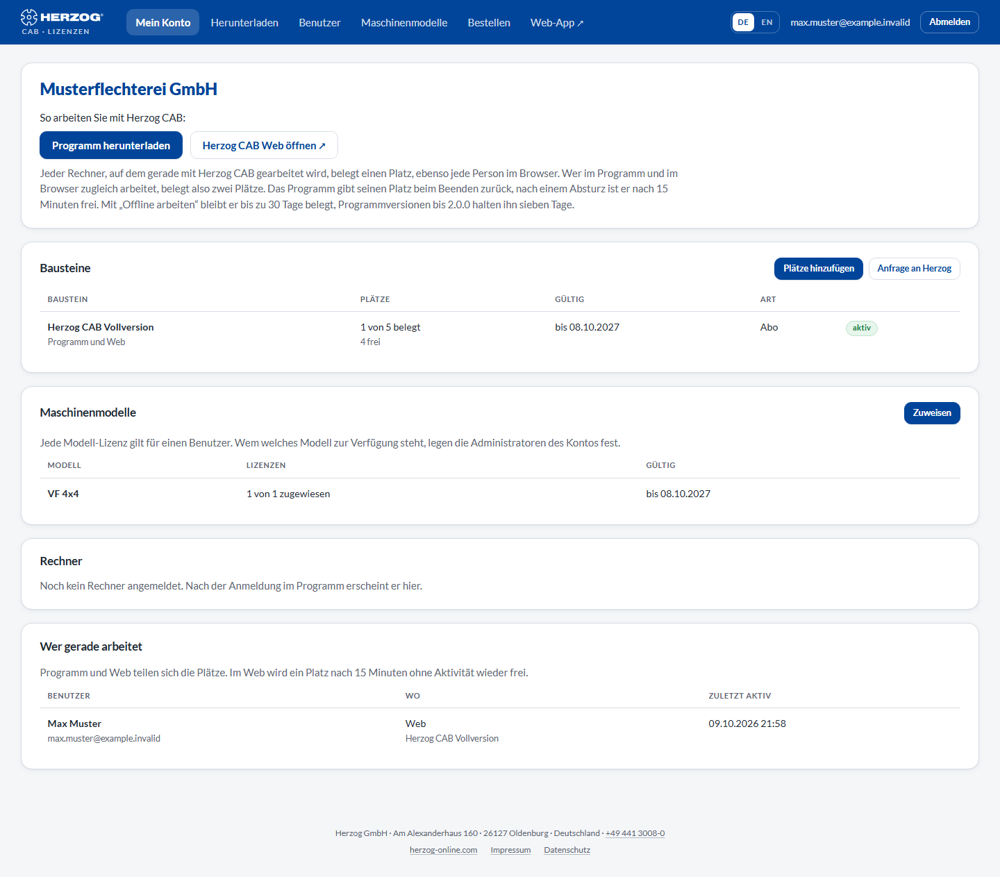

# My account — modules, computers and seats

!!! abstract "Reference — The start page of the licence portal: modules with seats, signed-in computers, who is currently working, and your requests"

## What you use this area for { #wofur-sie-diesen-bereich-nutzen }

**My account** is the overview of your customer account. Here you see which
modules your company has and how many seats are currently in use. You also see
which computers are signed in and who is currently working, in the program
or in the browser. Administrators release seats here, block computers
and track their requests to Herzog.

## The screen at a glance { #der-bildschirm-im-uberblick }

The page consists of up to five cards, from top to bottom:

| Card | Content |
|---|---|
| **Company** | Company name and customer number. Below that, **Download the program** and **Open Herzog CAB Web** as well as the note on how seats are taken and released again. If the account is blocked, a red message appears here. The licence server then no longer issues new licences. |
| **Modules** | All activations with seats and term. |
| **Computers** | All computers that have signed in to the account with Herzog CAB. |
| **Currently working** | All persons currently occupying a seat, in the program or in the browser. |
| **Requests** | Your requests to Herzog with status and reply. The card appears as soon as there is a request. |

## Controls in detail { #bedienelemente-im-detail }

### Company { #firma }

| Element | Effect |
|---|---|
| **Download the program** | Switches to [Download](download.md). Only if the account has a module for the program. |
| **Open Herzog CAB Web** | Opens the [web app](../web/index.md) in a new tab. Only if the account may use the web app. |

The note below summarizes the rules for the seats:

* Every computer currently running Herzog CAB takes
  one seat. So does every person working in the browser.
* Working in the program and in the browser at the same time takes two seats.
* The program returns its seat when it closes. After a crash,
  the seat is free again after 15 minutes.
* With *Work offline*, the seat stays taken for up to 30 days.
  Program versions up to 2.0.0 hold it for seven days.

More on this under [Customer account and invitation](../setup/account.md#platze).

### Modules { #bausteine }

| Column | Meaning |
|---|---|
| **Module** | Name of the module, for example *Herzog CAB Full Version*. Below it, what it applies to: *Program and web*, *Program only* or *Web only*. Plus your order reference, if applicable. The available modules are described under [Customer account and invitation](../setup/account.md#bausteine). |
| **Seats** | *n of m in use*, below it the number of free seats. The program and the web app count together. If a module has several rows, they share the seats and show the same numbers. |
| **Valid** | *Lifetime* or *until &lt;date&gt;*. If an activation expires in **30 days or less**, this is shown in yellow. |
| **Type** | Where the activation comes from: *Purchase*, *Subscription*, *Order*, *Trial*, *Dongle replacement* or *Goodwill*. |
| Status | **active**, **expired** (term over) or **ended** (ended by Herzog). |

Only administrators see the buttons.

| Button | Effect |
|---|---|
| **Add seats** | Switches to *Order* in the portal. There you order additional seats for your annual subscription, as described under [Subscription and ordering](../web/subscription.md). |
| **Request to Herzog** | Switches to [Request licence](requests.md). |
| **Request additional licence** | Appears instead of the two buttons above if nothing can be ordered online. Switches to [Request licence](requests.md). |
| **Renew** | Appears when an activation is about to expire. Opens the *Extend term* request for this activation. |

!!! info "Reminder before expiry"
    When an activation expires, all active users of the account receive an e-mail from Herzog
    **30 days and 7 days** beforehand, each in their own
    language. Short activations such as the trial version (term under 60
    days) only get the reminder 7 days beforehand. If a renewal has
    already been ordered and is awaiting payment, no reminder is sent.
    Renew in good time. After expiry, the desktop app no longer starts with
    this module, and the web app refuses sign-in.

### Computers { #rechner }

Every computer on which Herzog CAB is signed in to the account appears here
with its computer name.

Above the list, the **company storage location** is shown as soon as one has been
stored: the folder on your file server that new computers connect to at their first
start. It is defined in the desktop app
([Storage location](../admin/storage-location.md)) or in the web app under
[Account and users](../web/account.md#speicherort-der-firma).

| Column | Meaning |
|---|---|
| **Computers** | Computer name (without a name: *Unnamed*), below it *signed in by &lt;e-mail&gt;*. This is the user who last signed the computer in. Blocked or signed-out computers are marked accordingly. |
| **Seats in use** | Per module, the state of the seat: *in use* (program running), *Program closed, seat free*, *Offline until &lt;time&gt;* or, for program versions up to 2.0.0, *Standard lease until &lt;time&gt;*. *none* if the computer holds no seat. |
| **Last seen** | When the computer last reported to the licence server. |

| Button | Effect |
|---|---|
| **Release seats** | Immediately releases all seats of this computer, after a confirmation prompt. At the next program start it takes new ones if any are free. |
| **Block** | The computer no longer receives a licence until it is unblocked. For example, in the case of a lost laptop. Its seats become free. |
| **Unblock** | Removes the block again. |

Only administrators see the buttons. As long as no computer is
signed in yet, this area shows *"No computer signed in yet. It appears here after
signing in from the program."*

!!! tip "When to release seats by hand"
    From version 2.1.0, the program returns its seat by itself when it
    closes. You mainly need **Release seats** if a computer
    is on the road with *Work offline* and does not come back. Or if
    a version up to 2.0.0 is still running on a computer: it holds its
    seat for seven days, even if the program is closed.

### Currently working { #wer-gerade-arbeitet }

The card lists all persons currently occupying a seat. Program and
web share the seats. On the web, a seat becomes free again after **15 minutes without
activity**. Internal accounts have no seat limit on the web.

| Column | Meaning |
|---|---|
| **Users** | Who is working. |
| **Where** | *Program on &lt;computer&gt;*, *offline on &lt;computer&gt;* or *Web*, below it the module. If someone works in the program and in the browser, they appear twice and take two seats. |
| **Last active** | When the person was last active. |

If nobody is working at the moment, this area shows *Nobody at the moment.*

### Requests { #anfragen }

All [licence requests](requests.md) of your account with **Date**, **Module**,
**Seats** and **Status**:

| Status | Meaning |
|---|---|
| **in progress** | Herzog has received the request. |
| **done** | The activation has been adjusted. It appears immediately in the **Modules** table. |
| **declined** | Herzog did not carry out the request. The reason appears under *Reply from Herzog*. |

For every completed or declined request, the administrators also receive
an e-mail.

## Related pages { #verwandte-seiten }

* [Customer account and invitation](../setup/account.md): what modules and seats are
* [Subscription and ordering](../web/subscription.md): ordering an annual subscription, buying additional seats, renewing
* [Request licence](requests.md): request to Herzog
* [Users](users.md): who may sign in
* [Licence and cloud (Settings)](../admin/settings/license.md): working offline and signing out in the desktop app
* [Licence problems](../help/license-problems.md): when no seat is free
