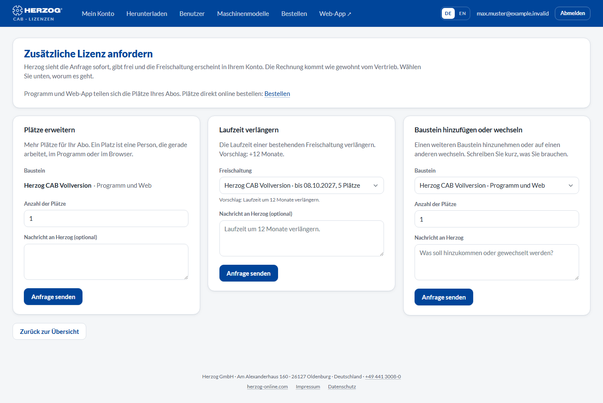

# Request licence

!!! abstract "Reference — The “Request licence” page in the licence portal: requesting more seats, a renewal or a different module from Herzog"

## What you use this area for { #wofur-sie-diesen-bereich-nutzen }

Here administrators send a request directly to Herzog. For example, if you
need more seats, want to extend an activation or would like a different
module. Herzog sees the request immediately, activates it, and the
change appears in your account under [My account](licenses.md). The
invoice comes from sales as usual.

You can also order the annual subscription itself, buy additional seats or renew
directly online without a request, see
[Subscription and ordering](../web/subscription.md). The request is intended for everything
else.

The page has no menu item of its own. You open it from
[My account](licenses.md#bausteine) via **Request to Herzog**,
**Request additional licence** or **Renew**.

!!! info "Administrators only"
    Editors and viewers see a note instead of the forms, asking them to contact
    an administrator of their account.

## The screen at a glance { #der-bildschirm-im-uberblick }

<!-- VERALTET seit 24.09.2026: anfordern.png zeigt noch "Herzog CAB Web" als Baustein, "Ein Platz je Rechner" und den Menüpunkt "Lizenz anfordern". Neu erzeugen mit: python _tools/web_screenshots.py shots nur:portal-anfordern -->

!!! info "Image of an earlier state"
    The image still shows earlier modules and texts. An up-to-date image will
    follow. The description on this page is authoritative.

At the top is the heading **Request additional licence** with the
note *The program and the web app share the seats of your subscription.* If
ordering online is possible, the **Order** link leads directly to the order.
Below it follow three request types as separate sections. You only fill in the
appropriate one and click **Send request** there.

## Controls in detail { #bedienelemente-im-detail }

### Add seats { #platze-erweitern }

More seats for your subscription. A seat is one person working at the moment,
in the program or in the browser.

| Field | Meaning |
|---|---|
| **Module** | The subscription to which the seats should apply: *Herzog CAB Full Version · Program and web* or *Herzog CAB Designer · Program and web*. If your account has exactly one of them, it is fixed. |
| **Number of seats** | How many **additional** seats are wanted (1 to 100). |
| **Message to Herzog (optional)** | Free text, for example a purchase order number or questions. |

### Extend term { #laufzeit-verlangern }

For an existing activation. The suggestion is **+12 months**.
Write in the message if you would like something else. You can also reach this
section directly via **Renew** in the
module table under [My account](licenses.md). The
activation is then already preselected.

| Field | Meaning |
|---|---|
| **Activation** | The activation to be extended, with term and seats. If there is no active activation that could be extended, a note appears here. |
| **Message to Herzog (optional)** | Suggestion: *"Extend the term by 12 months."* |

### Add or change module { #baustein-hinzufugen-oder-wechseln }

Add another module or switch to a different one. For
example from the trial version to the full version or from the Designer to the
full version.

| Field | Meaning |
|---|---|
| **Module** | *Herzog CAB Full Version · Program and web* or *Herzog CAB Designer · Program and web*. |
| **Number of seats** | How many seats you need. |
| **Message to Herzog** | Briefly describe what should be added or changed. |

### After sending { #nach-dem-absenden }

* The request appears under [My account → Requests](licenses.md#anfragen)
  with the status **in progress**.
* Herzog completes or answers it. You receive an e-mail, and the
  status changes to **done** or **declined** (with reply text).
* A completed request takes effect immediately: new seats are available at the next
  program start, a renewal moves the end date,
  a new module appears in the module table.

## Related pages { #verwandte-seiten }

* [My account](licenses.md): status of requests, modules and seats
* [Subscription and ordering](../web/subscription.md): ordering the annual subscription directly
* [Customer account and invitation](../setup/account.md): which modules are available
* [Contacting support](../help/support.md): if you would rather talk to someone
