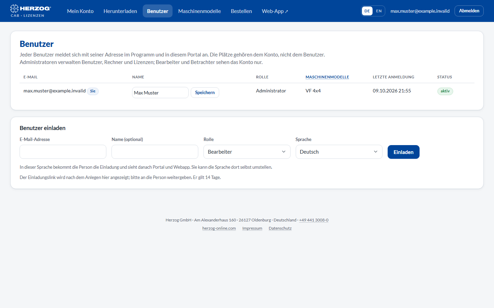
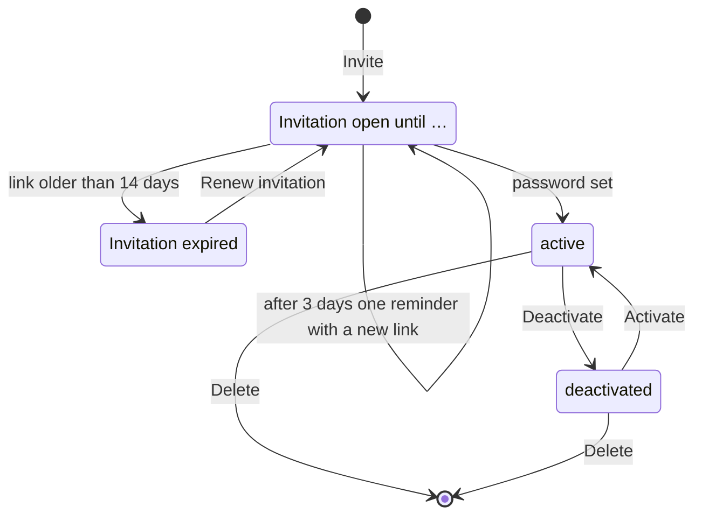

# Inviting and managing users

!!! abstract "Reference — The \"Users\" page in the licence portal: inviting colleagues, changing names and roles, deactivating or deleting accesses"

## What you use this area for { #wofur-sie-diesen-bereich-nutzen }

Everyone who is to sign in to the desktop app, the web app or the licence portal
needs a **user in the customer account**. Administrators
invite colleagues by e-mail here, define their role and switch off
accesses of people who have left. The seats belong to the account, not to the
user. You can therefore create any number of users. The seats
only limit how many persons can work at the same time, in the program or
in the browser.

## The screen at a glance { #der-bildschirm-im-uberblick }

At the top is the **User list**, below it the **Invite
user** form. Editors and viewers can only view the list; it is managed by
the administrators.

## Controls in detail { #bedienelemente-im-detail }

### User list { #benutzerliste }

| Column | Meaning |
|---|---|
| **E-mail** | Login name of the user. Your own entry is marked *you*; Herzog employees assigned to your account for support are marked *Herzog staff*. |
| **Name** | Display name, as the person appears in the program, in the web app and in the portal. Administrators change it directly in the row (see **Save** below). You do not change the name of Herzog staff accounts here. |
| **Role** | **Administrator**, **Editor** or **Viewer** — administrators change it directly in the row with **Change**. What the roles mean is described under [Customer account and invitation](../setup/account.md#benutzer-und-rollen). |
| **Last sign-in** | Time of the last sign-in (portal, desktop or web) or *never*. |
| **Status** | **active**, **deactivated**, **Invitation open until &lt;time&gt;** or **Invitation expired**. Plus the **2FA** flag if the user has set up a [second factor](security.md#zweiter-faktor). |

| Button | Effect |
|---|---|
| **Save** (name) | Saves the name you entered in the row: at most 190 characters; an empty field removes the name. The portal confirms *The name has been saved.* The desktop app takes it over at the person's next sign-in. Every user can also change their own name themselves under [Password, second factor and name](security.md#name). |
| **Change** (role) | Saves the role selected in the row. The new role applies immediately in the web app, and in the desktop app after the next start or after **Refresh from customer account** in the [user management](../admin/users.md). |
| **Renew invitation** | Sends a new link to a person who has not yet set their password, even if the invitation has already expired. The new link is again valid for 14 days; the old one is then no longer valid. Next to it, you choose the language of the invitation. |
| **Deactivate** | The user can no longer sign in anywhere; their data and assignments are retained. Computers on which they were signed in to the desktop app require a new sign-in. With confirmation prompt. |
| **Activate** | Removes the deactivation. |
| **Delete** | Permanently deletes the access, after the prompt *Permanently delete the access &lt;e-mail&gt;? Designs, orders and computers stay with the account.* |

!!! info "Built-in protection mechanisms"
    You can neither deactivate nor delete your own access, and
    your own role can only be changed by another administrator. The last active
    administrator of an account can neither be deactivated, deleted
    nor downgraded.

### Invite user { #benutzer-einladen }

| Field | Meaning |
|---|---|
| **E-mail address** | Login name of the new person; must be unique within the account. |
| **Name (optional)** | Display name. |
| **Role** | Role of the new user (default: Editor). |
| **Language** | Deutsch or English. The person receives the invitation in this language and then sees the portal and the web app in it; they can change the language there themselves. Preset according to the country of your account. |
| **Invite** | Creates the user and sends the invitation. |

This is how the invitation works:

1. The person receives an e-mail with a link and sets their password
   themselves (at least 10 characters). The link is valid for **14 days**.
2. Until then, the user appears in the list with *Invitation open until …*.
3. If the person has not accepted after three days, the
   portal sends them a reminder once with a new link. The old link is
   then no longer valid. If they open an expired link, they can send themselves
   a new invitation there.
4. After the password has been set, the access is **active** and applies immediately
   to the portal, desktop app and web app.

The life cycle of an access at a glance:

!!! info "Users in the trial account"
    With the trial version, you can invite as many users as the
    trial version has seats. Below the form, it says how many are still
    free. Once the number is reached, a note appears instead of the form. With
    a subscription, the limit no longer applies.

!!! tip "No e-mail delivery possible?"
    If no e-mail could be sent (e.g. in a test environment),
    the portal displays the invitation link directly — pass it on to the
    person by another route.

## What the roles do in the programs { #was-die-rollen-in-den-programmen-bewirken }

| | Licence portal | Desktop app | Web app |
|---|---|---|---|
| **Administrator** | Manages users, computers, requests. | Global administrator: all permissions in all profiles. | All permissions; can create roles, manage company and import. |
| **Editor** | Views the account. | Standard role *Editor*: create and change orders, designs, master data. | Same. |
| **Viewer** | Views the account. | Standard role *Viewer*: read, calculate, print, export. | Same. |

In the web app, administrators can additionally create **custom roles** with
individual permissions and assign them to users — see
[Roles (web app)](../web/roles.md) and
[Account and users (web app)](../web/account.md). In the desktop app, assignment
is made per profile (workspace), see
[Managing users](../admin/users.md).

## Related pages { #verwandte-seiten }

* [Customer account and invitation](../setup/account.md) — accepting the invitation, roles
* [Setting up users and roles](../tasks/setup-users.md) — the procedure as a guide
* [Password, second factor and name](security.md) — what every user sets themselves
* [My account](licenses.md) — seats and computers
