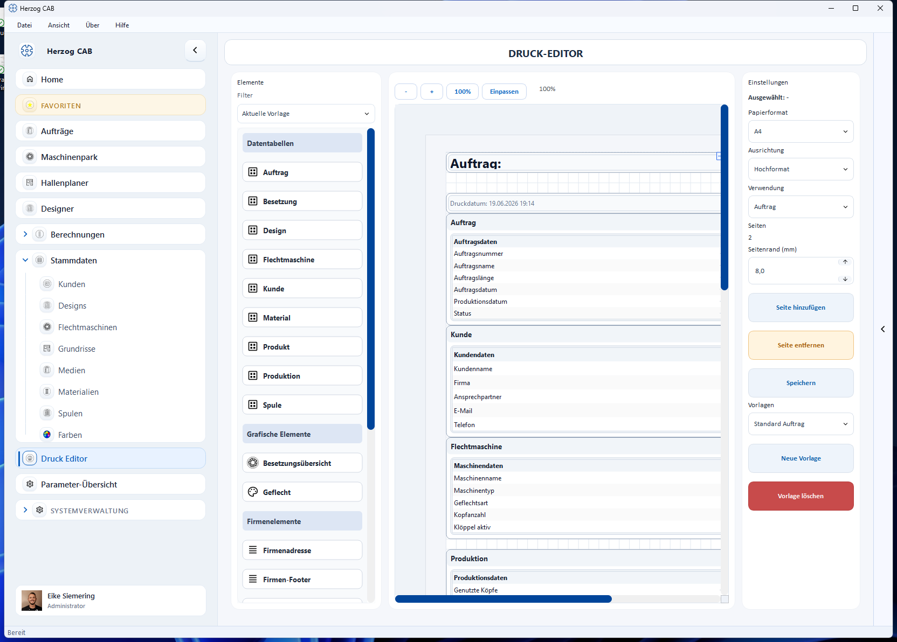

# Editor layout

!!! abstract "Reference — layout of the print editor: element palette, page canvas, properties"

The print editor consists of three areas: the **element palette** (left),
the **page canvas** (center) and the **properties / page settings**
(right).

## Element palette (left) { #element-palette-links }

The palette contains all building blocks that you can drag onto the page –
divided into six groups (Data tables, Data tables braiding,
Data tables winding, Graphic elements, Company elements, Free elements).
Each element is described in detail under [Elements and placeholders](elements.md).

Use the **Filter** selection field to narrow down which elements
appear in the list:

| Selection | Shows |
|---|---|
| **Current template** | Only elements that match the **Usage** of the currently opened template (e.g. no input/result table for an order template), plus the always available company and free elements. Default setting. |
| **Show all** | Turns off the filter – all elements from all areas are visible. |
| **Calculation / Design / Order** | Shows only the elements of a specific usage, regardless of the opened template. |

You drag an element onto the page canvas by drag and drop.

## Page canvas (center) { #seiten-canvas-mitte }

The canvas shows the page true to the original. You place elements by
drag and drop, and move and scale them directly on the page. Use the
zoom controls at the top (**−**, **+**, percentage display, **Fit**) to adjust the
display size without changing the layout.

You edit an element that has already been placed by double-clicking it – which
dialog opens depends on the element type and is described under
[Elements and placeholders](elements.md).

## Properties and page settings (right) { #eigenschaften-und-seiteneinstellungen-rechts }

At the top, **Selected: …** shows the name of the currently marked element
("Selected: −" if nothing is selected). Depending on the element type, its
properties follow below, e.g. rows/columns for tables or content,
format and text color for text field and date/time.

Below that, you set the page settings of the entire template:

| Setting | Meaning |
|---|---|
| **Paper size** | A4 or A3. |
| **Orientation** | Portrait or landscape. |
| **Usage** | Which kind of printout the template is for: calculation, design or order. Determines in which selection dialog the template appears later and filters the element palette (see above). |
| **Pages** | Number of pages of the template. |
| **Page margin (mm)** | Margin of the page. |

Below that, you manage the pages of the template with the
side-by-side buttons **+ Page** and **− Page** (tooltips *Add
page* / *Remove page*) as well as the template itself (**Save**,
**New**, **Delete**) – see [Manage templates](manage.md). If the
window height is not sufficient, the right-hand bar can be scrolled.

!!! warning "Permission required"
    To edit and save print templates you need the
    permission **Edit print templates**. Without this permission, the editor
    opens read-only: you can view templates but cannot save
    changes. More on permissions under
    [Roles](../admin/roles.md).

## Related pages { #verwandte-seiten }

* [Elements and placeholders](elements.md) – all building blocks of the element palette in detail
* [Manage templates](manage.md) – create, choose and delete templates
* [Preview and print](preview-and-print.md) – page format, preview, output
* [Create a print template](../tasks/create-print-template.md) – step-by-step guide
* [Orders → Print](../orders/print.md) – where order templates are used
* [Designer → Save and print](../designer/save-print.md) – where design templates are used
