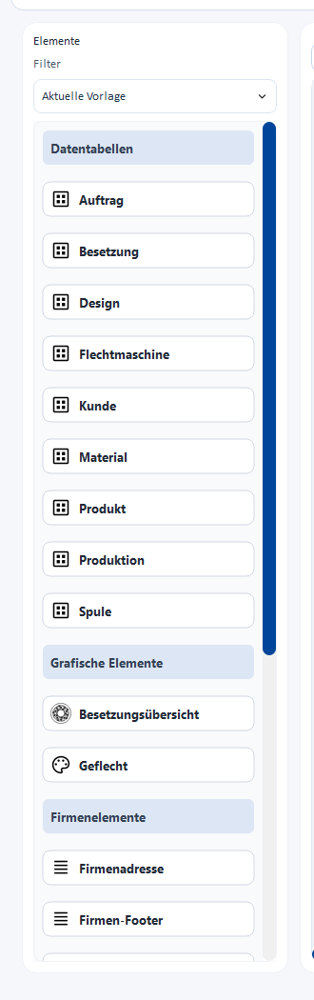
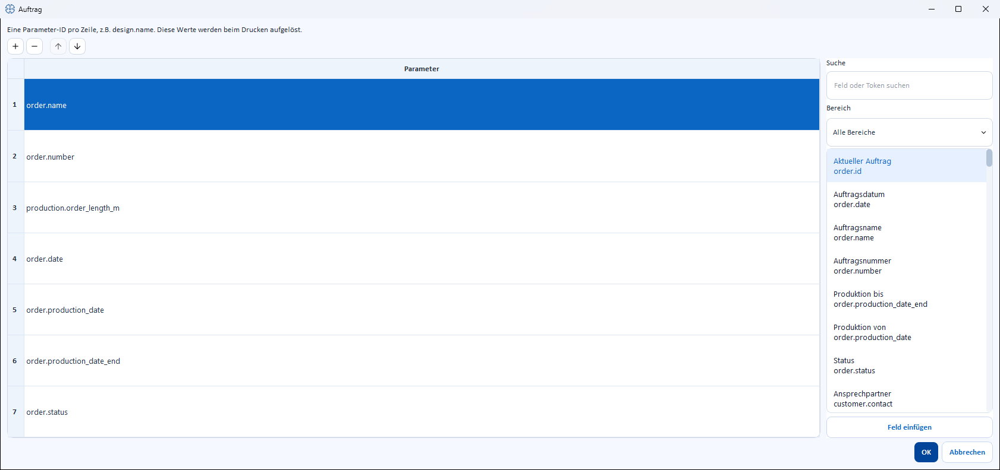
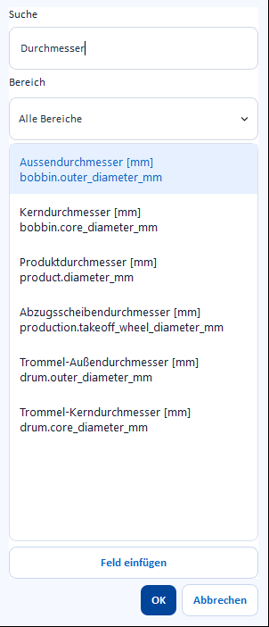

# Elements and placeholders

!!! abstract "Reference — All building blocks of the element palette and how you fill them with program values"

## What you use this area for { #wofur-sie-diesen-bereich-nutzen }

A print template is made up of **elements** that you drag from the
element palette (on the left in the [print editor](editor.md)) onto the page. The
palette is divided into six groups. This page explains each element,
shows for which template **Usage** (calculation / design / order) it
is available, and how you specify which program value
is actually printed.

!!! info "Only an excerpt"
    The screenshot shows the basic structure of the palette. Since version 1.4.5,
    two further data table groups for braiding and winding
    have been added (see below) — an up-to-date screenshot with all six groups
    is still missing.

## The six element groups { #die-sechs-element-gruppen }

### Data tables { #datentabellen }

Tables that are neutral with regard to the order type, as well as the tables for calculation templates.

| Element | Shows | Usage |
|---|---|---|
| **Order** | Order number, order name, dates, status | Order |
| **Customer** | Address and contact details of the customer | Order |
| **Material** | Data of the materials used in the order | Order |
| **Bobbin** | Data of the bobbins used | Order |
| **Input table** | Input values of the active calculation | Calculation |
| **Result table** | Result values of the active calculation | Calculation |

### Data tables braiding { #datentabellen-flechterei }

| Element | Shows | Usage |
|---|---|---|
| **Braiding machine** | Machine name, machine type, braid type, number of heads, active carriers | Order |
| **Product** | Product data (e.g. diameter, braid density) | Order |
| **Production** | Production values (e.g. heads used) | Order |
| **Design** | Information on the linked design | Design, Order |
| **Setup** | Carrier setup as a table (round braid or lace braid) | Design, Order |

### Data tables winding { #datentabellen-spulerei }

New since version 1.4.5, for winding order templates.

| Element | Shows | Usage |
|---|---|---|
| **Winding** | Winding values of the winding order — including target number of bobbins, length per bobbin, total length, yarn speed, spindle speed, traverse stroke, yarn tension | Order |
| **Color breakdown** | The color positions of the winding order: color sample, name/code/Pantone, number of carriers and number of bobbins per color | Order |

### Graphic elements { #grafische-elemente }

| Element | Shows | Usage |
|---|---|---|
| **Braid** | Preview image of the braid pattern | Design, Order |
| **Setup overview** | Graphic overview of the carrier setup | Design, Order |

### Company elements { #firmenelemente }

Filled from the [company data](../admin/company.md) and available in every
template, regardless of the usage.

| Element | Shows |
|---|---|
| **Company logo** | Your company logo as an image |
| **Company address** | Address and contact details of the company |
| **Company footer** | Compact footer with company information |

### Free elements { #freie-elemente }

Also available in every template.

| Element | Shows |
|---|---|
| **Date/time** | Current date or time at the time of printing |
| **Table** | Freely definable table with any number of rows and columns |
| **Text field** | Freely placeable text, also with embedded placeholders |
| **Image** | Any image, either from the [media library](../master-data/media.md) or from the hard disk |

!!! tip "Not every element is available everywhere"
    Which elements appear in the palette depends on the **Usage**
    of the currently opened template — a calculation template, for example, shows
    no braiding machine table. How you control the display via the
    **Current template** filter is described under
    [Element palette](editor.md#element-palette-links).

## Defining content: double-click opens the editing dialog { #inhalte-festlegen-doppelklick-offnet-den-bearbeitungsdialog }

You edit an element that has already been placed by **double-clicking** it on the
page canvas. Depending on the element type, a different dialog opens:

### Data tables with selectable rows { #datentabellen-mit-wahlbaren-zeilen }

For **Order**, **Customer**, **Braiding machine**, **Material**, **Bobbin**,
**Product**, **Production**, **Design** and **Winding** you decide
**yourself** which program value appears in which row:

* Use the row toolbar to add or remove rows and
  change their order (up/down arrows).
* For the marked row, choose the desired program value on the right in the
  **Field template picker** (see below) and take it over with
  **Insert field**.

Each of these tables starts with a sensible default content, which you can
adapt or extend as needed.

### Free table { #freie-tabelle }

You edit the **Table** from the free elements cell by cell: you set the number of rows
and columns in the toolbar via the fields **Rows**
and **Columns**, alignment and text color via the icons next to them.
Each cell can contain free text and/or placeholders — here, too, the
field template picker on the right is at your disposal.

### Text field { #textfeld }

Opens a text editor with alignment and text color as well as the same
field template picker. You type text and placeholders mixed, e.g.
"Order {order.number}".

### Image { #bild }

Opens the selection for image files — either from the central
[media library](../master-data/media.md) or from the hard disk.

### Setup { #besetzung }

Instead of individual rows, here you define **how** the carrier setup
is displayed:

| Field | Selection |
|---|---|
| **Braid type** | **Automatic**, **Round**, **Lace**, **Per track (multi-column)**. *Automatic* chooses the two columns counterclockwise/clockwise for round braid, one continuous column for lace braid and, for packing and spiral braiders, **one column per track** (header *Track 1*, *Track 2*, …; row number per track starting at 1). *Strand* forces a single column instead. |
| **Displayed runs** | Both columns, Left run only, Right run only (selectable only for round braid) |
| **Displayed value** | Color ID, Color name, Hex value, Pantone |
| **Cell style** | **Color fill**: cell completely filled in the carrier color (classic). **Color swatch + number**: white cell with number and value on the left and a small, rounded color swatch on the right — compact rows, zebra stripes, light grid and the header in Herzog blue, like the other data tables. |

!!! info "Direct printing without a template"
    If you print a design directly from the Designer without a template,
    Herzog CAB always uses the **Color fill** and chooses the columns automatically.
    The toggles exist only on the template element.

### Automatically filled elements without their own dialog { #automatisch-befullte-elemente-ohne-eigenen-dialog }

**Color breakdown**, **Input table** and **Result table** always show
the complete, current data record when printing (all color positions
of the winding order or all input/result values of the calculation). You
only place and scale these elements — there is no row selection
here.

## Setting placeholders: the field template picker { #platzhalter-setzen-der-feldvorlagen-picker }

On the right of the editing dialog (see above) you narrow down the available
program values and take them over:

| Field | Meaning |
|---|---|
| **Search** | Free-text search across designation, technical name and description. |
| **Area** | Restricts the list to one area: *All areas*, Order, Customer, Machine, Material, Bobbin, Product, Production, Design, Calculations or Company. |
| **List** | The program values matching the search term/area, with designation and – if available – unit. A click shows the current value and a short description below. |
| **Insert field** | Takes the marked program value over into the currently selected row or text position. Double-clicking a list entry does the same. |

### Two kinds of placeholders { #zwei-arten-von-platzhaltern }

* **For data tables with selectable rows**, "Insert field" takes the
  pure program value directly into the row (e.g. `design.name`) — without
  braces, since the row shows exactly one value anyway.
* **For the free table and in the text field**, the same value is inserted in
  curly braces, e.g. `{order.number}`. This lets you mix
  placeholders with free text, for example "Order no. {order.number} of
  {order.date}".

!!! tip "Type placeholders directly"
    In the text field and the free table, a suggestion list of matching
    placeholders already appears when you type an
    opening curly brace `{` — so you do not necessarily have to open the field template picker.

## Related pages { #verwandte-seiten }

* [Editor layout](editor.md) – element palette, filter, page settings
* [Manage templates](manage.md) – create, choose and delete templates
* [Preview and print](preview-and-print.md) – page format, preview, output
* [Create a print template](../tasks/create-print-template.md) – step-by-step guide
* [Orders → Print](../orders/print.md) – where order templates are used
* [Designer → Save and print](../designer/save-print.md) – where design templates are used
* [Media](../master-data/media.md) – central image store for the "Image" element
