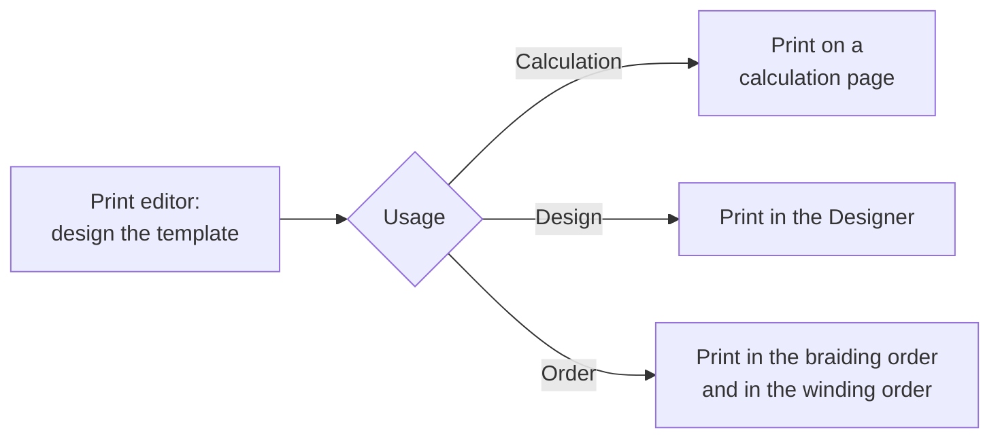

# Print templates

!!! abstract "Reference — Overview of print templates and the print editor"

## What you use this area for { #wofur-sie-diesen-bereich-nutzen }

**Print templates** determine what printouts from Herzog CAB look like – e.g. a
production accompanying sheet for the order, a material list, a label or
a calculation report. You design the templates once in the
**Print editor** and then use them as often as you like for the actual
printing.

You reach the print editor via the navigation item **Print editor**.
Templates are stored centrally per workspace (under `Printouts/templates/`)
and are therefore available to all operators of the same workspace.

## In this chapter { #in-diesem-kapitel }

- :material-file-cog-outline: **Manage templates**

    ---

    Choose, create, save and delete a template.

    [:octicons-arrow-right-24: Manage templates](manage.md)

- :material-view-dashboard-outline: **Editor layout**

    ---

    Element palette, page canvas and properties/page settings.

    [:octicons-arrow-right-24: Editor layout](editor.md)

- :material-shape-plus-outline: **Elements and placeholders**

    ---

    All building blocks of the palette – from data tables to color breakdown –
    and how you fill them with program values.

    [:octicons-arrow-right-24: Elements and placeholders](elements.md)

- :material-printer-eye: **Preview and print**

    ---

    Set the page format, live preview, and where you start the actual
    printout or PDF export.

    [:octicons-arrow-right-24: Preview and print](preview-and-print.md)

## A template applies to exactly one usage { #eine-vorlage-gilt-fur-genau-eine-verwendung }

Every template has a **Usage**: calculation, design or order. It
determines in which selection dialog the template appears later and which
elements are available in the palette. Details under
[Editor layout](editor.md).

Where a template is offered for printing, depending on its usage:

!!! warning "Permission required"
    You can view templates with the permission **View print
    templates**; to edit and save you additionally need
    **Edit print templates**. More on this under [Roles](../admin/roles.md).

## Related pages { #verwandte-seiten }

* [Create a print template](../tasks/create-print-template.md) – step-by-step guide
* [Orders → Print](../orders/print.md) – production accompanying sheet and templates in the order
* [Designer → Save and print](../designer/save-print.md) – print design templates
* [Parameter Explorer](../parameter-overview/index.md) – look up all program values in detail
