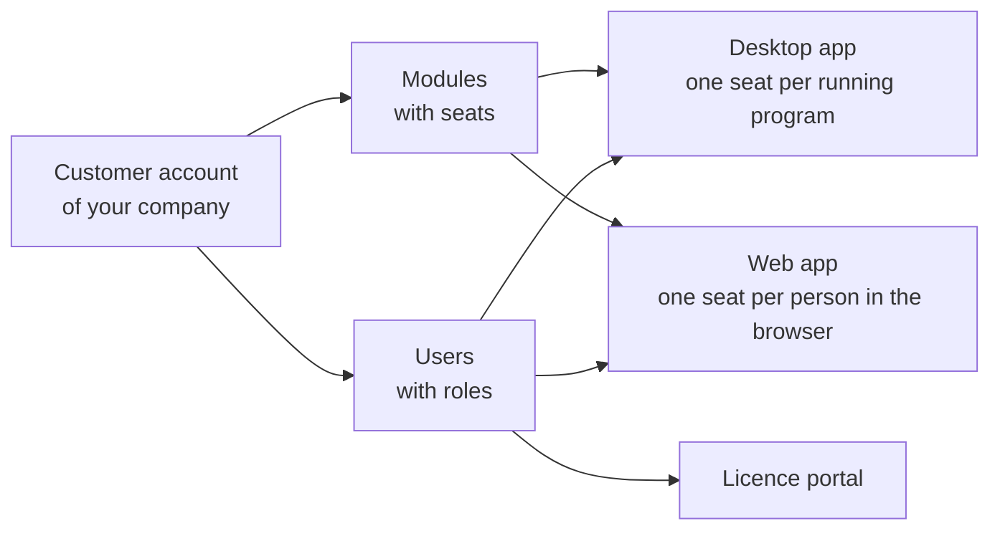
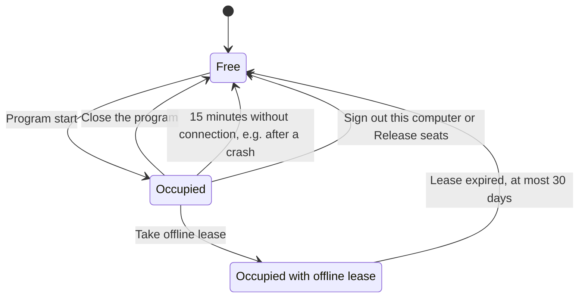

# Customer account and invitation

!!! info "Concept — What the customer account is, how you get into it and what modules and seats mean"

Since version 2.0, Herzog CAB normally obtains its licence from a
**customer account** on the Herzog licence server. The account belongs to your company;
it contains the purchased **modules** with their **seats**, the
registered **computers** and the **users** who are allowed to sign in. A
computer no longer needs a dongle — it signs in to the account at startup
and draws its licence from the pool.

You manage the account in the **licence portal** at
[license.herzog-cab.com](https://license.herzog-cab.com). The same
credentials apply to the desktop app and to the
[web app](../web/index.md) — **one login for everything**.

## How to get into the account { #so-kommen-sie-ins-konto }

**Herzog** creates an account for your company. Herzog invites the first user
by email; every further user is invited by an **administrator of your
account** in the licence portal (see
[Invite and manage users](../portal/users.md)).

1. You receive an email with the subject *Your access to the Herzog CAB
   licence portal* and a link. For a trial version, the subject is
   *Your Herzog CAB trial is ready*. The link is valid for
   **14 days**.
2. Click the link. The licence portal's **Set password** page
   opens with your email address.
3. Choose a password with **at least 10 characters** and repeat
   it.
4. You are then signed in to the licence portal and can sign in with the same
   email address and password in the desktop app and in the
   web app.

!!! tip "Second factor"
    In the licence portal you can register an **authenticator app** via your email address
    at the top right. Every sign-in — also in
    the desktop app and the web app — then additionally requires the six-digit code.
    Recommended for administrators. This is also where you change your name. See
    [Password, second factor and name](../portal/security.md).

!!! warning "Invitation expired?"
    If you have not accepted the invitation after three days, the licence portal
    sends you a **reminder** once with a new
    link. From then on, only the link from the reminder is valid.

    If the link is older than 14 days, open it anyway. The page
    *This invitation has expired* offers **Send a new invitation**;
    the new invitation goes to your own email address. An administrator of your account
    can also renew the invitation in the licence portal
    under **Users**.

    You reset a forgotten password yourself via **Forgot password**
    on the portal's sign-in page.

## Modules { #bausteine }

A **module** is a licensed scope of functions. You can see which modules your
account has in the licence portal under **My account** and in the
desktop app under *Settings > Licence*.

| Module | Scope | Term |
|---|---|---|
| **Herzog CAB Full Version** | The complete program, on the computer and in the browser. | Annual subscription |
| **Herzog CAB Designer** | Only the braid Designer, on the computer and in the browser. | Annual subscription |
| **Herzog CAB Trial** | 30 days on the computer and in the browser, with the [quantity limits of the trial version](../basics/trial-quotas.md). Created by Herzog on request, see [Trial](../web/trial.md). | 30 days |
| **Herzog CAB Web Trial** | 30 days in the browser only. Only created through [self-registration](../web/trial.md#selbstregistrierung), if Herzog has enabled it. | 30 days |

You order, renew or add seats to the annual subscription under
[Subscription and order](../web/subscription.md).

For the full version with a subscription there is the **Braiding Simulator**
with **model licences** per machine model and user. They appear in the
licence portal in a separate **Machine models** card, not among the
modules, see [Braiding Simulator: Licence and rights](../braiding-simulator/licence.md).

!!! info "One subscription for program and web app"
    The annual subscription applies to the program on the computer and to the
    [web app](../web/index.md). In the licence portal, the module then shows
    *program and web*. Both share the seats of the subscription.

!!! info "Older activations"
    * A **full version or Designer version without an end date** (lifetime,
      also as a dongle replacement) only applies to the program, not to the
      web app. The portal shows *program only*. It has its own seats.
    * The former modules **Herzog CAB Web** and **Herzog CAB Web
      Designer** only apply to the web app. The portal shows *web only*. They
      are no longer sold because the annual subscription includes the web app.

## Seats { #platze }

Each module has a number of **seats**. A seat is a **person
who is currently working**. Any number of employees share the seats,
just not at the same time. The program and the web app share the seats of a
subscription.

| | Program on the computer | Web app |
|---|---|---|
| Occupied … | at program start, one seat per computer. | when signing in in the browser, one seat per person. |
| Released … | when the program is closed. After a crash, after **15 minutes** at the latest. With an **offline lease**, the seat remains occupied for up to 30 days. Released immediately via **Sign out this computer** in the settings or **Release seats** in the portal. | when signing out or after **15 minutes** without activity. |
| When all are occupied … | Herzog CAB shows the **All seats taken** dialog at startup with the list of who is currently working. | the web app reports *All seats of this account are currently taken.* |

This is how the seat of a computer changes between free and occupied:

Anyone working in the program and in the browser at the same time occupies **two** seats.
Several browser windows of the same person occupy only one. If several operators
sign in one after the other on the same computer, the computer
also occupies only **one** seat.

You can see who is currently working in the licence portal under
[My account](../portal/licenses.md#wer-gerade-arbeitet). In the desktop app,
*Settings > Licence* shows in the **Seats** row how many are
occupied.

!!! info "Program versions up to 2.0.0"
    Up to version 2.0.0, a computer keeps its seat for seven days, even if
    the program is closed. Only from version 2.1.0 is the seat released when
    the program is closed. You should therefore update all computers to the current
    version.

## Users and roles { #benutzer-und-rollen }

Each user in the account has an **email address** (sign-in name), a
**password** and a **role**:

| Role in the account | In the licence portal | In desktop and web app |
|---|---|---|
| **Administrator** | Manages users, computers, licences and requests. | All rights. |
| **Editor** | Can only view the account. | May create and change orders, designs and master data (default for users without a role). |
| **Viewer** | Can only view the account. | May read, calculate, print and export, but not change anything. |

The roles apply equally in the desktop app and in the web app. In
the web app, administrators can also create their own roles with individual
rights — see [Roles (web app)](../web/roles.md). In the
desktop app, users and roles come from the account; only the
assignment to workspaces remains local (see
[Manage users](../admin/users.md)).

!!! info "Existing customers with a dongle"
    If you continue to work with a **CmDongle** or **CmAct licence**, you do not need
    a customer account. The local user management of the desktop app
    (including Microsoft Entra ID and LDAP) remains unchanged for these installations
    — see [Sign in and obtain a licence](activate-license.md).

## Next step { #nachster-schritt }

Once the password is set, download the current installer in the licence portal under **Download**
and [install Herzog CAB](installer.md). At the
first start, [sign the computer in to the account](activate-license.md).

## Related pages { #verwandte-seiten }

* [Licence portal](../portal/index.md) — manage account, users, computers and requests
* [Web app](../web/index.md) — Herzog CAB in the browser
* [Licence and cloud (settings)](../admin/settings/license.md) — licence status in the desktop app
* [Licence problems](../help/license-problems.md) — if signing in to the account fails
