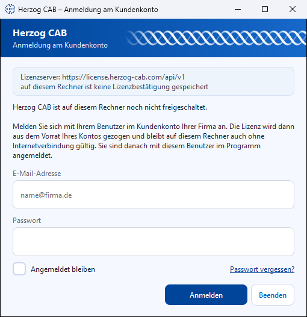
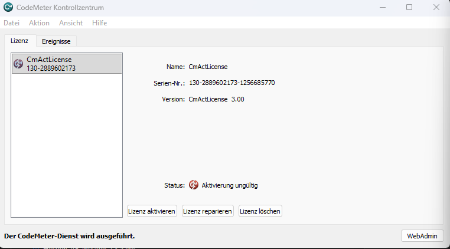
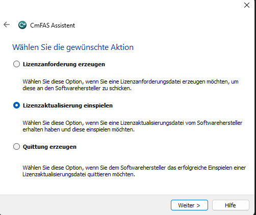

# Sign in and obtain a licence

!!! example "Guide — Herzog CAB activated on this computer: via the customer account or via a CodeMeter licence"

Herzog CAB cannot be started without a valid licence. Since version 2.0
there are two routes for this — Herzog CAB detects at startup which one
applies:

| Route | For whom | What you need |
|---|---|---|
| **Customer account** (standard case) | All new customers from version 2.0 and everyone who has switched from the dongle to the account. | Your user in the [customer account](account.md) and an internet connection at the first start. |
| **CodeMeter** (existing customers) | Customers with a **CmDongle** or **CmAct software licence** from version 1.x. | The [CodeMeter Runtime](codemeter.md) and the dongle or the licence files. |

!!! info "Both available?"
    If Herzog CAB finds a CodeMeter container with a valid licence, it uses
    it — the customer account only comes into play if **no** container
    is present. Existing customers therefore change nothing.

---

## Standard case: signing in to the customer account { #regelfall-anmeldung-am-kundenkonto }

**Prerequisites:** You have accepted the [invitation to the customer account](account.md)
and set a password; Herzog CAB is
[installed](installer.md); the computer is online.

### Step 1: Wait for the first start { #schritt-1-ersten-start-abwarten }

Start Herzog CAB. On a computer that has not yet been activated,
the **Herzog CAB – Sign in to your customer account** dialog appears. At the top
there is a blue header band with *Herzog CAB* and the subtitle *Sign in to your
customer account*, with a small animated braid running on its right. Below it is
the note *"Herzog CAB is not yet activated on this computer."*
with a short explanation. The layout and behaviour of the dialog are the same
as for the daily [sign-in with the account user](../admin/login.md#anmeldung-mit-dem-kontobenutzer).



### Step 2: Sign in { #schritt-2-anmelden }

| Field / button | Meaning |
|---|---|
| **Email address** | The address of your user in the customer account (the same as in the licence portal). |
| **Password** | Your account password (masked input). |
| **Code from the authenticator app** | Only expands after you click **Sign in** if [two-factor sign-in](../portal/security.md) is set up for your user. Type the current six-digit code into the six boxes — after the sixth digit, Herzog CAB checks it automatically. Details under [Sign-in with the account user](../admin/login.md#bedienelemente). |
| **Stay signed in** | On by default. Herzog CAB then starts on this computer without a new sign-in until you sign out in the program, change your password or do not work with it for 30 days. Applies only to your Windows user. If several people work on the computer with the same Windows user, switch it off. |
| **Sign in** | Checks the credentials on the licence server, signs the computer in to the account and occupies a seat. |
| **Quit** | Closes Herzog CAB without signing in. |

After a successful sign-in, Herzog CAB starts directly — **you are also
signed in to the program with the same user**; no second
sign-in dialog follows. At the very first start on a computer, you then
set up the [workspace folder](first-run.md).

!!! tip "Password manager"
    Windows password managers do not fill in this dialog automatically.
    With **Auto-Type** (e.g. 1Password: ++ctrl+shift+space++, KeePass:
    ++ctrl+alt+a++), the manager types the email address and password into the field that
    currently has the focus — clicking in the **Email address** field selects
    the prefilled content for this.

### Step 3: Check { #schritt-3-prufen }

Under *File > Settings*, **Licence** tab, you now see your account,
the signed-in user, the edition, the activated modules and
the lease with its expiry date — see
[Licence and cloud](../admin/settings/license.md).

### What happens afterwards { #was-danach-passiert }

* **Seat and lease:** As long as Herzog CAB is running, the computer occupies a
  seat in the account. It is released when the program is closed, after a crash after
  15 minutes at the latest. The lease renews itself at every program start and
  every six hours. Without a connection, Herzog CAB keeps running for up to
  **24 hours**, version 2.0.0 for up to seven days.
* **All seats taken:** Herzog CAB then shows the
  **All seats taken** dialog at startup with the list of who is currently working. See
  [Licence problems](../help/license-problems.md).
* **Offline for longer:** If you work without a network for more than 24 hours
  (trade fair, construction site), first take an
  **offline lease** for up to 30 days under *Settings > Licence*. The seat then remains
  occupied for that time.
* **Further operators on the same computer:** At the next start, the
  shorter **Herzog CAB – Sign in** dialog appears. Each colleague signs in there
  with their own account user; the computer still occupies only one
  seat. See [Sign in and sign out](../admin/login.md).
* **Handing over or reinstalling a computer:** First choose **Sign out this
  computer** (Licence tab). This cancels the computer's sign-in and also releases
  an offline lease. Forgetting it is not a problem: the seat is
  released anyway as soon as the program is closed. An administrator can also release or
  block the computer in the [licence portal](../portal/licenses.md).

### Messages when signing in { #meldungen-bei-der-anmeldung }

| Message | Meaning / remedy |
|---|---|
| *E-mail address or password is not correct.* | Check the credentials; reset the password via **Forgot password** in the licence portal. |
| *Two-factor sign-in is set up for this user …* | Not an error — enter the code from the authenticator app. |
| *The code is not correct.* | Check the time on the phone, wait for a new code. |
| *Sign-in succeeded, but all seats of the account "…" are currently taken.* | The credentials are correct, but all seats are currently occupied, in the program or in the browser. Below it you see who is currently working. Wait until someone closes Herzog CAB, or order more seats under [Subscription and order](../web/subscription.md). |
| *This user is deactivated.* | An administrator has deactivated the user in the portal. |
| *Too many failed attempts. Please try again later.* | The licence server slows down after several failed attempts — wait a few minutes. |
| *The licence server cannot be reached …* | Check the internet connection, proxy and firewall (destination: `license.herzog-cab.com`, port 443). A connection is mandatory for the **first** sign-in of a computer. |

Further cases: [Licence problems](../help/license-problems.md).

---

## Existing customers: dongle or CmAct licence { #bestandskunden-dongle-oder-cmact-lizenz }

Herzog CAB uses **Wibu CodeMeter** for these licences.

!!! info "Prerequisite"
    The [CodeMeter Runtime](codemeter.md) must already be installed.

### Licence type { #lizenztyp }

| Type           | Article  | Product Code | Scope                                               |
|----------------|----------|--------------|-----------------------------------------------------|
| Full version   | 88805    | 200006       | All functions, unlimited                            |
| Designer edition | 88805  | 200006, Feature Code 4 | Designer only                             |

The firm code at Wibu CodeMeter is always **6001037** (Herzog GmbH).

### Sources { #bezugswege }

| Source                          | When?                                                                 |
|---------------------------------|-----------------------------------------------------------------------|
| **CmDongle** (USB licence stick) | If you have ordered a physical dongle.                               |
| **CmActLicense** (software licence) | If your licence is bound to the **fingerprint** of the computer. |

### Variant A - Licence via USB dongle { #variante-a-lizenz-per-usb-dongle }

You received a small Wibu dongle with your order. The
licence is already preinstalled on the dongle.

1. Close the Herzog CAB program if it is running.
2. Plug the **CmDongle** into a free USB port.
3. Wait briefly - Windows recognises the stick and CodeMeter reads the
   licence automatically.

You can recognise success by the **CodeMeter tray icon** at the bottom right of the
taskbar: it changes from grey to blue.

!!! warning "📷 Screenshot missing"
    **Subject:** CodeMeter tray icon in the Windows notification area before and after
    plugging in the dongle (color change grey → blue).
    **How to create:** Photograph it with the dongle unplugged, then plug the dongle in and
    photograph it again after a few seconds.
    **Target file:** `assets/screenshots/activate-license/tray-icon-farbwechsel.png`

4. Open the **CodeMeter Control Center** (double-click the
   tray icon) and check that a licence with firm code
   **6001037** and article **88805** (full version) is displayed.

!!! warning "📷 Screenshot missing"
    **Subject:** CodeMeter Control Center with a detected CmDongle, firm code
    6001037 and article 88805 in the licence list.
    **How to create:** Plug in the dongle, open the CodeMeter Control Center,
    show the licence list.
    **Target file:** `assets/screenshots/activate-license/kontrollzentrum-dongle-erkannt.png`

!!! warning "The dongle must stay plugged in"
    The dongle must **remain plugged in** while Herzog CAB is
    running - otherwise the licence is not found. Only remove it
    after closing the program.

!!! tip "Several workstations"
    If you have only one dongle, you can move it between several
    computers - but only ever on one computer at a
    time.

### Variant B - Software licence via CmAct file exchange { #variante-b-software-lizenz-per-cmact-dateiaustausch }

Software licences are bound to the **fingerprint** of your computer
(hardware characteristics). Activation takes place via a
multi-stage file exchange between you and Herzog GmbH.

#### Overview { #uberblick }

```text
1. Empty.WibuCmLif      Herzog GmbH  →  you    (empty licence container)
2. Request.WibuCmRaC    you          →  Herzog (request with fingerprint)
3. Update.WibuCmRaU     Herzog GmbH  →  you    (valid licence)
4. Receipt.WibuCmRaC    you          →  Herzog (receipt)
```

The advantage: your computer needs **no direct internet connection**
to Wibu - the exchange takes place by email. The disadvantage: a bit of
back and forth; allow about one working day.

#### Step 1 - Import the empty container { #schritt-1-leeren-container-einspielen }

You receive a file from Herzog GmbH by email with the naming scheme

```
Herzog-CAB-Container_CmActLicense_6001037.WibuCmLif
```

1. Save the file on the target computer.
2. A **double-click** on the file is enough - the CodeMeter Control Center
   opens automatically and sets up an empty container for the
   manufacturer *Herzog GmbH*.
3. Alternatively: open the CodeMeter Control Center and drag the `.WibuCmLif` file
   into the window with the mouse.

In the Control Center, an entry **CmActLicense** for the company *Herzog GmbH*
now appears under *License*. The status shows
**"Activation invalid"** - this is correct after this step; the
activation only follows in step 3.

!!! warning "📷 Screenshot missing"
    **Subject:** CodeMeter Control Center directly after double-clicking
    the `.WibuCmLif` container — entry “Herzog GmbH”, status
    “Activation invalid”.
    **How to create:** Double-click the `.WibuCmLif` file, photograph the
    Control Center.
    **Target file:** `assets/screenshots/activate-license/kontrollzentrum-leerer-container.png`

#### Step 2 - Create a licence request { #schritt-2-lizenzanforderung-erzeugen }

1. Open the **CodeMeter Control Center**.
2. Select the container *Herzog GmbH*.
3. Click **Activate License** at the bottom (in older versions
   *"License Update…"*).
4. In the **CmFAS Assistant**, choose the action
   **Create license request** and click **Next**.

!!! warning "📷 Screenshot missing"
    **Subject:** CmFAS Assistant with the option “Create license request”
    selected.
    **How to create:** In the CodeMeter Control Center, click **Activate License**,
    photograph the first assistant step.
    **Target file:** `assets/screenshots/activate-license/cmfas-lizenzanforderung-erzeugen.png`

5. Select **Herzog GmbH** as the manufacturer (it is in the list after step 1)
   and click **Next**.
6. Choose **Request license for this empty container**, then
   **Next**.
7. Choose a storage location - the generated file has the extension
   `.WibuCmRaC`.

#### Step 3 - Send the request back { #schritt-3-anforderung-zurucksenden }

Send the `.WibuCmRaC` file as an email attachment to your
Herzog representative. The default address is:

```
e.siemering@herzog-online.com
```

#### Step 4 - Import the activation file { #schritt-4-aktivierungsdatei-einspielen }

You will shortly receive a file with the extension `.WibuCmRaU` in return.

!!! warning "Important: same computer"
    Import the `.WibuCmRaU` file **on the same computer**
    on which you created the request in step 2. The licence
    is bound to the fingerprint of this computer and does not work
    on any other computer.

How to do it:

1. A **double-click** on the `.WibuCmRaU` file is enough - the licence is
   imported automatically.

Alternatively via the Control Center:

1. Open the Control Center and select the container *Herzog GmbH*.
   The container is visible (name: *CmActLicense*, serial no. is
   displayed), but the status still shows **"Activation invalid"**.



2. Click the **Activate License** button at the bottom of the window.
3. In the **CmFAS Assistant**, choose the action
   **Import license update** and click **Next**.



4. Select the `.WibuCmRaU` file and follow the assistant's instructions
   to the end.

#### Step 5 - Check success { #schritt-5-erfolg-prufen }

In the CodeMeter Control Center, the active licence **Herzog CAB** with
Product Code **200006** (full version) should now appear under *Herzog GmbH*.
The next time Herzog CAB starts, the full version is
activated.

#### Step 6 - Create and send back a receipt { #schritt-6-quittung-erzeugen-und-zurucksenden }

So that Herzog GmbH can document the successful activation,
create a receipt as the final step:

1. Open the Control Center → select the container *Herzog GmbH* →
   **Activate License** → **CmFAS Assistant**.
2. Choose the action **Create receipt**, then **Next**.
3. Choose a storage location - the generated file also has the extension
   `.WibuCmRaC`.
4. Send this receipt by email to your Herzog representative.

### Important notes on CmActLicense { #wichtige-hinweise-zu-cmactlicense }

!!! warning "Computer binding"
    CmActLicenses are bound to the computer on which you created the
    request in step 2.

!!! warning "Hardware change or relocation"
    If you move to another computer or replace hardware
    (mainboard, hard disk), the licence must be returned **before the move** via
    a separate relocation procedure and then
    reactivated. Contact your
    Herzog representative in good time — or talk to them about switching to
    the [customer account](account.md), which works without computer binding.

---

## Licence check by Herzog CAB { #lizenzprufung-durch-herzog-cab }

At startup, Herzog CAB checks whether a valid licence is available:

| Status                      | Behaviour                                       |
|-----------------------------|-------------------------------------------------|
| CodeMeter licence present, valid | Program starts normally (dongle route).    |
| No CodeMeter container, computer signed in to the account | Program starts normally; the lease is renewed in the background. |
| No CodeMeter container, computer not yet signed in | *Sign in to your customer account* dialog. |
| Lease expired and no server reachable | Notice dialog; as soon as there is a connection again, the program starts normally. |
| Licence expired (dongle) or module ended | Notice dialog, program does not start. |

If the licence check fails, read
[Licence problems](../help/license-problems.md).

## Next step { #nachster-schritt }

With the valid licence, the installation is complete. At the first
program start you still set up your workspace folder — see
[First start and setup](first-run.md).
