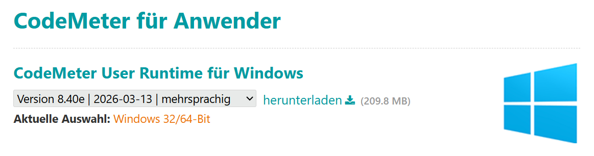
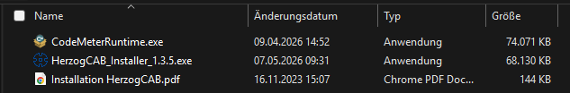
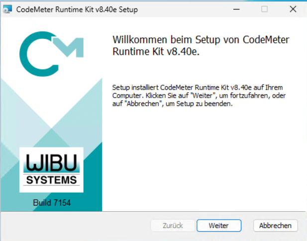
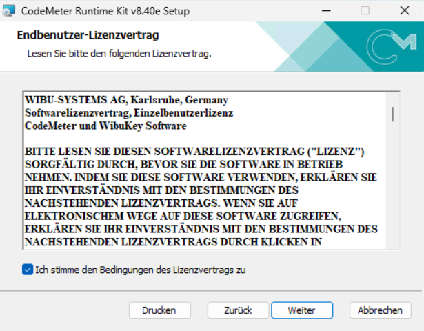
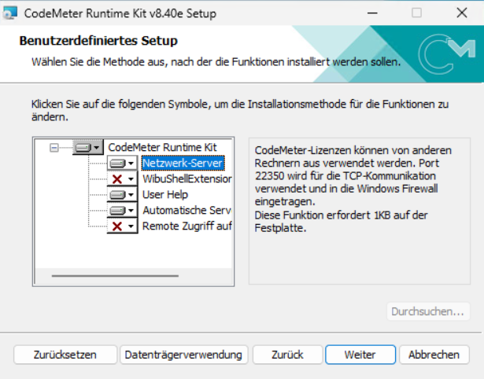
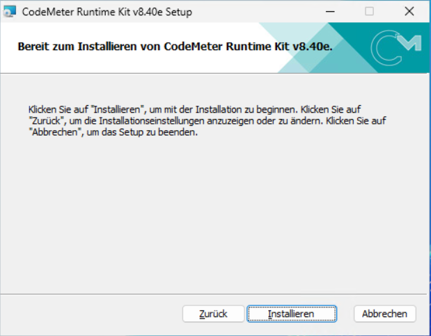
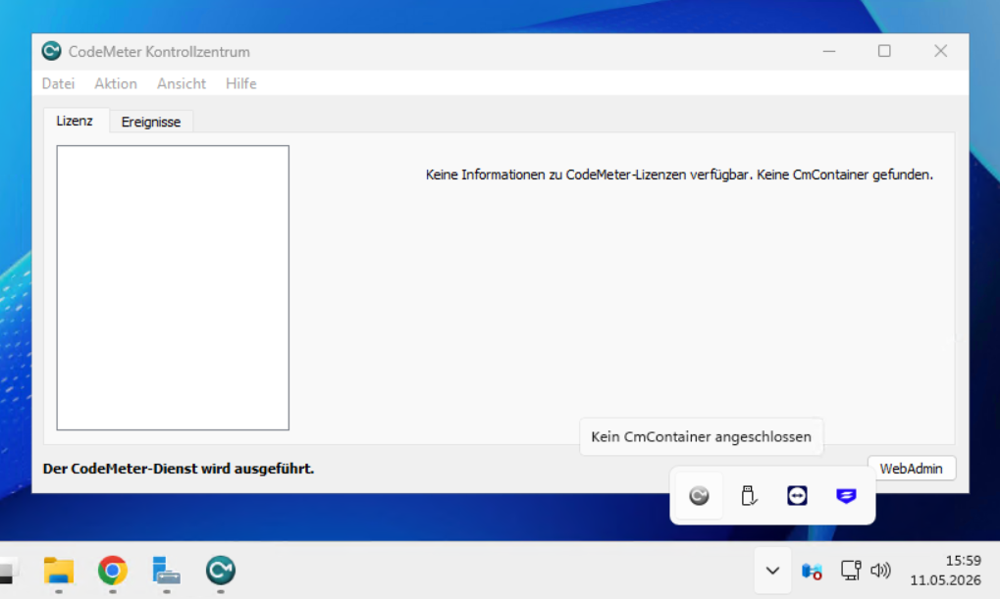

# Install CodeMeter

!!! example "Guide — Wibu CodeMeter Runtime installed and ready for use"

!!! info "Only for existing customers with a dongle or software licence"
    This page only concerns installations whose licence is on a
    **CmDongle** or a **CmAct software licence**. If you license your
    Herzog CAB via the [customer account](account.md) (standard case since
    version 2.0), you need **no CodeMeter** and can skip this
    page.

For dongle and CmAct licences, Herzog CAB uses the **Wibu
CodeMeter** system. Before you install Herzog CAB itself, the
**CodeMeter User Runtime** must be present on the computer. It includes the *CodeMeter
Control Center* and *CodeMeter WebAdmin*, which are used to manage
licences.

!!! info "Order"
    We recommend setting up CodeMeter **before** the Herzog CAB installer.
    This way the runtime is already fully initialised at the first program
    start.

!!! tip "Clarify in advance: deployment scenario"
    How CodeMeter should be set up depends on whether only one
    user or several operators / computers work with it. A look
    at the [deployment scenarios](topology.md) helps you choose the right setup.

## Where do you get the runtime? { #woher-bekommen-sie-die-runtime }

There are two sources — both lead to the same result and
are independent of the licence type:

| Source                             | When?                                                                 |
|------------------------------------|-----------------------------------------------------------------------|
| **Download from wibu.com**         | Always possible. Provides the latest version. **Recommended.**        |
| **Supplied USB stick**             | Only if you have ordered a **CmDongle** — the installer is also included there. Useful if the computer has no internet access. |

So dongle customers can also download the runtime from Wibu — the
enclosed USB stick is just a convenience bonus.

---

## Variant A - Download the runtime from wibu.com { #variante-a-runtime-von-wibucom-herunterladen }

1. Open
   [https://www.wibu.com/de/support/anwendersoftware.html](https://www.wibu.com/de/support/anwendersoftware.html) in the browser.
2. Under *CodeMeter User Runtime for Windows*, choose the current
   version (in the example v8.40e). The **Windows 32/64-bit** variant
   suits all current Windows PCs.
3. Click **download**. You receive the file
   `CodeMeterRuntime.exe`.

4. Double-click the downloaded `CodeMeterRuntime.exe` and
   confirm the Windows prompt for administrator rights with **Yes**.
5. Follow the [setup wizard](#setup-assistent-durchlaufen) (see below).

!!! tip "Versions compatible"
    CodeMeter runtimes are backward compatible. Installing a newer version than
    the one on a supplied USB stick is usually
    not a problem.

---

## Variant B - Runtime from the supplied USB stick { #variante-b-runtime-vom-mitgelieferten-usb-stick }

Only relevant if you have ordered a **CmDongle**. With the
dongle delivery you receive two USB drives:

* the **CmDongle** itself (small stick with the licence)
* an additional **USB stick with the software**

Proceed as follows:

1. Plug the **software USB stick** (not the dongle!) into a
   free USB port.
2. Open the stick in Windows Explorer. You will find there:

3. Double-click `CodeMeterRuntime.exe`.
4. Confirm the Windows prompt for administrator rights with **Yes**.
5. Follow the [setup wizard](#setup-assistent-durchlaufen) (see below).

After a successful installation you can remove the USB stick
and store it safely - you only need it if the
runtime has to be reinstalled later.

---

## Run through the setup wizard { #setup-assistent-durchlaufen }

The setup wizard is identical for both variants.

### Step 1 - Welcome { #schritt-1-willkommen }

Click **Next**.

### Step 2 - Licence agreement { #schritt-2-lizenzvereinbarung }

Read the agreement, tick the checkbox
**I accept the terms in the License Agreement** and click
**Next**.

### Step 3 - Component selection { #schritt-3-komponenten-auswahl }

Here you decide which features are to be installed.

!!! warning "Important for floating licences / licence server"
    If this computer is to serve as a **licence server** (variant 3
    of the [deployment scenarios](topology.md) — floating licences for
    several clients), **the *Network Server* component must be
    activated**. To do this, click the icon in front of *Network Server* and
    choose **Will be installed on local hard drive**.

    The component opens **port 22350** for TCP communication with
    the clients and adds an exception to the Windows firewall.

!!! info "For single-seat or client installation"
    If this computer does **not** become a licence server (variant 1 or 2,
    or a client in variant 3), the standard components are sufficient —
    *Network Server* does **not** need to be activated.

After making your selection, click **Next**.

### Step 4 - Start the installation { #schritt-4-installation-starten }

Click **Install**.

Depending on the computer, the process takes one to two minutes. At the end,
close the wizard with **Finish**.

---

## Check whether CodeMeter is running { #prufen-ob-codemeter-lauft }

After the installation, CodeMeter runs as a background service. Check
success as follows:

1. Look at the Windows notification area at the bottom right (next to the clock).
   The **CodeMeter icon** should appear there (small C in a
   circle). You may have to expand the tray menu with the arrow
   to see it.
2. Double-click it - the **CodeMeter Control Center** opens.

In the Control Center, the licence list is **still empty** — the message
*"No information about CodeMeter licenses available. No
CmContainer found."* is correct at this point. All that matters is
the status at the bottom left: **"CodeMeter service is running."**

The Herzog licence is only activated in the next step.

---

## Next step { #nachster-schritt }

Now you can [install Herzog CAB](installer.md).
