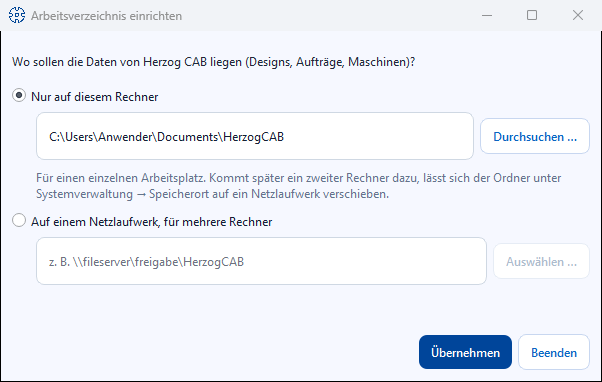

# First start and setup

!!! example "Guide — Storage location, user and workspace folder set up at the first program start"

**Prerequisites:** Herzog CAB is [installed](installer.md) and the
computer is [signed in to the customer account](activate-license.md) — or, for
existing customers: the dongle is plugged in or the CmAct licence is activated.

When you start Herzog CAB on a computer for the first time, the
program guides you through a short setup. Depending on whether you are the **first**
user in your plant or are joining an existing setup
(e.g. because user management is already on a network drive),
you see a different number of the following dialogs.

=== "Customer account"

    ```mermaid
    flowchart LR
      A[Sign in to the<br>customer account] --> B[Company's<br>workspace folder]
      B --> D[Herzog CAB starts]
    ```

    The user with whom you signed the computer in to the account is
    also your program user — you **no longer** create an administrator
    account. Instead of steps 1 to 3 below, only one
    dialog appears: [Company's workspace folder](#kundenkonto-arbeitsverzeichnis-der-firma).
    If your customer account already knows your company's folder, you just click
    **Connect** there.

=== "Dongle / CmAct licence"

    ```mermaid
    flowchart LR
      A[Choose storage location] --> B[Create administrator]
      B --> C[Set up profile]
      C --> D[Herzog CAB starts]
    ```

    Without a customer account, Herzog CAB manages its users locally. At the first
    start you create the first administrator (step 2).

!!! info "These dialogs only appear when needed"
    Each dialog is displayed **only** if the respective state
    does not yet exist. On a second or third computer that accesses
    the same (already set up) user management, you usually
    only see the normal [sign-in dialog](../admin/login.md) and, if applicable,
    the [profile selection](#profil-auswahlen-statt-einrichten).

## Customer account: company's workspace folder { #kundenkonto-arbeitsverzeichnis-der-firma }

In the account model, after signing in Herzog CAB only asks where the company's
data is stored — designs, orders, machines and master data. Your
[customer account](account.md) remembers the storage location: the company's first computer
defines it, and every further computer connects to it. Nobody
needs to know the network path for this.

### The account knows the folder: connect { #das-konto-kennt-den-ordner-verbinden }

If your company already has a storage location, the
**"Set up working directory"** dialog shows this folder and immediately checks whether it
can be reached from this computer.

!!! warning "📷 Screenshot fehlt"
    **Motiv:** Dialog „Arbeitsverzeichnis einrichten" mit dem Ordner der Firma, grünem Haken „erreichbar" und der Schaltfläche **Verbinden**
    **So erzeugen:** Auf einem zweiten Rechner mit einem Konto, das schon einen Speicherort hat, zum ersten Mal anmelden
    **Ziel-Datei:** `assets/screenshots/setup/arbeitsverzeichnis-verbinden.png`

| Element | Meaning |
|---|---|
| Company folder | The network path from the customer account, e.g. `\\fileserver\freigabe\HerzogCAB`. |
| Check result | ✔ = the folder can be reached. ✘ = cannot be reached; usually the network drive is not connected (when working from home: VPN) or your Windows user is not allowed to write there. |
| **Connect** | Sets up the folder on this computer and starts Herzog CAB. Only active if the folder can be reached. |
| **Check again** | Appears if the folder cannot be reached. Checks again after you have connected the network drive. |
| **Choose a different folder …** | Only for users with the **Workspace settings** right. Opens the selection below, e.g. for a test folder. |
| **Quit** | Quits Herzog CAB without setting anything up. |

!!! info "No silent fallback"
    If the folder cannot be reached, Herzog CAB does **not** create a local
    substitute folder. This prevents two separate data sets from being created.

### Company's first computer: define the storage location { #erster-rechner-der-firma-speicherort-festlegen }

If the account does not yet know a storage location, the dialog asks once:



| Element | Meaning |
|---|---|
| **On this computer only** | For a single workstation. Prefilled with *Documents\HerzogCAB*, can be changed via **Browse …**. If a second computer is added later, move the folder to a network drive under [Storage location](../admin/storage-location.md#auf-netzlaufwerk-verschieben). |
| **On a network drive, for several computers** | For several workstations. Enter the path or select it via **Choose …**. Herzog CAB itself converts a mapped drive such as `Z:\HerzogCAB` into the network path so that every computer can find it. |
| **Apply** | Sets up the folder. With the **Workspace settings** right, a network drive is also stored as the company's storage location in the customer account. |

!!! tip "Define the storage location in advance"
    Administrators can also enter the storage location in the web app under
    [Account and users](../web/account.md#speicherort-der-firma)
    before the first computer is set up.

## Step 1: Choose the storage location for user management (dongle / CmAct only) { #schritt-1-speicherort-fur-die-benutzerverwaltung-wahlen-nur-dongle-cmact }

!!! info "Not applicable with the customer account"
    In the account model, users come from the customer account. The folder for the
    data is defined by the [Company's workspace folder](#kundenkonto-arbeitsverzeichnis-der-firma) dialog.

This **"Set up data storage location"** dialog only appears at the
very first start on a computer that does not yet know any user management
(neither locally nor via an already configured network path).
It defines where user accounts, profiles and roles are stored.

| Element | Meaning |
|---|---|
| **Local — this computer only** | Preselected option. User management is stored under `%ProgramData%\Herzog GmbH\Herzog Cab` on this computer. Suitable for variant 1 of the [deployment scenarios](topology.md). |
| **Network path — shared with other computers** | Activates the path field. Suitable for variant 2/3, if several computers are to see the same user accounts. |
| Path field | Free text field for the UNC path (e.g. `\\fileserver\share\HerzogCAB`), only active with "Network path". |
| **Choose …** | Opens the folder selection. |
| **Test connection** | Checks whether the path exists or can be created and is writable. Also shows whether user data is already stored there. |
| **Apply** | Saves the choice. With "Network path", Herzog CAB then restarts automatically so that the new path takes effect everywhere. |

!!! tip "Data already present at the destination?"
    If the connection test finds user data at a network path
    (e.g. because a colleague has already created an administrator there),
    it is reused — **no** new administrator is
    created. You then go straight to the normal sign-in dialog.

The chosen storage location can be changed at any time later under
[Storage location](../admin/storage-location.md) in system administration.

## Step 2: Create the administrator account (dongle / CmAct only) { #schritt-2-administrator-konto-anlegen-nur-dongle-cmact }

!!! info "Not applicable with the customer account"
    In the account model, users, passwords and roles come from the
    [customer account](account.md). Whoever signed in the computer is immediately
    signed in to the program; colleagues sign in at the next start with their
    own account user (see [Sign in and sign out](../admin/login.md)).
    Your role in the program corresponds to your role in the account — an
    account administrator has all rights.

If there is **no** account yet in the local user management,
Herzog CAB shows the **"Set up user management"** dialog. The account created here
automatically becomes the first **SuperAdmin** and is then immediately
signed in — signing in again is not necessary.

!!! warning "📷 Screenshot fehlt"
    **Motiv:** Dialog „Benutzerverwaltung einrichten" mit den Feldern
    Firma, Login-Name, Anzeigename, E-Mail, Passwort, Passwort bestätigen.
    **So erzeugen:** Herzog CAB auf einem Rechner ohne bestehende
    Benutzerverwaltung starten (leerer `%ProgramData%\Herzog GmbH\Herzog Cab`).
    **Ziel-Datei:** `assets/screenshots/setup/erstadmin-einrichten.png`

| Field | Meaning |
|---|---|
| **Company** | Company name displayed in the program. Can be changed later under *System administration > Company*. |
| **Login name** | Sign-in name for the login dialog. Not case-sensitive. |
| **Display name** | Full name displayed in the program. |
| **Email** (optional) | Stored in the user account. |
| **Password** / **Confirm password** | Must be at least **6 characters** long and match in both fields. |

Click **Finish setup** as soon as all mandatory fields
are filled in — the button is disabled until then.

!!! tip "Who should be the first administrator?"
    Ideally a person who is organisationally responsible for Herzog CAB in the plant
    — e.g. a shift supervisor or workshop manager.
    You create further users with restricted rights later under
    [Manage users](../admin/users.md).

!!! warning "Keep the password safe"
    If you forget the administrator password, only another
    SuperAdmin can reset it via [Manage users](../admin/users.md).
    If there is no second SuperAdmin yet, write down the
    password in a safe place.

## Step 3: Set up a profile (dongle / CmAct only) { #schritt-3-profil-einrichten-nur-dongle-cmact }

!!! info "Not applicable with the customer account"
    There, the [Company's workspace folder](#kundenkonto-arbeitsverzeichnis-der-firma) dialog
    creates the profile itself; it is named after your company.

A **profile** is a self-contained workspace with its own
workspace folder (orders, master data, print templates) and its own
web server port. If the newly signed-in SuperAdmin sees **no** profile,
Herzog CAB automatically shows the **"Set up profile"** dialog.

| Field | Meaning |
|---|---|
| **Profile name** | Name of the profile, prefilled with "Default". With several companies/plants on the same installation, give it a meaningful name here. |
| **Working directory** | Folder for orders, machines, materials, colors and print templates of this profile. Prefilled with *Documents\HerzogCAB*. Selectable via **Browse …**. |
| **Webserver port** | Port at which the mobile web interface of this profile can be reached. Prefilled with 8080. |
| **Start webserver automatically at launch** | Checkbox, off by default. |
| **Webserver password** | At least 8 characters. Without a password, the web interface can only be reached on this computer; tablets and phones on the network need a password. Can be set later under [Web server and QR code](../admin/settings/web-server.md). |

!!! warning "Workspace folder in multi-user operation"
    Profiles are stored centrally. If several computers are to work with the same
    profile, the workspace folder must be a
    **network path** (e.g. `\\fileserver\share\HerzogCAB-Daten`).
    A local path such as `C:\Daten\…` can only be reached on the computer
    on which you entered it here.

Click **Create profile** as soon as the name and workspace folder
are valid (green tick below the form).

### Select a profile instead of setting one up { #profil-auswahlen-statt-einrichten }

If the signed-in user sees **more than one** profile (e.g. because
several plants/profiles have already been created), the
**"Select profile"** dialog appears instead: a list of all assigned profiles with
the workspace folder and web server status for the selected row, and the
buttons **Manage profiles …** (SuperAdmins only) and
**Open profile**. If exactly one profile is assigned, Herzog CAB opens it
automatically — without a dialog.

You create, rename or delete further profiles later under
[Profiles (workspaces)](../admin/profiles.md).

## Result { #ergebnis }

Herzog CAB opens the main window, signed in with your user and the
profile you set up. In the workspace folder,
the program automatically creates the necessary basic files (including for
orders, braiding machines, materials and colors) — you will find details
under [Profiles (workspaces)](../admin/profiles.md).

## If the workspace folder can no longer be reached later { #wenn-nachtraglich-kein-arbeitsverzeichnis-mehr-erreichbar-ist }

If the workspace folder stored in the profile can no longer be reached or is not writable at a **later**
program start (e.g.
network drive not connected), Herzog CAB reports this directly at startup with
an error message including a hint for the solution. In an older special case — very
early installations without profile assignment — the
**"Set up working directory"** dialog may appear automatically instead: path field,
**Browse …**, a status note (green tick with write access,
red cross otherwise) and **Apply working directory**. If you cancel
this dialog, Herzog CAB automatically falls back to *Documents\HerzogCAB*
so that the program can start in any case.

## If something doesn't work { #wenn-etwas-nicht-klappt }

* Password is not accepted or the two password fields do not
  match → note the message in the dialog, use at least 6 characters.
* Folder is not writable (red cross) → choose a different folder
  or check permissions; do not choose a folder under
  `C:\Program Files` or on a write-protected network drive.
* Sign-in fails on a further computer → see
  [Sign-in problems](../help/login-problems.md).
* Licence is not recognised → see [Licence problems](../help/license-problems.md).

## Related pages { #verwandte-seiten }

* [Deployment scenarios](topology.md) — which topology suits your plant
* [Storage location](../admin/storage-location.md) — change the storage location later
* [Profiles (workspaces)](../admin/profiles.md) — create and manage further profiles
* [Manage users](../admin/users.md) — create further users or take them over from the customer account
* [Customer account and invitation](account.md) — invite colleagues to the account
* [The interface at a glance](../basics/interface.md) — how to continue after the start
