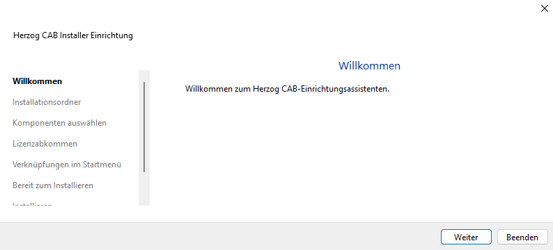
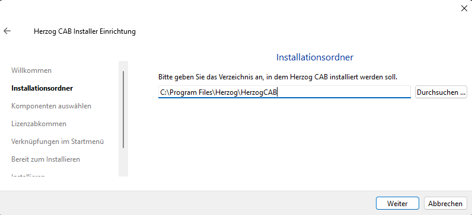
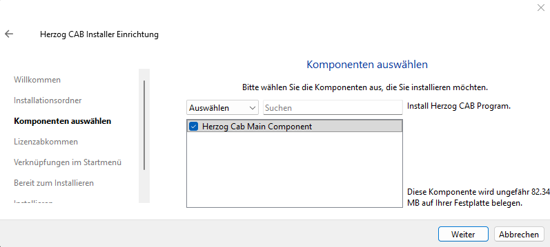
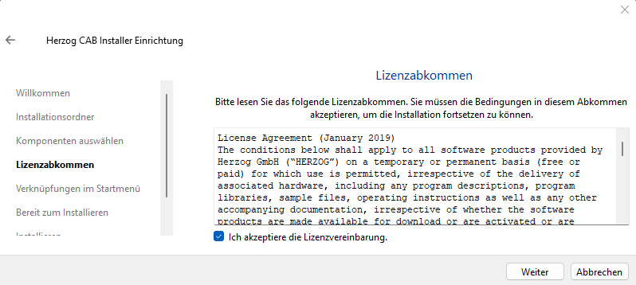
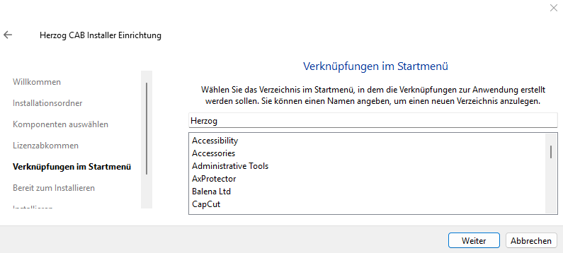
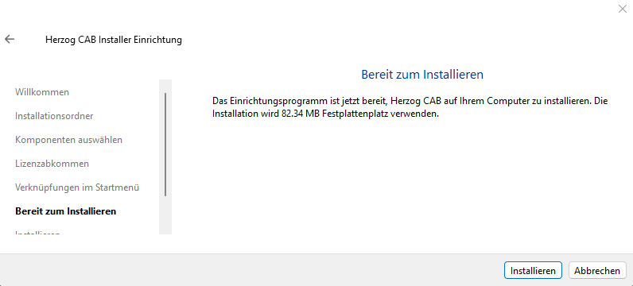
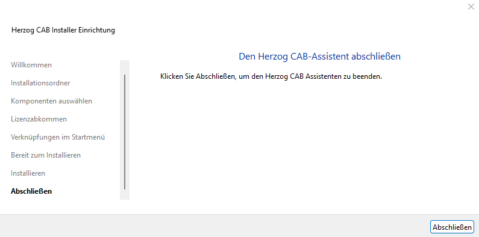

# Install Herzog CAB

!!! example "Guide — Herzog CAB installed via the setup wizard"

!!! info "Prerequisite only for dongle licences"
    Existing customers with a **CmDongle** or **CmAct licence** first install
    the [CodeMeter Runtime](codemeter.md); otherwise the program reports a missing
    licence component at the first start. With the
    [customer account](account.md) this step is not required.

## Where do you get the installer? { #woher-bekommen-sie-den-installer }

| Source                             | When?                                                                 |
|------------------------------------|-----------------------------------------------------------------------|
| **Licence portal → Download** | **Recommended** for everyone with a customer account. Sign in at [license.herzog-cab.com](https://license.herzog-cab.com) and click **Download** — the page shows the latest version with its release date, the new features and one installer each for Windows (`Herzog_CAB_Installer_<Version>.exe`) and macOS (`.dmg`, from version 2.1.0). See [Download](../portal/download.md). |
| **Download from the Herzog feedback repo** | Without a customer account. Open [github.com/Herzog-GmbH/HerzogCAB-Feedback](https://github.com/Herzog-GmbH/HerzogCAB-Feedback) and download the current installer under *Releases*. The product page [cab.herzog-online.com](https://cab.herzog-online.com) links to the same files. |
| **Supplied USB stick**             | Only if you have ordered a **CmDongle** — the installer is included on the supplied software USB stick. Useful if the computer has no internet access. |

!!! info "One installer for all editions"
    Since version 2.0 there is **one** installer. Whether the full version,
    Designer edition or trial version runs is determined by the licence —
    the modules in the customer account or the feature code of the dongle.

Double-click the downloaded file or the file started from the USB stick
and confirm the Windows prompt for administrator rights
with **Yes**.

---

## Run through the setup wizard { #setup-assistent-durchlaufen }

The setup wizard guides you through the installation in seven steps.
The left sidebar always shows where you
are.

### Step 1 - Welcome { #schritt-1-willkommen }



Click **Next**.

### Step 2 - Installation folder { #schritt-2-installationsordner }



By default, Herzog CAB is installed to

```
C:\Program Files\Herzog\HerzogCAB
```

You can choose a different folder via **Browse** — but we recommend keeping the
default unless there is a
specific reason not to.

Click **Next**.

### Step 3 - Select components { #schritt-3-komponenten-auswahlen }



There is currently only one component: **Herzog Cab Main Component**
(the main application, approx. 82 MB). Leave the checkbox ticked and
click **Next**.

### Step 4 - Licence agreement { #schritt-4-lizenzabkommen }



Read the *License Agreement* of Herzog GmbH, tick the
checkbox **I accept the license.** and click
**Next**.

### Step 5 - Start menu shortcuts { #schritt-5-verknupfungen-im-startmenu }



The installer creates a shortcut in the Windows Start menu. The
default folder name is **Herzog**. You can type a different name
or select an existing folder from the list.

Click **Next**.

### Step 6 - Ready to install { #schritt-6-bereit-zum-installieren }



The wizard summarises what will happen (disk space required,
target folder). Click **Install**.

Depending on the computer, the process takes one to two minutes. During
the installation you see a progress bar.

### Step 7 - Finish { #schritt-7-abschlieen }



Click **Finish**. Herzog CAB is now installed and
can be reached via the Start menu under *Herzog > Herzog CAB*.

---

## Next step { #nachster-schritt }

Start Herzog CAB and [sign the computer in to the customer
account](activate-license.md). Existing customers with a dongle first plug in the
CmDongle or activate their CmAct licence — also described on this
page.
