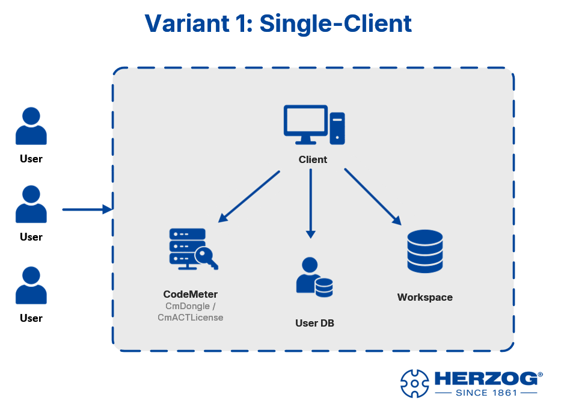
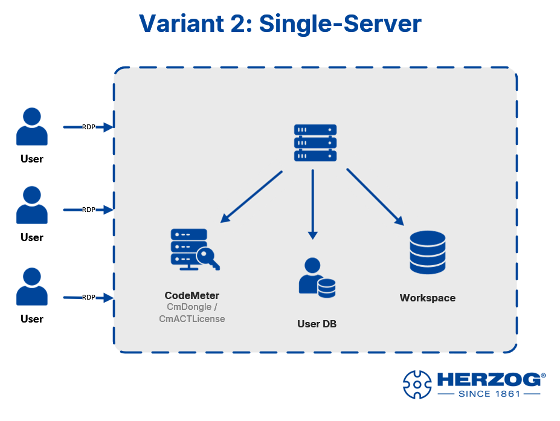
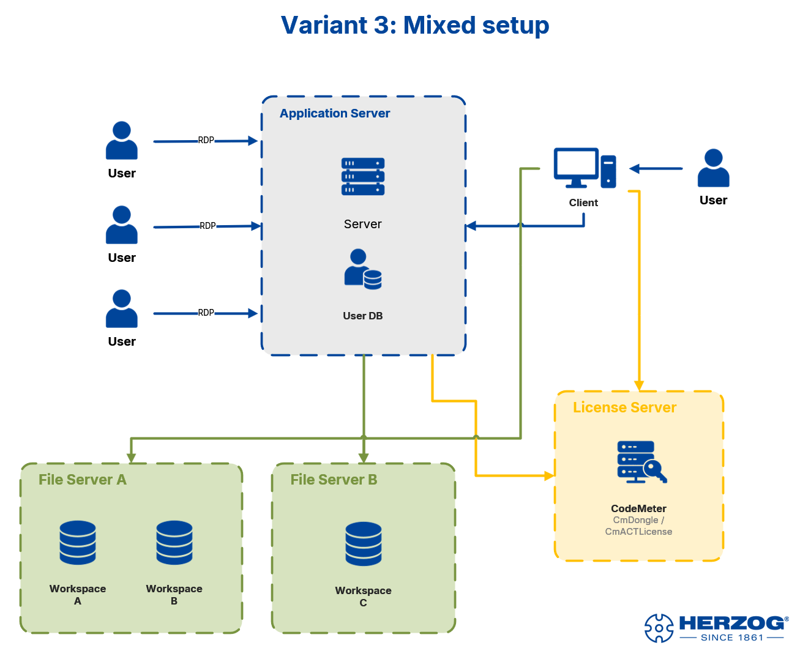

# Deployment scenarios

!!! info "Concept — Which topology (single client, server, mixed setup, web app) suits your plant"

Before you get started, it is worth looking at the typical setups.
Herzog CAB has built-in user management — **so several operators
can sign in with their own account in every variant**. The
interesting question is not "how many operators?", but **where does what run**:

* **Program** — on each PC individually or centrally on a server?
* **Workspace** (orders, master data, print templates) — locally or
  on a file server?
* **User DB** — per PC or centrally on the application server?
* **Licence** — since version 2.0 normally from the **customer account**
  (each computer occupies a seat while Herzog CAB is running); for existing customers
  locally per computer (CmDongle / CmActLicense) or centrally via a
  **Wibu licence server**.

This results in four setups that occur in practice — the first
three with the desktop app, the fourth with the web app in the browser.

---

## Variant 1 — Single client { #variante-1-single-client }

Program, workspace, user DB and licence are all on the same
workstation PC. Whether one operator works alone or several
sign in during shift operation — the data stays local.

!!! info "User management"
    User accounts are stored under `%ProgramData%\Herzog GmbH\Herzog Cab` —
    they belong to the **computer**. Several operators share this
    one user DB and sign in with their own
    account when the program starts.

**When suitable:** design work at a fixed workstation or
workshop PC in shift operation. Simplest setup, no server
infrastructure required.

---

## Variant 2 — Single server (RDP access) { #variante-2-single-server-rdp-zugriff }

A server is the central installation. Operators connect from
their PCs / tablets / laptops via **Remote Desktop (RDP)** and work
in their own sessions. Workspace, user DB and CodeMeter licence
are also on the server.

!!! warning "Licence for terminal server / RDP"
    In the **account model**, the server as one computer occupies **one seat**
    while Herzog CAB is running there. This also applies if several operators
    sign in one after the other.
    If several users are to work **simultaneously** in their own RDP sessions,
    clarify the required number of seats with your
    Herzog representative. Standard single-seat licences via CodeMeter
    (CmDongle or CmActLicense) do **not cover parallel RDP sessions**;
    for this, the licence must be explicitly issued as a **terminal server licence** with
    the desired number of sessions.

**When suitable:** operators with their own devices (including tablets or
laptops outside the plant) who are to access a central installation.
Updates and backups are concentrated on the one
server.

---

## Variant 3 — Mixed setup { #variante-3-mixed-setup }

The most demanding variant combines several strategies:

* **Application server**: Herzog CAB runs here in RDP sessions for
  the operators; the user DB is located right next to it.
* **Local client**: individual users (e.g. the design department) have
  Herzog CAB installed locally on their PC and access the
  servers directly.
* **File server**: one or more file servers provide several
  workspaces (e.g. one workspace per plant or project group).
* **Licence server**: a central Wibu licence server manages a
  pool of floating licences. Both the application server and
  the local clients obtain their licence from here.

!!! info "When is a licence server worthwhile?"
    A dedicated Wibu licence server only concerns **existing customers with
    CodeMeter**. It makes sense if there are significantly **more operators than
    licences needed in parallel** — e.g. 10 operators, but
    never more than 3 in the program at the same time. With the **customer account**,
    the Herzog licence server takes on this role automatically: the seats of a
    subscription are a pool for everyone who is currently working, in the program or in the
    browser. The program returns its seat when it is closed.

!!! warning "Several workspaces"
    If you work with several workspaces (e.g. one per plant
    or project group), switch between them via the **profile menu** in
    Herzog CAB. Each profile points to a different workspace path.

!!! warning "Notes on workspaces on network drives"
    * All operators need **write permissions** on the shares.
    * **All computers on the same version** (2.1.1 or later): then
      Herzog CAB locks every entry that someone is currently editing, and
      the others see it read-only, see
      [Multiple users in the same workspace folder](../basics/multi-user.md).
      Older versions do not know the lock.
    * A **stable network connection** is mandatory. Dropouts
      can damage order files.
    * **Don't forget the backup** — the workspace is now the only
      place where your data is stored.

**When suitable:** larger plants with professional IT infrastructure,
where design (local) and workshop operators (via RDP)
access shared data in parallel, with central licence and
file management.

---

## Variant 4 — Web app in the browser { #variante-4-web-app-im-browser }

Since version 2.0, Herzog CAB also runs entirely in the browser:
[app.herzog-cab.com](https://app.herzog-cab.com). There is nothing to
install, no workspace path and no local user DB — all
data is stored in the **workspace of your customer account** on the Herzog server,
and each user signs in with their account user.

* **Program:** in the browser, on PC, tablet or smartphone.
* **Workspace:** centrally in the account — all users see the same orders,
  designs, machines and master data.
* **Users and roles:** from the customer account (licence portal).
* **Licence:** the same annual subscription as the desktop app, one seat per person
  in the browser. Anyone who works in the program at the same time occupies two seats.

The web app can be combined with any of the three desktop variants:
the desktop app can automatically upload its workspace folder to the cloud
(see [Licence and cloud](../admin/settings/license.md)), or you
import the workspace once as a ZIP
([Import from the desktop app](../web/import.md)).

**When suitable:** operators at changing locations or with tablets, plants without
their own servers, access for colleagues in sales or production planning
— and anyone who does not want to maintain an installation. What the web app can do
compared with the desktop app is described under
[Desktop app or web app?](../basics/platforms.md).

---

## Which variant is the right one? { #welche-variante-ist-die-richtige }

| Your situation                                                      | Recommendation |
|---------------------------------------------------------------------|--------------|
| A single PC, no server infrastructure required                      | Variant 1    |
| Operators with their own devices, everything central on one server  | Variant 2    |
| Existing server landscape, RDP + local clients, floating licence    | Variant 3    |
| No installation, access from anywhere, shared data                  | Variant 4 (web app) |

If in doubt, have a quick word with your Herzog representative — the
decision also affects the order (number of seats
shared by the program and the web app) and is more
complicated to change later.

## Next step { #nachster-schritt }

Once you know which variant suits your setup, continue
with the [customer account](account.md) — or, for existing customers with a dongle,
with the [CodeMeter installation](codemeter.md).
