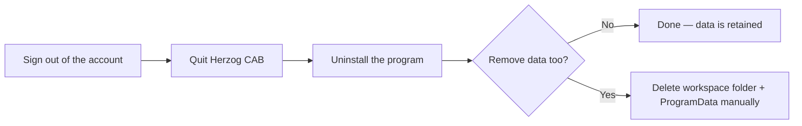

# Uninstall

!!! example "Guide — Herzog CAB removed, with or without your own data"

You can uninstall Herzog CAB in two equivalent ways — via
the supplied maintenance tool or via the Windows settings
(which call the same maintenance tool in the background). Removing the
program leaves your orders, master data and user accounts
**untouched** by default.

## Step 0: Sign the computer out of the customer account { #schritt-0-rechner-vom-kundenkonto-abmelden }

If Herzog CAB obtains its licence from the [customer account](account.md),
this computer occupies seats there. Release them before uninstalling:
*File > Settings*, **Licence** tab, **Sign out this
computer** button (see [Licence and cloud](../admin/settings/license.md)).
Forgetting it is no disaster. The seat is released anyway as soon as the
program is closed. An administrator releases an offline lease in the
[licence portal](../portal/licenses.md). Existing customers with a dongle
skip this step.

## Step 1: Quit Herzog CAB { #schritt-1-herzog-cab-beenden }

Close the program completely if it is still running — including from
the tray icon.

## Step 2: Uninstall the program { #schritt-2-programm-deinstallieren }

=== "Via the maintenance tool"

    1. Open the Start menu under *Herzog > Herzog CAB Maintenance*.
    2. Choose **Remove all components**.
    3. Confirm the process and wait until the wizard has
       finished.

=== "Via the Windows settings"

    1. Open *Settings > Apps > Installed apps*.
    2. Look for the **Herzog CAB** entry.
    3. Click **Uninstall** and confirm the prompt.

    Windows calls the same maintenance tool in the background as in the
    first route — the result is identical.

!!! warning "📷 Screenshot missing"
    **Subject:** Maintenance tool wizard at the “Remove all components”
    step.
    **How to create:** Open the maintenance tool via *Herzog > Herzog CAB
    Maintenance* and photograph the uninstall step.
    **Target file:** `assets/screenshots/setup/maintenance-tool-entfernen.png`

## Removing data { #daten-entfernen }

!!! warning "The workspace is retained"
    Uninstalling removes **only the program itself**. Your
    workspace folder (orders, braiding machines, materials,
    print templates) and the user management (accounts, profiles, roles)
    remain — in case you reinstall Herzog CAB later
    or another computer continues to use the same storage location.

If you really want to remove this data permanently, delete manually:

| Location | Contents |
|---|---|
| Your workspace folder (folder you chose, e.g. *Documents\HerzogCAB*) | Orders, braiding machines, materials, colors, print templates of every profile that points to this folder. |
| `%ProgramData%\Herzog GmbH\Herzog Cab` | Global user management (accounts, profiles, roles) — only if it is stored **locally**. If it is on a network path (see [Storage location](../admin/storage-location.md)), delete the folder configured there instead. |
| Registry key `HKEY_CURRENT_USER\Software\Herzog GmbH\Herzog Cab` | Personal display settings (window sizes etc.) of this Windows user. |

!!! danger "Cannot be restored"
    Deleted orders, master data and user accounts **cannot**
    be restored. Check beforehand whether a backup of the
    workspace folder is required.

## Result { #ergebnis }

Herzog CAB has been removed from this computer. If you have also deleted the data as described
above, there is no longer any trace of the user management
or the order data — a new installation then starts
again with the [first-start wizard](first-run.md).

## If something doesn't work { #wenn-etwas-nicht-klappt }

* The uninstallation aborts with an error → quit Herzog CAB completely
  (also check the tray icon) and try again.
* You are unsure which data is still needed elsewhere
  (e.g. network storage location for other computers) → see
  [Storage location](../admin/storage-location.md) and, if in doubt, contact
  [support](../help/support.md).
