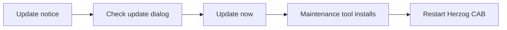

# Install updates

!!! example "Guide — New Herzog CAB version installed via the maintenance tool"

**Prerequisites:** Herzog CAB is installed, the computer has an
internet connection.

## Step 1: Notice that an update is available { #schritt-1-auf-ein-verfugbares-update-aufmerksam-werden }

At **every program start**, Herzog CAB checks in the background whether a newer
version is available. If there is nothing new, you will not notice anything — there
is no distracting message.

If a newer version is available, this is shown in two places:

* On the [home page (Home)](../basics/home.md), an unobtrusive
  **"Update available"** card appears. Clicking it opens the
  update dialog from step 2.
* Via *Help > Updates* you can check manually at any time — this route
  also reports when **no** update is available.

## Step 2: Check the update dialog { #schritt-2-update-dialog-prufen }

The **"Update available"** dialog shows:

| Element | Meaning |
|---|---|
| Title | "Herzog CAB *version* is available". |
| Subtitle | Your currently installed version and the release date of the new version. |
| **What's new** | List of new features from the release notes. |
| Note | Confirms that your master data (machines, materials, bobbins, orders, designs) is retained during the update. |
| **Open release page** | Opens the release page in the browser without installing. |
| **Later** | Closes the dialog without updating. The card on the home page remains visible. |
| **Update now** | Starts the installation (see step 3). |

!!! warning "📷 Screenshot fehlt"
    **Motiv:** Dialog „Update verfügbar" mit Versionsangabe, Was-ist-neu-Liste
    und den drei Schaltflächen.
    **So erzeugen:** *Hilfe > Updates* anklicken, wenn eine neuere Version
    veröffentlicht ist.
    **Ziel-Datei:** `assets/screenshots/setup/update-dialog.png`

## Step 3: Update now { #schritt-3-jetzt-aktualisieren }

=== "Via the update dialog"

    1. In the update dialog, click **Update now**.
    2. Herzog CAB starts the **maintenance tool** in update mode and
       then quits itself so that the tool can replace the program files.
    3. In the maintenance tool, run through the update wizard to the end
       and finally click **Finish**.
    4. Start Herzog CAB again via the Start menu or the desktop.

=== "Directly via the maintenance tool"

    1. Quit Herzog CAB if it is still running.
    2. Open the Start menu under *Herzog > Herzog CAB Maintenance*.
    3. Choose **Update components**.
    4. Follow the instructions and click **Finish** at the end.
    5. Restart Herzog CAB.

=== "Installer from the licence portal"

    If you have a [customer account](account.md), you can also install any version without the
    maintenance tool:

    1. In the [licence portal](https://license.herzog-cab.com), click
       **Download** and download the current installer.
    2. Quit Herzog CAB and run the installer — it updates the
       existing installation in place.
    3. Restart Herzog CAB. The sign-in to the account is retained.

!!! warning "📷 Screenshot fehlt"
    **Motiv:** Maintenance-Tool-Assistent im Schritt „Komponenten
    aktualisieren".
    **So erzeugen:** Maintenance-Tool über *Herzog > Herzog CAB
    Maintenance* öffnen und den Update-Schritt fotografieren.
    **Ziel-Datei:** `assets/screenshots/setup/maintenance-tool-update.png`

!!! info "Update from version 1.x to 2.0"
    Version 2.0 introduces the customer account. Existing customers with a **dongle or
    CmAct licence** change nothing — the dongle continues to be recognised and the
    local user management remains. Only those who have been switched over to the
    customer account by Herzog sign the computer in to the account once after the update
    (see [Sign in and obtain a licence](activate-license.md)).
    Installations of version 1.0 (without maintenance tool) cannot be
    updated — a new installation is required there; the
    workspace folder can be taken over.

## Result { #ergebnis }

Herzog CAB starts in the new version. Your orders, master data and
print templates in the workspace folder are retained unchanged. What has changed
in the new version is described under
[Release notes](../appendix/changelog.md).

## If something doesn't work { #wenn-etwas-nicht-klappt }

* The maintenance tool is not found → Herzog CAB automatically opens
  the release page, from which you can download a new installer.
* The update check fails or the update cannot be
  installed → see [Update errors](../help/update-errors.md).
