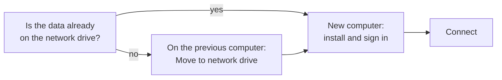

# Set up another computer

!!! example "Guide — at the end, another computer works with the same designs, orders and machines as the other computers in your company"

**Prerequisites:**

* Your company works with a [customer account](../setup/account.md) and has
  a free seat (see [My account](../portal/licenses.md)).
* The person working on the new computer has been invited to the customer
  account (see [Set up users and roles](setup-users.md)).
* The new computer can reach your company's network drive (when working
  from home, via VPN).

## Step 1: Is the data already on the network drive? { #schritt-1-liegen-die-daten-schon-auf-dem-netzlaufwerk }

On a computer that already works with Herzog CAB, open
*System administration > Storage location* (reference: [Storage location](../admin/storage-location.md)).

* If the workspace shows **NETWORK** and the
  *Company storage location in the customer account* is shown below it,
  everything is ready. Continue with step 3.
* If it shows **LOCAL**, the data is only on this computer. Continue with
  step 2.

!!! tip "Check in the web app"
    Administrators also see the same storage location in the web app under
    [Account and users](../web/account.md#speicherort-der-firma) and in the
    [licence portal](../portal/licenses.md) above the list of computers.

## Step 2: Move the data to the network drive { #schritt-2-daten-auf-das-netzlaufwerk-verschieben }

Only necessary if your company has so far worked with one computer and local
data.

1. On the file server, create an **empty** folder, e.g.
   `\\fileserver\freigabe\HerzogCAB`, to which all employees have write
   access. If in doubt, ask your IT department.
2. Save any open designs and orders.
3. Under *System administration > Storage location*, click
   **Move to network drive …**, select the new folder and
   click **Move**
   (reference: [Move to network drive](../admin/storage-location.md#auf-netzlaufwerk-verschieben)).
4. Herzog CAB copies the data, checks it and restarts. The new folder is
   then stored as the company storage location in the customer account.

## Step 3: Set up the new computer { #schritt-3-neuen-rechner-einrichten }

1. Install Herzog CAB on the new computer
   (reference: [Installation](../setup/installer.md)).
2. Start Herzog CAB and sign in with the e-mail address and
   password from the customer account
   (reference: [Sign in and obtain a licence](../setup/activate-license.md)).
3. The **"Set up workspace folder"** dialog shows your company's
   folder. If it shows ✔ *reachable*, click **Connect**
   (reference: [First start](../setup/first-run.md#kundenkonto-arbeitsverzeichnis-der-firma)).

## Result { #ergebnis }

* The home page of the new computer shows *Data: on the network drive (…)*.
* Designs, orders and machines are the same on all computers.
* Under *Settings > Licence*, the new computer counts as one more seat.

## If something does not work { #wenn-etwas-nicht-klappt }

* ✘ *The folder cannot be reached from this computer* → connect the network
  drive (when working from home: VPN) and click **Check again**. If that does
  not help, write permissions on the share are usually missing — ask your IT
  department.
* The dialog asks "Where should the data be stored?" although the company
  already uses a network drive → no storage location is stored in the
  customer account yet. An administrator enters it in the web app under
  [Account and users](../web/account.md#speicherort-der-firma) or
  starts Herzog CAB once on a computer that already works on the
  network drive. Then restart the new computer.
* All seats taken → [My account](../portal/licenses.md) in the licence portal
* Further help → [Help overview](../help/index.md) and
  [Contact support](../help/support.md)
