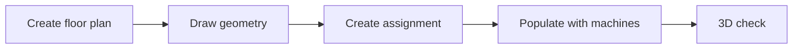

# Build a production hall

!!! example "Guide — at the end you have a true-to-scale model of your hall with placed machines, an active actual assignment and a 3D check view"

**Prerequisites:**

* The machines are recorded with their dimensions in the master data
  ([Braiding machines](../master-data/braiding-machines.md),
  [Bobbin winding machines](../master-data/winding-machines.md)) — the tile
  sizes in the plan are based on these dimensions.
* You have permission to edit floor plans and assignments.
* Optional: a scanned hall plan as an image file that you want to use as a
  drawing template.

## Step 1: Create a floor plan { #schritt-1-grundriss-anlegen }

1. Open *Master data > Floor plans* (reference:
   [Floor plans](../master-data/floor-plans.md)).
2. Click **+ New floor plan** and enter a name.

## Step 2: Draw the hall geometry { #schritt-2-hallengeometrie-zeichnen }

1. Select the new floor plan and click **Edit** — the
   [Factory Planner editor](../hall-planner/editor.md) opens in
   geometry mode.
2. First draw the exterior walls with the **Exterior wall** tool, then the
   interior walls with **Interior wall**.
3. Use the area tools to create functional areas (e.g.
   production, traffic route, storage).
4. Place building elements such as doors, gates, windows or stairs.
5. Save the floor plan.

All tools, the properties panel and the grid and snap settings are
explained on the reference page
[Editor — Geometry & Populating](../hall-planner/editor.md).

!!! tip "Use an existing hall plan as a template"
    You can load a floor plan image as a background and calibrate it to
    scale using two reference points — then you simply trace the walls.
    How this works is described on the
    [editor reference page](../hall-planner/editor.md).

## Step 3: Create an assignment { #schritt-3-belegung-anlegen }

1. Open the navigation item **Factory Planner** (reference:
   [Floor plan / assignment overview](../hall-planner/index.md)).
2. Select your floor plan on the left.
3. In the assignment bar, create a new assignment using **+** and
   name it (e.g. "Planning 2026").

An *Assignment* is a populating scenario: the same floor plan can have several
assignments (current state, conversion variants) that you can switch between.

## Step 4: Populate with machines { #schritt-4-maschinen-bestucken }

1. Click **Populate** — the editor opens in
   populating mode.
2. Drag machines from the machine catalogue (on the left, with search and
   type filter) onto the drawing area.
3. Arrange the machines: move, rotate in 90° steps,
   duplicate. When several machines are selected, the functions
   **Align**, **Distribute** and **Line up** in the
   selection toolbar help you.
4. Save the assignment.

All placement tools, context menus and the properties panel are
described on the reference page
[Editor — Geometry & Populating](../hall-planner/editor.md).

## Step 5: Set the actual assignment { #schritt-5-ist-belegung-festlegen }

The **first** assignment of a floor plan automatically becomes the actual assignment —
so this step is only necessary if you have created several assignments.
Back in the [assignment overview](../hall-planner/index.md), mark
the desired assignment via its context menu with **Set as actual assignment**.
The actual assignment is the scenario that represents the real state of the
hall; the status lights of the machines in it show the current
order status from the [Orders](../orders/index.md).

## Step 6: 3D check { #schritt-6-3d-kontrolle }

In the editor, switch to the 3D view with the **3D** view toggle (reference:
[3D shop floor view](../hall-planner/view-3d.md)):

* Rotate, pan and zoom through the hall with the mouse.
* Lower the walls if necessary so that you have a clear view into the
  hall.
* Check floor space, routes and distances; the glowing spheres above the
  machines show the order status.

## Result { #ergebnis }

* The floor plan with walls, areas and building elements is stored in the
  [Master data](../master-data/floor-plans.md).
* At least one assignment with placed machines is saved and marked as the
  actual assignment.
* The [3D shop floor view](../hall-planner/view-3d.md) shows your hall
  to scale with machines and status.

## If something does not work { #wenn-etwas-nicht-klappt }

* Machines do not appear in the catalogue → check the master data
  ([Braiding machines](../master-data/braiding-machines.md),
  [Bobbin winding machines](../master-data/winding-machines.md))
* Tiles have the wrong size → add the dimensions in the machine
  master data
* Buttons are greyed out → permission missing, see
  [Roles and permissions](../admin/roles.md)
* Further help → [Help overview](../help/index.md) and
  [Contact support](../help/support.md)
