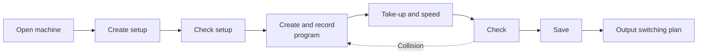

# Create a braiding program

!!! example "Guide — at the end, a checked time program with a setup exists for a machine, and the switching plan has been printed or saved as a PDF"

**Prerequisites:**

* A model licence for the machine has been assigned to you in the licence
  portal, and your role has *View Braiding Simulator* and
  *Edit Braiding Simulator*, see [Licence and rights](../braiding-simulator/licence.md).
* For the switching plan: the desktop app. Steps 1 to 6 also work in the
  [web app](../web/braiding-simulator.md).

## Step 1: Open the machine { #schritt-1-maschine-offnen }

1. In the navigation, click **Braiding Simulator** (reference:
   [Start page](../braiding-simulator/index.md#startseite)).
2. Select the machine on the left.
3. On the right, below the section **Setups and programs**, click **New
   setup**.

The empty machine appears in the
[simulator screen](../braiding-simulator/editor.md), with the **Set up**
task open.

!!! tip "Tip"
    If the machine already has a suitable setup, click **Open** in its
    card, adjust the setup in step 2 and save changes with **Save** instead
    of **Save as new setup…**.

## Step 2: Create the setup { #schritt-2-besetzung-anlegen }

1. In the **Set up** task
   ([reference](../braiding-simulator/populate.md)), a click on an empty
   position places a carrier.
2. Color the carriers: click a carrier and choose **Individual colors** in
   the selection card, or select several carriers with ++ctrl++ + click
   and choose **Color…** or **Color by running direction**.
3. If needed, set **Ply count** and **Arrangement**.
4. Under **Yarn**, enter the **Material diameter**; only then does the
   preview calculate in millimeters.
5. On machines with tubes, thread in axial threads or a core by clicking
   the tube.
6. Choose **Save as new setup…** and enter a name.

## Step 3: Check the setup { #schritt-3-besetzung-prufen }

1. If a program is selected under **Program** at the top, select
   **— no program —** there. Without a program, the simulator checks the
   setup with the start position of the switches and gears.
2. Open the **Check** task ([reference](../braiding-simulator/check.md))
   and click **Check current arrangement**.
3. The result must be *✅ Collision-free — repeat after … steps*.

If the setup itself does not run collision-free, adjust it before you
write a program.

## Step 4: Create and record the program { #schritt-4-programm-anlegen-und-aufnehmen }

1. At the top, choose **⋯** next to **Program** > **New program…** and
   enter a name. The program belongs to the selected setup and takes over
   the current switch position as its start.
2. Open the **Program** task
   ([reference](../braiding-simulator/program.md)).
3. If a switch should be in a different position from the beginning,
   click it without recording. This changes the program's start position.
4. In the playback bar, click **Record** and then **Start**.
5. At the point where the changeover should happen, press **Pause** (or
   enter the step under **Go to step**).
6. Click the switches that should change; with a shift lever, one switch
   is enough.
7. Let the run continue and switch back later. At the end, click
   **Stop recording**.

You do the fine-tuning in the [timeline](../braiding-simulator/program.md#zeitachse):
move commands, insert or delete steps. You take over commands from another
program of this machine with **Copy section…** in the right-click menu of
the timeline.

## Step 5: Set take-up and speed { #schritt-5-abzug-und-drehzahl-einstellen }

1. In the timeline, click step 1 in the **Speed** row and enter the
   horngear speed.
2. Click step 1 in the **Take-up** row, choose the **Quantity** that you
   want to specify (for example **Braiding angle**), and enter the
   **Value**.
3. If a section needs a different take-up, click there in the **Take-up**
   row or drag over the range.

Reference: [Take-up](../braiding-simulator/views.md#abzug) and
[Speed](../braiding-simulator/views.md#drehzahl). In the
[3D preview](../braiding-simulator/views.md) you see the braid with
these values.

## Step 6: Check and save { #schritt-6-prufen-und-speichern }

1. In **Check**, click **Check current arrangement**. The check uses the
   program selected under **Program** at the top.
2. If the result is ❌, jump to the collision with **Jump to step** and
   correct the command in the timeline; then check again.
3. If the repeat is much longer than the program, accept the suggestion
   **length …**.
4. Click **Save** (++ctrl+s++).

## Step 7: Output the switching plan { #schritt-7-schaltplan-ausgeben }

1. Open the **Output** task ([reference](../braiding-simulator/output.md)).
2. Check the orange notes; if, for example, the speed is missing, times
   and take-up lengths are unknown.
3. Click **Print…** or **Save as PDF…**. For further processing in Excel,
   choose **Save as CSV…**.

## Result { #ergebnis }

* On the start page, your setup appears as a card under **Setups and
  programs**, with the program indented below it.
* The check shows *✅ Collision-free — repeat after … steps*.
* The switching plan is available as a printout, PDF or CSV.

## If something does not work { #wenn-etwas-nicht-klappt }

* The machine is missing or does not open: [Licence and rights](../braiding-simulator/licence.md#wenn-eine-lizenz-wegfallt).
* **Save** stays gray: your role needs *Edit Braiding Simulator*, or a
  colleague is currently editing the same machine.
* **New program…** asks for a setup: a program always belongs to a saved
  setup. Save the arrangement first (step 2), see
  [Setup and program](../braiding-simulator/editor.md#besetzung-und-programm).
* A pitch change has no effect: see
  [Pitch in this run](../braiding-simulator/program.md#teilung-im-lauf).
