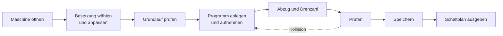

# Ein Flechtprogramm erstellen

!!! example "Anleitung — am Ende liegt für eine Maschine ein geprüftes Zeitprogramm mit Besetzung vor, und der Schaltplan ist ausgedruckt oder als PDF gespeichert"

**Voraussetzungen:**

* Ihnen ist im Lizenzportal eine Modell-Lizenz für die Maschine
  zugewiesen, und Ihre Rolle hat *Flechtsimulator anzeigen* und
  *Flechtsimulator bearbeiten*, siehe [Lizenz und Rechte](../braiding-simulator/licence.md).
* Für den Schaltplan: die Desktop-App. Schritte 1 bis 6 gehen auch in der
  [Web-App](../web/braiding-simulator.md).

## Schritt 1: Maschine öffnen

1. Klicken Sie in der Navigation auf **Flechtsimulator** (Referenz:
   [Startseite](../braiding-simulator/index.md#startseite)).
2. Wählen Sie links die Maschine.
3. Klicken Sie rechts unter **Konfigurationen von Herzog** bei der
   gewünschten Konfiguration (zum Beispiel *Voll*) auf **Öffnen**.

Die Maschine erscheint mit der Konfiguration im
[Simulator-Bildschirm](../braiding-simulator/editor.md).

## Schritt 2: Besetzung anpassen

1. Öffnen Sie rechts die Aufgabe **Bestücken**
   ([Referenz](../braiding-simulator/populate.md)).
2. Färben Sie die Klöppel: Klöppel anklicken und in der Auswahlkarte
   **Einzelfarben** wählen, oder mehrere mit ++ctrl++ + Klick wählen und
   **Farbe…** bzw. **Nach Laufrichtung färben**.
3. Stellen Sie bei Bedarf **Fachung** und **Anordnung** ein.
4. Tragen Sie unter **Garn** den **Materialdurchmesser** ein; erst dann
   rechnet die Vorschau in Millimetern.
5. Ziehen Sie bei Maschinen mit Rohren Zettelfäden oder einen Kern per
   Klick auf das Rohr ein.
6. Wählen Sie **Als neue Besetzung speichern…** und vergeben Sie einen
   Namen.

!!! tip "Bestücken nach Muster"
    Statt von Hand verteilt **Bestücken nach Muster…** die Klöppel voll,
    halb, als Tandem oder nur in einer Laufrichtung, auf Wunsch mit einer
    Farbe je Laufrichtung.

## Schritt 3: Grundlauf prüfen

1. Öffnen Sie die Aufgabe **Prüfen** ([Referenz](../braiding-simulator/check.md)).
2. Setzen Sie das Häkchen **Grundlauf ohne Programm** und klicken Sie auf
   **Aktuelle Aufstellung prüfen**.
3. Das Ergebnis muss *✅ Kollisionsfrei — Rapport nach … Schritten* sein.

Läuft schon die Besetzung nicht kollisionsfrei, passen Sie sie an, bevor
Sie ein Programm schreiben.

## Schritt 4: Programm anlegen und aufnehmen

1. Wählen Sie oben **⋯** neben **Programm** > **Neues Programm…** und
   vergeben Sie einen Namen. Das Programm übernimmt die aktuelle
   Weichenstellung als Start und die gewählte Besetzung.
2. Öffnen Sie die Aufgabe **Programm**
   ([Referenz](../braiding-simulator/program.md)).
3. Klicken Sie in der Wiedergabeleiste auf **Aufnahme** und dann auf
   **Start**.
4. Drücken Sie an der Stelle, an der umgeschaltet werden soll, **Pause**
   (oder geben Sie den Schritt unter **Gehe zu Schritt** ein).
5. Klicken Sie die Weichen, die schalten sollen; bei einem Stellhebel
   genügt eine Weiche.
6. Lassen Sie weiterlaufen und schalten Sie später zurück. Klicken Sie am
   Ende auf **Aufnahme stoppen**.

Feinarbeit erledigen Sie in der [Zeitachse](../braiding-simulator/program.md#zeitachse):
Befehle verschieben, Schritte einfügen oder löschen. Umschaltungen aus den
Programmen von Herzog übernehmen Sie mit **Betriebsart einfügen…**.

## Schritt 5: Abzug und Drehzahl einstellen

1. Klicken Sie in der Zeitachse in der Zeile **Drehzahl** auf Schritt 1
   und tragen Sie die Flügelraddrehzahl ein.
2. Klicken Sie in der Zeile **Abzug** auf Schritt 1, wählen Sie die
   **Größe**, die Sie vorgeben wollen (zum Beispiel **Flechtwinkel**), und
   tragen Sie den **Wert** ein.
3. Braucht ein Abschnitt einen anderen Abzug, klicken Sie dort in die
   Zeile **Abzug** oder ziehen Sie über den Bereich.

Referenz: [Abzug](../braiding-simulator/views.md#abzug) und
[Drehzahl](../braiding-simulator/views.md#drehzahl). In der
[3D-Vorschau](../braiding-simulator/views.md) sehen Sie das Geflecht mit
diesen Werten.

## Schritt 6: Prüfen und speichern

1. Nehmen Sie in **Prüfen** das Häkchen **Grundlauf ohne Programm** weg und
   klicken Sie auf **Aktuelle Aufstellung prüfen**.
2. Bei ❌ springen Sie mit **Zum Schritt springen** zur Kollision und
   korrigieren den Befehl in der Zeitachse; dann erneut prüfen.
3. Ist der Rapport viel länger als das Programm, übernehmen Sie den
   Vorschlag **Länge …**.
4. Klicken Sie auf **Speichern** (++ctrl+s++).

## Schritt 7: Schaltplan ausgeben

1. Öffnen Sie die Aufgabe **Ausgeben** ([Referenz](../braiding-simulator/output.md)).
2. Prüfen Sie die gelben Hinweise; fehlt zum Beispiel die Drehzahl, sind
   Zeiten und Abzugslängen unbekannt.
3. Klicken Sie auf **Drucken…** oder **Als PDF speichern…**. Für die
   Weiterverarbeitung in Excel wählen Sie **Als CSV speichern…**.

## Ergebnis

* Auf der Startseite steht Ihre Besetzung unter **Meine Besetzungen** und
  das Programm unter **Meine Programme**.
* Die Prüfung zeigt *✅ Kollisionsfrei — Rapport nach … Schritten*.
* Der Schaltplan liegt als Ausdruck, PDF oder CSV vor.

## Wenn etwas nicht klappt

* Die Maschine fehlt oder öffnet nicht: [Lizenz und Rechte](../braiding-simulator/licence.md#wenn-eine-lizenz-wegfallt).
* **Speichern** bleibt grau: Ihre Rolle braucht *Flechtsimulator
  bearbeiten*, oder ein Kollege bearbeitet gerade dieselbe Maschine.
* Ein Teilungswechsel wirkt nicht: siehe
  [Teilung im Lauf](../braiding-simulator/program.md#teilung-im-lauf).
