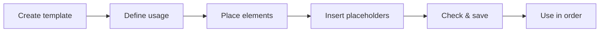

# Create a print template

!!! example "Guide — at the end, your own print template is ready and can be selected when printing an order, a design or a calculation"

**Prerequisites:**

* You have permission to edit print templates (without it, the print editor
  opens read-only).
* The company logo and company data are maintained if you want to use company
  elements ([Company](../admin/company.md),
  [Media](../master-data/media.md)).
* For testing: a saved [order](../orders/index.md) or a
  [design](../master-data/designs.md) with real data.

## Step 1: Create a template { #schritt-1-vorlage-anlegen }

1. Open the navigation item **Print editor** (reference:
   [Print editor](../print-templates/index.md)).
2. Click **New template** to start with an empty template.

!!! tip "Start with a copy"
    It is usually quicker to select a supplied default template
    (e.g. *Default Order*), adapt it and save it under a new
    name — see [Manage templates](../print-templates/manage.md).

## Step 2: Define the usage { #schritt-2-verwendung-festlegen }

In the page settings, define what the template is for: **Design**,
**Order** or **Calculation**. This assignment determines

* in which print dialog the template will later be offered and
* which elements are offered in the toolbox at all (e.g.
  input/result tables only for calculation templates).

Also set the paper format, orientation and page margin here
(reference: [Manage templates](../print-templates/manage.md) and
[Editor & toolbox](../print-templates/editor.md)).

## Step 3: Place elements { #schritt-3-elemente-platzieren }

1. Drag the desired building blocks from the toolbox on the left onto the
   page: data tables (order, customer, material, bobbin, braiding and
   winding tables), graphical design elements (braid pattern,
   setup overview), company elements (logo, address, footer) and free
   elements (text field, free table, image, date/time).
2. Position the elements by dragging and adjust their size.
3. If one page is not enough, add more pages.

Which elements exist and what they output is described on the reference page
[Elements & placeholders](../print-templates/elements.md); how to operate the
work area (zoom, context menu, element list) is described on
[Editor & toolbox](../print-templates/editor.md).

## Step 4: Insert placeholders { #schritt-4-platzhalter-einfugen }

Select a text field and open the token browser in the properties panel on the
right: it lists all placeholders that can be inserted (e.g. customer name or
order number) with preview and description. When printing, the
placeholders are replaced by the real data of the order, design or calculation
— details: [Elements & placeholders](../print-templates/elements.md).

## Step 5: Check and save { #schritt-5-prufen-und-speichern }

1. Check the layout directly on the work area — it shows the
   template true to the original in the selected paper format (reference:
   [Preview and print](../print-templates/preview-and-print.md)).
2. Click **Save** and enter a meaningful
   template name — it will later appear in the selection dialog when printing.

## Step 6: Use the template in an order { #schritt-6-vorlage-im-auftrag-verwenden }

1. Open an order and click **Print**.
2. In the **Choose print template** dialog, select your new template.
3. The print preview shows the template with the real order data — from
   here you print or output a PDF (reference:
   [Print order](../orders/print.md)).

Printing a design or a calculation works in the same way —
the templates of the matching usage are offered in each case.

<!-- TODO(verification): A "Set template as default" function cannot be
     found in the code (as of 1.4.5). The pre-selection in the
     "Choose print template" dialog is made automatically by the supplied
     default templates (by order type or number of carriers). If such a
     function is added later, document it here as a separate step. -->

## Result { #ergebnis }

* The template is saved and appears in the template drop-down of the
  print editor and in the **Choose print template** dialog of the matching
  usage.
* Printouts from an order, design or calculation use your layout with the
  current data in each case.

## If something does not work { #wenn-etwas-nicht-klappt }

* The template does not appear in the print dialog → the **Usage**
  (Design/Order/Calculation) does not match the print target, see
  [Manage templates](../print-templates/manage.md)
* Elements are missing in the toolbox → this is also controlled by the usage of the
  template, see [Elements & placeholders](../print-templates/elements.md)
* Printout incorrectly positioned, cut off or empty →
  [Print problems](../help/print-problems.md)
* Further help → [Help overview](../help/index.md) and
  [Contact support](../help/support.md)
