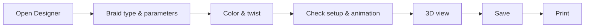

# Create and print a design

!!! example "Guide — at the end, a fully patterned design is stored in the design library and is available as a printout"

**Prerequisites:**

* You have permission to create and save designs.
* Optional: your own colors in the [Color database](../master-data/colors.md) —
  but the Designer also comes with a color palette without any preparation.

## Step 1: Open the Designer and create a new design { #schritt-1-designer-offnen-und-neues-design-anlegen }

1. Open the navigation item **Designer** (reference:
   [Designer](../designer/index.md)).
2. In the toolbar, click **New** (++ctrl+n++). An
   empty design with default values is created.

To open an existing design instead, use **Load** (++ctrl+o++) or
double-click it in the "Last edited" list. You can open two design windows
side by side to compare variants directly.

!!! tip "Guided tour"
    On your first visit, the Designer offers a
    [guided tour](../basics/guided-tour.md) that takes you step by step
    through creating a design.

## Step 2: Define braid type and parameters { #schritt-2-geflechtsart-und-parameter-festlegen }

In the left panel, set the basic data of the design: **Design name**,
**Braid type** (round braid, flat braid, square braid, spiral braid,
packing braid or soutache braid), **Braid binding**,
**Number of carriers**, **Braiding angle**
and **Ply count**. Every change rebuilds the braid pattern immediately.

All parameters and their permitted values are explained on the reference page
[Braid type & parameters](../designer/parameters.md).

## Step 3: Color and set the twist { #schritt-3-farben-und-drehung-setzen }

1. Activate the **Color** tool.
2. Select a color via **Color palette** (or a color from a library in the
   [Color database](../master-data/colors.md)).
3. In the braid pattern or in the carrier table, click the positions
   that should receive this color. Using the side filter, you can color
   only the left run or only the right run.
4. Optionally, give carriers a twist: click **Twist**, choose **S**, **Z**
   or **Untwisted** and, if needed, the **TPM**, and then click the
   carriers. A color from the palette switches back to coloring.

Undo mistakes with **Back** (++ctrl+z++). All
controls of the painting mode and the twist are described on the reference
page [Color & twist](../designer/painting.md).

## Step 4: Check setup and track animation { #schritt-4-besetzung-und-gangbahn-animation-prufen }

The setup overview shows the horngears of the machine from above with the
colors assigned to each carrier:

1. Check whether the colors sit on the carriers as you planned. You can
   keep recoloring in the braid pattern or in the carrier table; the
   overview follows immediately.
2. Start the **Track animation** with the play button: the
   carriers move across the horngears and the braid pattern builds up in sync,
   layer by layer. Control the speed with the
   speed buttons; ⏮ resets machine and build-up to the start.

Details on all buttons: reference page
[Setup & track animation](../designer/animation.md).

## Step 5: Check the 3D view { #schritt-5-3d-ansicht-kontrollieren }

Switch on the 3D view in the toolbar with the **3D** view switch (available
for all braid types except mixed designs). It shows how the pattern
continues around the finished braid strand. You choose material and form of
the model via the **Display** button — reference:
[Views and 3D view](../designer/view-3d.md).

## Step 6: Save the design in the library { #schritt-6-design-in-der-bibliothek-speichern }

1. In the header of the design window, click **Save**.
2. In the dialog, select the target folder of the design library (or create
   a new subfolder directly) and enter the design name.

To create a copy under a new name, use **Save under new
name**. Details: [Save & print](../designer/save-print.md). You will then
find the saved design in the
[design library](../master-data/designs.md) under *Master data > Designs*.

## Step 7: Print the design { #schritt-7-design-drucken }

1. In the header of the design window, click **Print**.
2. If several print templates are available, select the desired template;
   a default template matching the number of carriers (**Default Design**
   or **Default Design (high carrier count)**) is already pre-selected.
3. Check the print preview and start printing.

Details: [Save & print](../designer/save-print.md); you can design your own
templates in the [Print editor](../print-templates/index.md).

## Result { #ergebnis }

* The design is in the [design library](../master-data/designs.md) and
  appears under "Recently opened" on the [Home page](../basics/home.md).
* The printout with braid pattern, 3D view, Setup overview and setup is
  ready.
* The design can now be linked in the
  [braiding order](../orders/braiding-order.md) (**Design** tab) —
  see the workflow
  [From customer order to machine sheet](order-to-machine-sheet.md).

## If something does not work { #wenn-etwas-nicht-klappt }

* The printout looks wrong or nothing happens →
  [Print problems](../help/print-problems.md)
* You cannot create any more designs (trial version) →
  [Trial version and licence quotas](../basics/trial-quotas.md)
* Further help → [Help overview](../help/index.md) and
  [Contact support](../help/support.md)
