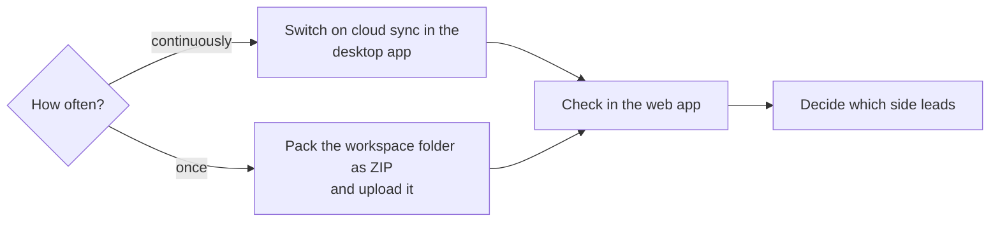
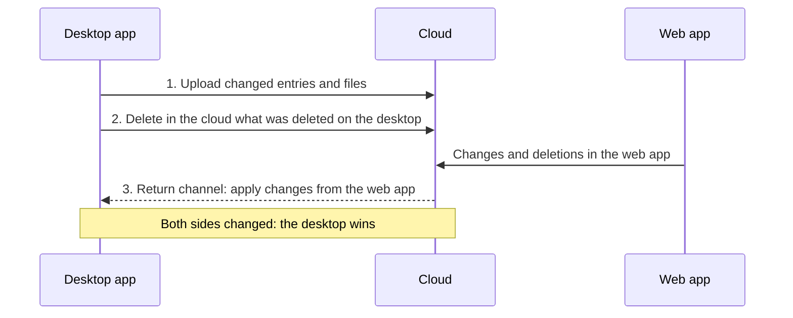

# Bring data from the desktop app into the web app

!!! example "Guide — at the end, you also see your orders, designs, machines and master data from the desktop app in the web app"

**Prerequisites:**

* Your [customer account](../setup/account.md) has an annual subscription that
  includes the web app (or the trial version), and you can sign in to the
  [web app](../web/login.md).
* For cloud sync: the desktop app is signed in to the customer account
  (version 2.0 or later) and the computer is online.
* For ZIP import: you have the
  **Workspace settings** permission in the web app (account administrators always have it).

## Which route? { #welcher-weg }

| | Cloud sync | ZIP import |
|---|---|---|
| When | The desktop app and web app should continuously show the same state; the desktop app takes precedence in case of conflicts. | One-time move or occasional update; also without a running desktop app. |
| Direction | Desktop → web automatically, shortly after saving and every 15 minutes; then web → desktop, as long as *Apply changes from the web app to the workspace folder* is on (default) | Desktop → web (upload) and web → desktop (download), each manually |
| Deletions | take effect in both directions (details under [Licence and cloud](../admin/settings/license.md#was-in-welche-richtung-geht)) | are not transferred |
| Requirement | Desktop app signed in to the account, subscription with web app; one workspace folder per account | Subscription with web app, *Workspace settings* permission |

## Route A: Switch on cloud sync { #weg-a-cloud-abgleich-einschalten }

1. In the desktop app, open *File > Settings*, **Licence** tab.
2. In the **Cloud (app.herzog-cab.com)** card, tick the option
   **Sync workspace folder with the cloud automatically**. If the
   switch is gray, the account lacks a subscription with the web app. The note
   gives the reason (reference: [Licence and cloud](../admin/settings/license.md)).
3. Leave **Apply changes from the web app to the workspace folder**
   ticked if people also work in the web app;
   untick it if only the desktop app should change data.
4. Check the **In the cloud:** line — the first time, it shows
   *No workspace folder yet – the first sync sets it.*
5. Click **Sync now**. The status changes from
   *Reading the workspace folder …* via *Syncing …* to
   *Last synced: &lt;time&gt;*.
6. Click **Save**.

From now on, the desktop app syncs every saved change on its own.

## Route B: Import the workspace as ZIP { #weg-b-arbeitsbereich-als-zip-importieren }

1. Locate the workspace folder: *System administration > Storage location*,
   section **Workspace** (reference: [Storage location](../admin/storage-location.md)).
2. Pack the folder as a ZIP — in Windows Explorer, right-click,
   *Send to > Compressed (zipped) folder*. You can leave out large subfolders such as
   `machines/`.
3. Sign in to the web app and open *User menu > Import
   from the desktop app* (reference: [Import from the desktop app](../web/import.md)).
4. Select the ZIP file, if needed **Data only, no images and
   documents**, and click **Import**.
5. Check the **Result**: for each data type, the number of created,
   updated and unchanged entries as well as errors.

The import can be repeated at any time; identical entries are updated
according to their modification date, nothing is deleted.

## Check in the web app { #in-der-web-app-prufen }

Open the [Home page](../web/start.md) — the **Overview** card shows
the state with **Orders**, **Designs**, **Machines** and **Customers**.
Spot checks:

* [Orders](../web/orders.md): open a braiding order with a design — the
  **Design** tab shows the preview and the carrier table.
* [Designs](../web/designer.md): preview images and folders are correct.
* [Machines](../web/machines.md): images are present (otherwise they were skipped
  during the import).
* [Print](../web/print.md): your print templates are listed under
  **Choose print template**.

## Decide how both work together { #festlegen-wie-beide-zusammenarbeiten }

Cloud sync first uploads and then fetches the changes from the
web app; if both sides change the same entry, the desktop app wins:

Choose one of these ways of working:

* **Both work** (default): sync on, *Apply changes from the web app
  to the workspace folder* on. Orders, designs, master data,
  machines, hall plans and files from the web app arrive in the
  workspace folder, including deletions. Agree on who
  edits which entry.
* **Desktop leads**: sync on, return route off. The web app is used to
  look things up, calculate and print; anything changed there remains in the
  cloud until the desktop app changes the same entry and overwrites it.
* **Web app leads** (without a running desktop app): sync off; the
  desktop app fetches the state when needed via **Download workspace as ZIP**
  and unpacks it into its own workspace folder.

## Result { #ergebnis }

The web app shows your workspace; with cloud sync, the time of the last sync
is shown under *Settings > Licence*.

## If something does not work { #wenn-etwas-nicht-klappt }

* Switch gray, note *This requires the “Herzog CAB Web” module
  (subscription) on the account* → order the annual subscription in the web app under
  [Subscription and order](../web/subscription.md). The subscription includes
  the program and the web app.
* *Error: No connection to the server* → check internet, proxy and firewall
  (`app.herzog-cab.com`, HTTPS).
* *The customer account sign-in is no longer valid* → restart the desktop app
  and sign in to the account.
* *This account is already synced from the workspace folder “…” …* → The
  account is already syncing with another workspace folder (profile).
  Work in that one, or rebind the cloud with **Use this workspace folder
  instead …** (*Manage workspace* permission).
* ZIP upload fails → exclude the `machines/` folder or select **Data only**;
  upload images later via the [Media library](../web/media.md).
* Entries are missing in the web app → quantity limits apply during the trial period,
  for example at most 2 designs and 4 orders ([Trial period](../web/trial.md)).
