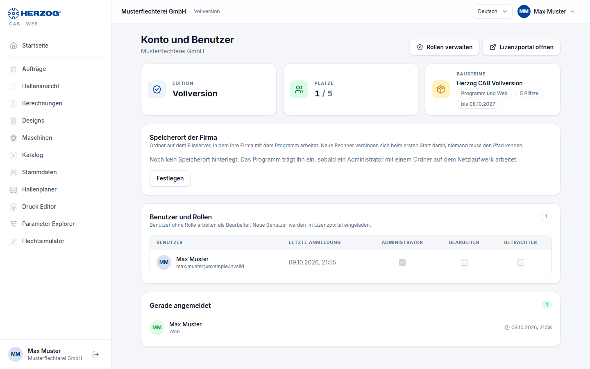

# Account and users (web app)

!!! abstract "Reference — The "Account and users" page in the user menu of the web app: edition, modules, seats, company storage location, users and their roles"

## What you use this area for { #wofur-sie-diesen-bereich-nutzen }

Here you see what your account has enabled in the web app and who is
currently working with it — and administrators assign the users their
**roles for the web app**. Inviting new users and managing passwords and
computers is still done in the [licence portal](../portal/index.md); the
page links to it.

You open the page via *User menu > Account and users* or the
**Account and users** tile on the home page.

## The screen at a glance { #der-bildschirm-im-uberblick }

| Element | Meaning |
|---|---|
| **Manage roles** | To the right of the page title, only with the permission *Manage roles*: switches to [Roles](roles.md). |
| **Open licence portal** | Opens [license.herzog-cab.com](https://license.herzog-cab.com) in a new tab. |
| **Edition** | Which subscription you are working with: *Full version*, *Designer* or *Trial version*. For internal accounts the note *internal account*. |
| **Seats** | Occupied and available seats, for example *2 / 3*. Program and web app are counted together. |
| **Modules** | The modules that open the web app, with the number of seats and the term (*until &lt;date&gt;* or *Lifetime*). *Program and web* means: one quota for the desktop app and web app together. |

### Company storage location { #speicherort-der-firma }

The folder on your file server in which the company works with the desktop app,
e.g. `\\fileserver\freigabe\HerzogCAB`. A new computer
connects to it on first start without anyone needing to know the path
(see [First start](../setup/first-run.md#kundenkonto-arbeitsverzeichnis-der-firma)).
Usually the desktop app enters the folder itself as soon as an administrator
works there.

| Element | Meaning |
|---|---|
| Path and *set …* | The stored folder and when it was last set. Without an entry, it shows *No storage location stored yet*. |
| **Set** / **Change** | Opens the **Network path** field. Only network paths such as `\\server\freigabe\ordner` are allowed, no drive letters. **Save** applies, **Cancel** discards. |
| **Remove** | Deletes the entry. New computers then ask for the folder again. |

Only users with the permission
**Workspace settings** (e.g. administrators) may set, change and remove the folder; everyone else only sees
the folder.

### Users and roles { #benutzer-und-rollen }

The table lists all users of the account with **Name**, **Email**,
**Last sign-in**, the indicator **Currently signed in** or *inactive*
and one **checkbox** per role.

* **Assign role:** Users with the permission *Manage users* check or uncheck
  the boxes; the change applies immediately. A user can have several
  roles — the permissions add up.
* **Without a role**, a user works as an **Editor**.
* The **Administrator** role always has all permissions.

So that nobody grants themselves more permissions than they have, three rules apply.
If a change violates them, the web app rejects it with a red
message.

* Your **own** roles are changed by another administrator. In your
  own row the checkboxes are locked.
* You can only assign or withdraw a role if you yourself have **all its
  permissions**. Anyone who has more permissions than you cannot be
  downgraded either.
* The account always keeps at least **one administrator** (*The account
  needs at least one administrator.*).

The same rules apply in the [licence portal](../portal/users.md).

### Currently signed in { #gerade-angemeldet }

The card at the bottom of the page lists who is currently occupying a seat and where:
computer name, *Web* or *(offline)*, plus the time of the last
activity. The number in the card title gives the occupied seats. The list
reloads every minute.

!!! info "Two places, one user"
    The account role (Administrator / Editor / Viewer) is assigned in the
    [licence portal](../portal/users.md); it applies in the desktop app and web app.
    The checkboxes here supplement it with **web app roles** with individual
    permissions — useful if, for example, sales should only see designs and orders.

## Related pages { #verwandte-seiten }

* [Roles (web app)](roles.md) — custom roles with individual permissions
* [Inviting and managing users (licence portal)](../portal/users.md)
* [Subscription and orders](subscription.md): ordering and renewing an annual subscription
* [Customer account and invitation](../setup/account.md)
