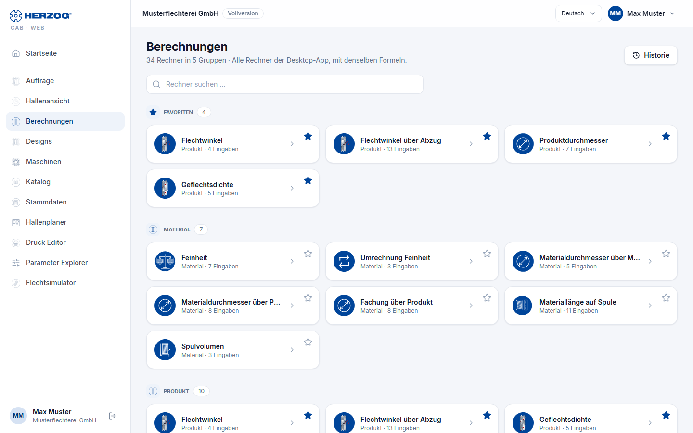
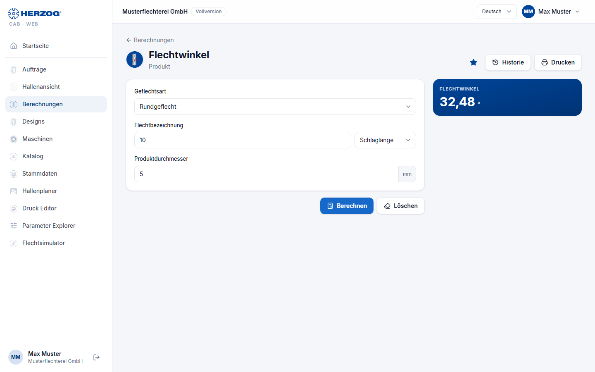

# Calculations (web app)

!!! abstract "Reference — The Calculations module of the web app: calculator overview with search, favorites and history, and the calculator page"

## What you use this area for { #wofur-sie-diesen-bereich-nutzen }

The web app contains all calculators of the desktop app in the same five
groups — Material, Product, Hollow braid, Production and Winding —,
including **Braiding angle from take-up** and
**Drum and take-up winder selection** (as of 30.09.2026: 34 calculators; the current
number is shown below the page title). Inputs, selection fields, units,
formulas and results are the same as in the desktop app; the meaning
of each field is described on the reference page of the respective calculator in the chapter
[Calculations](../calculations/index.md). This page only describes
operation in the browser.

!!! info "Difference from the desktop app"
    In the web app, favorites, the calculation history and the most recently entered
    values belong to your user and apply on every
    device. In addition, there is a search across all calculators.
    **Product length per drum** keeps the three dimension fields in the browser
    (*Outer diameter*, *Core diameter*, *Winding length*): the selection
    **Drum:** fills them from the [drums](master-data.md#trommeln); with
    *Own dimensions* you enter them yourself. In the desktop app, the
    dimensions have come only from the selected drum since version 2.1.0.

## Calculator overview { #rechnerubersicht }

| Element | Meaning |
|---|---|
| Subtitle | Number of calculators and groups, plus *All calculators of the desktop app, with the same formulas.* |
| **History** | Opens the latest calculations (at most ten) with result and time; a click opens the calculator with the inputs used at the time and recalculates. |
| **Search calculators …** | Filters the tiles live by the name of the calculator. If nothing matches, the page reports *No calculator matches "…"*. |
| **Favorites** | Group at the very top with your favorite calculators, as soon as you have marked at least one. |
| Groups | **Material**, **Product**, **Hollow braid**, **Production**, **Winding** — each with its calculator tiles (icon, name, number of inputs). |
| Tile | A click opens the calculator page. The star at the top right (**Add to favorites** / **Remove favorite**) adds the calculator to the favorites or removes it again. |

## Calculator page { #rechnerseite }

| Element | Meaning |
|---|---|
| **Calculations** (arrow) | Back to the calculator overview. |
| Star, **History** | As in the overview: set or remove a favorite, open the latest calculations. |
| **Inputs** | All input fields with unit; selection fields such as *Select material …* and *Select bobbin …* access your [master data](master-data.md). A small image next to some fields explains the quantity (e.g. the braiding angle). |
| **Unit** | Where the desktop app has a unit switch (e.g. fineness in tex, dtex, den, Nm, Ne), it is also available here. |
| **Calculate** | Runs the calculation. Missing or invalid inputs are marked at the field. |
| **Delete** | Resets all inputs to the default values. |
| **Result** | The result values with unit — the same values and decimal places as on the desktop. Calculators with a table (e.g. *Drums and reels* of the drum and take-up winder selection) show it below. |
| **Print** | Prints inputs and result via the browser (see [Print](print.md)). |

The web app remembers the most recently entered values per calculator for your
user, also across devices; the result is kept when switching
between pages. **Delete** resets the inputs. Every
calculation with a result is added to the history — except for the two
converters (*Fineness conversion*, *Braid density conversion*) and
*Machine sizing*, as in the desktop app.

!!! info "Braiding angle to the cross direction or to the braid axis"
    Whether angle fields and results are measured against the cross direction (Herzog) or
    against the braid axis (technical literature) is set
    under [Settings](settings.md#flechtwinkel). If you point to
    an angle, a tooltip shows both values. The small
    explanatory image at the field also follows the choice.

!!! tip "Calculators from within the order"
    In the [braiding order](orders.md) and [winding order](orders.md), the
    calculator icons next to the fields open the same calculator as a dialog —
    prefilled with the order values and with **Apply** back into the
    order.

## Related pages { #verwandte-seiten }

* [Calculations (reference of all calculators)](../calculations/index.md)
* [How calculation pages are structured](../basics/calc-page-anatomy.md) — structure in the desktop app
* [Calculating material correctly](../tasks/material-calculation.md)
