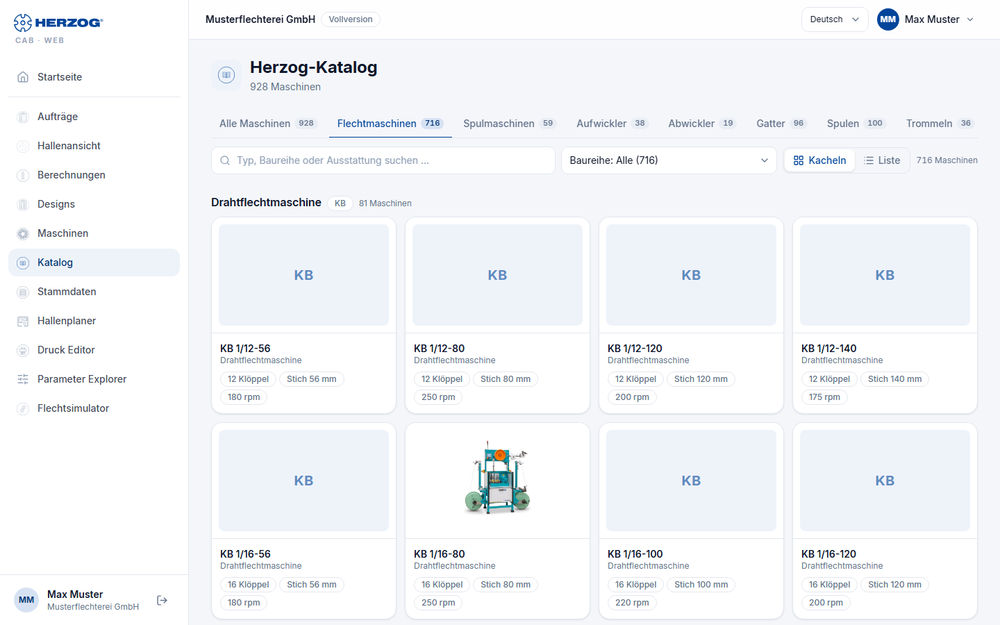

# Herzog catalogue (web app)

!!! abstract "Reference — The Herzog catalogue of the web app: view Herzog's machine models, bobbins and drums and adopt them directly as your own machine"

## What you use this area for { #wofur-sie-diesen-bereich-nutzen }

The Herzog catalogue contains Herzog's models: braiding machines,
bobbin winding machines, take-up winders, pay-offs and creels, as well as bobbins and drums.
You view a model with its technical data and create it as your own machine with
a few clicks. The technical data (heads, carriers, pitch,
speed, winding technology, drum and creel data) and the image come from
the catalogue; you only select accessories, take-off and setup and enter group,
serial number and name.

!!! info "Who sees the catalogue"
    The Herzog catalogue is available to all accounts with machines; it does not exist in
    Herzog CAB Designer. In the program you also find it from
    version 2.1.0, as a separate item **Catalogue** below the
    Machine Fleet — see [Herzog catalogue (desktop app)](../catalog/index.md).

## The overview { #die-ubersicht }

| Element | Meaning |
|---|---|
| Tabs | **All machines**, **Braiding machines**, **Bobbin winding machines**, **Take-up winders**, **Pay-offs**, **Creels**, **Bobbins** and **Drums**, each with the number of entries. |
| **Search** | Filters by type, series or equipment; for bobbins and drums by dimension, material, carrier or article number. |
| **Series** | Narrows the list down to one series (e.g. *Wire braider · KB*); the number is shown in brackets. |
| **Tiles** / **List** | Cards with image and key figures, or a table whose columns can be sorted by clicking the heading. The choice is saved. |
| Card / row | A click opens the details of the model. |

## Details of a machine model { #details-eines-maschinenmodells }

!!! warning "📷 Screenshot fehlt"
    **Motiv:** Die Details der Feindrahtflechtmaschine KB 1/12-80: Kennzahlen, Technische Daten, Lieferumfang, darunter Zubehör zum Ankreuzen und Abzug und Aufnahme mit Auswahlkreisen.
    **So erzeugen:** `python _tools/web_screenshots.py shots nur:katalog-dialog` (nach `login`).
    **Ziel-Datei:** `assets/screenshots/web/katalog-dialog.png`
    <!-- web-bild ../assets/screenshots/web/katalog-dialog.png -->

From top to bottom, the details show:

| Area | Content |
|---|---|
| **Head** | Image (if available), series, model designation and the key figures per machine type — braiding machine: **Carriers** (with number of braiding heads), **Pitch**, **Speed**, **Bobbin**; bobbin winding machine: **Winding heads**, **Bobbin size**, **Traverse width**, **Speed**; take-up winder: **Drum diameter** or **Reel diameter** and **Reel volume**, **Traverse width**, **Load capacity**, **Braid diameter**; pay-off: **Drum diameter**, **Drum width**, **Load capacity**, **Material diameter**; creel: **Pay-off positions**, **Pay-off**, **Bobbin**. |
| **Technical data** | The remaining data of the model (e.g. carrier type, traversing, control, version). The **Occupation** of a braiding machine is only shown here if there is no choice — otherwise you select it below when creating the machine. |
| **Matching bobbin** | Braiding machines only: the catalogue bobbin with the dimensions of the machine. A click shows its details; there you adopt it into your bobbins with **Add to bobbins**. |
| **Included in delivery** | What belongs to the machine as standard. |
| **Accessories** | The available accessories, grouped (e.g. *Monitoring and control*, *Guarding and cabin*). Check what your machine has — **ticked accessories are added to your own machine**. A click anywhere on the row sets or removes the check mark; checked rows are highlighted. |
| **Take-up and winding** | Braiding machines only: the take-off and winding variants with their dimensions. Exactly one is selected (radio button); the first one (standard) is preselected. **The selected take-up is added to your own machine.** |
| **Notes** | Additional information, e.g. for take-up winders. |

Without the permission *Edit master data*, accessories and take-off can only be viewed,
and the area for creating the machine is missing.

## Creating as own machine { #als-eigene-maschine-anlegen }

!!! warning "📷 Screenshot fehlt"
    **Motiv:** Der untere Teil der Details: Zubehör mit zwei angekreuzten Einträgen, gewählter Abzug, darunter „Als eigene Maschine anlegen" mit Besetzung, Maschinengruppe, Seriennummer und Name; unten rechts **Zu Flechtmaschinen hinzufügen**.
    **So erzeugen:** `python _tools/web_screenshots.py shots nur:katalog-anlegen` (nach `login`).
    **Ziel-Datei:** `assets/screenshots/web/katalog-anlegen.png`
    <!-- web-bild ../assets/screenshots/web/katalog-anlegen.png -->

At the end of the details you only enter what the catalogue cannot know:

| Field | Meaning |
|---|---|
| **Occupation** | Only for braiding machines with several setups: **Standard setup**, **Half setup** or **Tandem setup** side by side to click. The setup with which the machine usually runs is preselected. |
| **Machine group** | Freely assignable grouping (e.g. *Production North*). |
| **Serial number** | Serial number of your machine. |
| **Name in braiding machines** | The name in the Machine Fleet, prefilled with the catalogue name. For the other machine types the field is called **Name in winding machines**, **Name in take-up winders**, **Name in pay-offs** or **Name in creels**. |

| Button | Effect |
|---|---|
| **Product page** | Opens the product page of the model on herzog-online.com (not for all models). |
| **Add to braiding machines** | Creates the machine immediately in the [Machine Fleet](machines.md) — with the technical data and the image from the catalogue, the checked accessories, the selected take-off and the selected setup. For the other machine types the button is called **Add to winding machines**, **Add to take-up winders**, **Add to pay-offs** or **Add to creels**. A message confirms the creation, and the details close. |

!!! info "Assigning bobbins"
    A braiding machine created from the catalogue does not have a bobbin yet.
    Open it in the Machine Fleet and select at least one in the **Technical** tab under
    **Bobbins** — without a bobbin, the machine page reports
    *Please select at least one bobbin.* when saving.

!!! tip "Adding details later"
    You change location, year of manufacture, dimensions, documents and all technical values
    afterwards on the [machine page](machines.md#maschinenseite).
    Accessories and take-off can also be adjusted there.

## Bobbins and drums { #spulen-und-trommeln }

The **Bobbins** and **Drums** tabs list Herzog's bobbins and drums
with dimensions, material and article number. The details show the
technical data; **Add to bobbins** or **Add to drums**
adopts the entry into your [master data](master-data.md). If it is already
there, the dialog says so and the button stays gray.

## Related pages { #verwandte-seiten }

* [Machines (web app)](machines.md) — Machine Fleet and machine page
* [Braiding machines (master data)](../master-data/braiding-machines.md) · [Bobbin winding machines (master data)](../master-data/winding-machines.md) — meaning of the machine data
* [Master data (web app)](master-data.md) — bobbins and drums
* [Herzog catalogue (desktop app)](../catalog/index.md) — the same catalogue in the program
