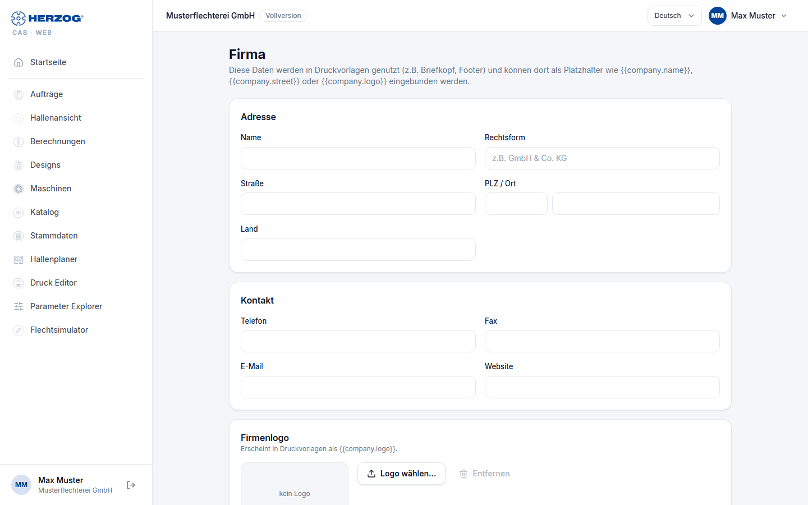

# Company (web app)

!!! abstract "Reference — The "Company" page in the user menu of the web app: company data and logo for print templates"

## What you use this area for { #wofur-sie-diesen-bereich-nutzen }

The company data appears on printouts — as a letterhead, in the footer
or wherever a print template uses the placeholders `{{company.name}}`,
`{{company.street}}`, `{{company.logo}}` etc. The page corresponds to
[Company](../admin/company.md) in the system administration of the desktop app; both
write the same workspace data.

You open the page via *User menu > Company*. To make changes you need
the permission **Manage company data**; otherwise the page is read-only.

## The screen at a glance { #der-bildschirm-im-uberblick }

| Card | Fields |
|---|---|
| **Company** | **Name**, **Legal form**. |
| **Address** | **Street**, **ZIP / City**, **Country**. |
| **Contact** | **Phone**, **Fax**, **Email**, **Website**. |
| **Legal** — Taxes & commercial register | **VAT ID**, **Tax number**, **Commercial register no.**, **Register court**, **Managing director**. |
| **Company logo** | Preview of the logo; **Choose logo…** uploads an image or selects one from the [media library](media.md), **Remove** deletes the assignment. Appears in print templates as `{{company.logo}}`. |

**Save** applies all cards; the confirmation reads *Company data
saved.*

## Related pages { #verwandte-seiten }

* [Company (desktop app)](../admin/company.md)
* [Printing (web app)](print.md)
* [Elements and placeholders (print editor)](../print-templates/elements.md) — the placeholders in detail
