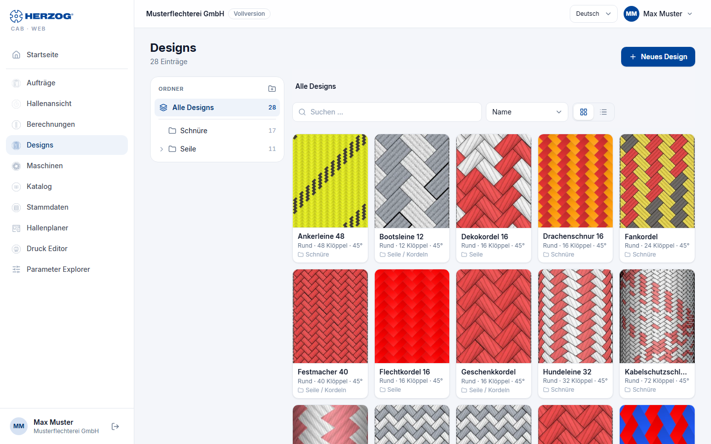
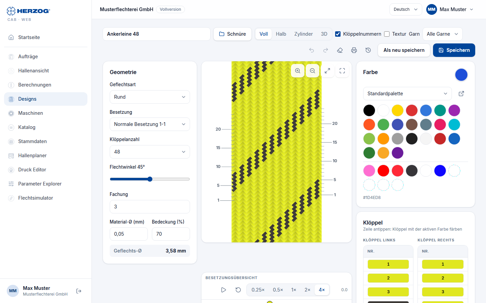
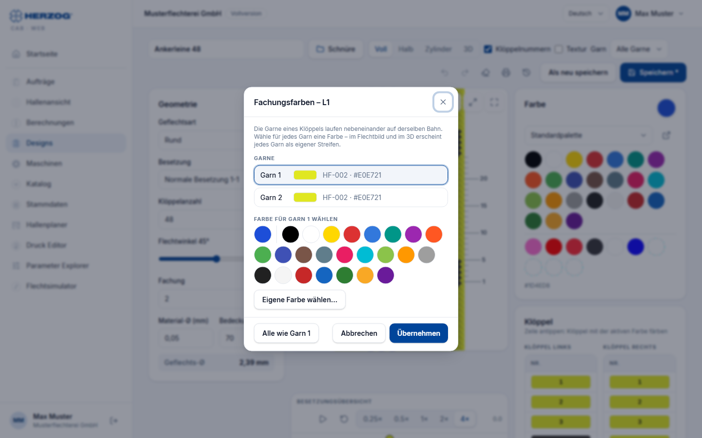

# Designs and Designer (web app)

!!! abstract "Reference — The Designs module of the web app: design library and the Designer with geometry, braid pattern, colors, carrier table, setup overview and 3D view"

## What you use this area for { #wofur-sie-diesen-bereich-nutzen }

Under **Designs** you find the design library of your account; clicking
a design opens the **Designer**. Like the desktop app, it handles all
six braid types (round, strand, square, spiral, packing, soutache) with
their interlacings, draws the same braid pattern, shows the setup overview
with track animation and the true 3D model of the braid. What the
individual parameters mean is described in the reference of the desktop Designer
([Braid type and parameters](../designer/parameters.md)); this page is about
operation in the browser.

## Design library { #design-bibliothek }

| Element | Meaning |
|---|---|
| **New design** | Creates a new design with default values and opens the Designer. |
| **Folder** (tree) | On a wide screen on the left: **All designs**, **No folder** and your folders with the number of designs. A folder shows its subfolders and the designs directly in it. On narrow screens, the button with the folder name above the list opens the tree. |
| Folder actions | With the permission *Edit designer*, next to the path of the selected folder: **New folder**, **Rename folder**, **Copy folder** and **Delete folder**. When a folder is deleted, the designs in it move to the parent folder. |
| **Search …** | Filters by name, in the selected folder or across all designs. |
| **Sort** | **Name**, **Last edited** or **Braid type**. In the list you can also sort via the column headers. |
| **Tiles** / **List view** | Narrow tiles with a large preview or a table with a small preview, braid type, number of carriers, angle, folder and date of the last change. The choice is stored in this browser. |
| Entry | Preview image (*no preview* as long as the design has never been saved), name, braid type, number of carriers and braiding angle. A click opens the design. |
| Checkbox and selection bar | With the checkbox on an entry you select designs. The bar at the bottom then offers **Move to …**, **Copy to …**, **Rename** (for one design) and **Delete**. On a computer, designs can also be dragged onto a folder in the tree. |
| **Delete** | Removes the design after a confirmation prompt. It goes to the [recycle bin](versions.md#papierkorb) and can be restored from there. |

Designs from the desktop app appear here with their folder after the
[import](import.md) or the cloud upload.

## The Designer at a glance { #der-designer-im-uberblick }

On the desktop the Designer has three columns: **Geometry** on the left, **Braid pattern**
with **Setup overview** in the middle, **Colors** and **Carrier table**
on the right. On tablet and smartphone the braid pattern is at the top in full
width; below it the tabs **Geometry**, **Colors** and
**Overview** switch between the areas.

### Header and toolbar { #kopfzeile-und-werkzeugleiste }

| Element | Effect |
|---|---|
| **Product name** | Name of the design (header). |
| **Storage location** (folder button next to the name) | Shows the folder of the design in the library or *No folder*. A click opens the folder tree for selection. |
| **View**: **Full** or **Braid pattern** / **Half** / **Cylinder**, **Square** or **Edge** / **3D** | *Full* unrolls the full circumference flat (development); for strand, spiral and soutache the button is called *Braid pattern*. *Half* (round braid only) shows half of the development, i.e. the front side. *Cylinder* (round), *Square* (square braid) or *Edge* (packing) projects the development rotatably onto the body. *3D* shows the true model from the carrier tracks (see below). |
| Rotate left / right | Only in the projection: rotates the body by 15° per click; holding the button keeps rotating. |
| **Carrier numbers** | Shows or hides the carrier labels in the braid pattern. |
| **Texture** | Fills the tiles of the braid pattern with a fiber texture instead of a plain color. |
| **Yarn** | Only from ply count 2: which yarn a click colors (see [Plying colors](#fachungsfarben-farbe-je-garn)). |
| **Undo** / **Redo** | Undo or redo coloring steps. |
| **Clear all colors** | Sets all carriers to uncolored. |
| **Print** | Opens the [print page](print.md) with the design template. |
| **Versions** (icon) | View and restore earlier versions of the design, see [Versions and recycle bin](versions.md). Appears as soon as the design has been saved. |
| **Zoom in** / **Zoom out** / **Fit** | Zoom of the braid pattern; in addition mouse wheel (two fingers on a touchscreen) and dragging with the mouse button held down. |
| **Save** / **Save as new** | Saves the design or creates a copy under a new name. Saving creates the preview image for the library. If you come from an order, the button is called **Save & return** and links the design to the order. |

### Geometry { #geometrie }

| Field | Meaning |
|---|---|
| **Braid type** | Round braid, Flat braid, Square braid, Spiral braid, Packing braid, Soutache braid. |
| **Track type** | Packing braid only: family (2-, 3-, 4-track, round). |
| **Setup** | Interlacing: normal, half, tandem etc. — depending on the braid type. |
| **Number of carriers** | Drop-down list with the permissible numbers of carriers for the selected braid type and interlacing. |
| **Braiding angle** | Slider; affects the braid pattern and, live, the 3D view. |
| **Ply count** | Number of threads (yarns) per carrier, 1 to 12. From 2, each yarn can get its own color, see [Plying colors](#fachungsfarben-farbe-je-garn). |
| **Core threads** | Soutache only: cores through the gear axes. |
| **Material Ø** / **Covering %** | Material diameter and covering; in the 3D view the covering controls the drawn yarn thickness. |

The meaning of these parameters per braid type is explained in
[Braid type and parameters](../designer/parameters.md).

### Colors and carrier table { #farben-und-kloppeltabelle }

* **Color:** The color palette from your [color master data](master-data.md)
  and **Custom color** (color picker). The active color is highlighted.
* **Color:** Click a tile in the **Braid pattern** or a
  row of the **Carrier table** — the carrier (for round and square braid:
  index and running side) takes on the active color. With the mouse button held down
  you color several rows of the table in one go. When pointing at a
  tile, a tooltip names the carrier.
* **Carrier table** (**Carriers** card): one row per carrier with the
  carrier number on its color. For round and square braid,
  **Carriers left-run** and **Carriers right-run** are separate columns side by side,
  for packing and spiral one column per **track**; if the card is narrow,
  they are shown one below the other. Where a carrier sits on the machine is shown by the
  setup overview. The assignment later appears like this in the order and on
  the printout.

### Plying colors: color per yarn { #fachungsfarben-farbe-je-garn }

With a **Ply count** of 2 or more, several yarns run side by side on each carrier.
Each of these yarns can get its own color, for
example a black and a white yarn on the same carrier. Yarn 1
carries the color of the carrier; without separate colors, all yarns run in
this color.

You color yarns in two ways:

=== "With the yarn selector"

    1. In the toolbar under **Yarn**, select the yarn, for
       example **Yarn 2**. The selection only appears with a ply count of 2 or more and
       with the permission *Edit designer*.
    2. Select the color in the palette.
    3. Click rows of the carrier table or tiles in the
       braid pattern. Only the selected yarn changes; the other yarns
       keep their color.

    With **All yarns**, a click colors the whole carrier again: all
    yarns get the new color.

=== "With the "Plying colors" dialog"

    1. Right-click a row of the
       carrier table. On a tablet or smartphone, keep your finger
       on the row a little longer.
    2. The dialog **Plying colors – &lt;carrier&gt;** lists the yarns
       (**Yarn 1**, **Yarn 2** …) with their color. Tap the yarn
       that you want to change.
    3. Below it, select the color: the **Active color** on the far left, a
       color of the palette or any color via **Choose custom color…**.
    4. Click **Apply**.

    **All like yarn 1** gives all yarns the color of yarn 1 again.
    **Cancel** closes the dialog without changes.

**Undo** and **Redo** also undo yarn colors. This is how
the yarn colors appear:

| Location | Display |
|---|---|
| Carrier table | The cell is striped lengthwise, yarn 1 on the left. When pointing at the row, a tooltip names the color of each yarn. |
| Braid pattern | Each tile is divided into stripes per yarn along the thread, in all views and also with **Texture**. Thin dividing lines always show the ply count, even if all yarns have the same color. |
| Setup overview | The carrier dot is divided into circle segments per yarn. |
| 3D view | Each yarn as a separate thread in its color. Separate colors exist for at most twelve yarns. |
| Print | The carrier list shows the stripes and the color per yarn; the braid pattern and overview are colored as in the Designer. |

!!! info "Desktop app"
    The yarn colors are saved with the design. The desktop app shows
    them from version 2.1.1 on.

### Setup overview { #besetzungsubersicht }

The top view of the machine with horngears and carriers below the
braid pattern — with **Track animation** (**Stop**, **Back to
start**, **Speed**). If the animation runs in the 3D view, the
braid grows in sync. Details on the overview:
[Setup and track animation](../designer/animation.md).

### 3D view { #3d-ansicht }

The **3D** view shows the braid as a spatial model — each thread
as a tube, over/under from the kinematics of the setup overview, in the
carrier colors. It works for all six braid types (except mixed
designs).

| Element | Effect |
|---|---|
| **Top view** / **Side view** / **Braiding point** | Three fixed camera views: cross-section, the whole braid from the side, close-up of the point where the braid is formed. |
| **Lock** | Locked: mouse and fingers do not rotate, the mouse wheel zooms. Open: the left mouse button rotates, the right one pans, a double-click restores the selected view. |
| **Material** | Smooth filament, twisted yarn, wire or a simple light version. |
| **Display** | Default of the braid type, *Interlacing only (schematic)*, *Automatic* or *As the machine is arranged* — determines whether the cross-section is derived from the tracks or idealized. |
| **Covering** | Line *Covering n % (yarn thickness m %)*: the yarn thickness follows the covering of the design. |

The 3D view applies color changes immediately; the number of carriers, interlacing and angle
rebuild the model (with large machines this takes a moment,
*Building up braid …*). The browser needs WebGL — if it is missing, the view reports
*"This browser cannot render WebGL."*

!!! info "Difference from the desktop app"
    The web app shows one design per page — the two-window comparison of the
    desktop app does not exist. The web app displays mixed designs made of round and strand sections;
    they can only be created in the desktop app.
    You set the [twist](../designer/painting.md#drehung-s-z-oder-gerade) per
    carrier in the desktop app.
    On the other hand, the web app already has the [plying colors](#fachungsfarben-farbe-je-garn)
    and the [Versions](versions.md) dialog.

## Related pages { #verwandte-seiten }

* [Designer (desktop app)](../designer/index.md) — reference with all details
* [Braid type and parameters](../designer/parameters.md)
* [3D view (desktop app)](../designer/view-3d.md)
* [Designing and printing a design](../tasks/design-from-scratch.md)
* [Printing (web app)](print.md)
* [Versions and recycle bin](versions.md)
