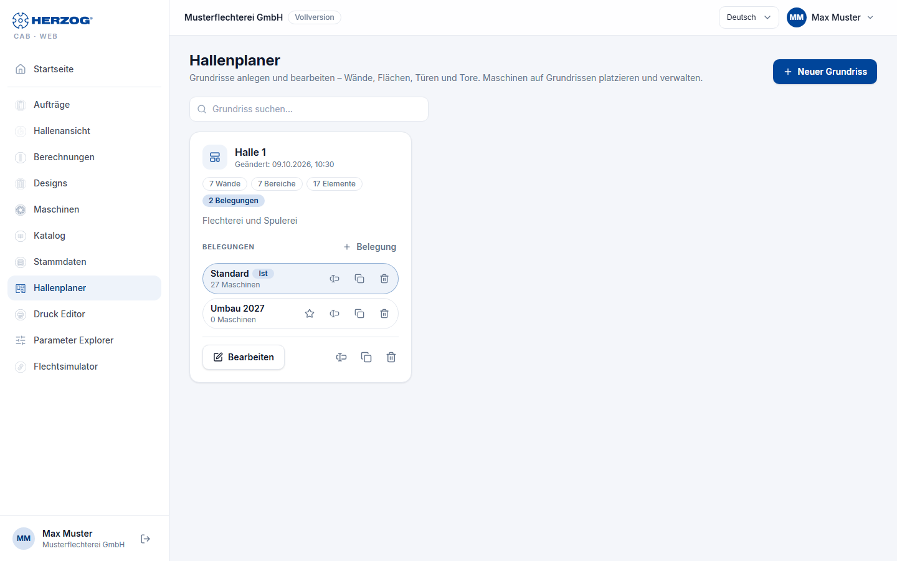
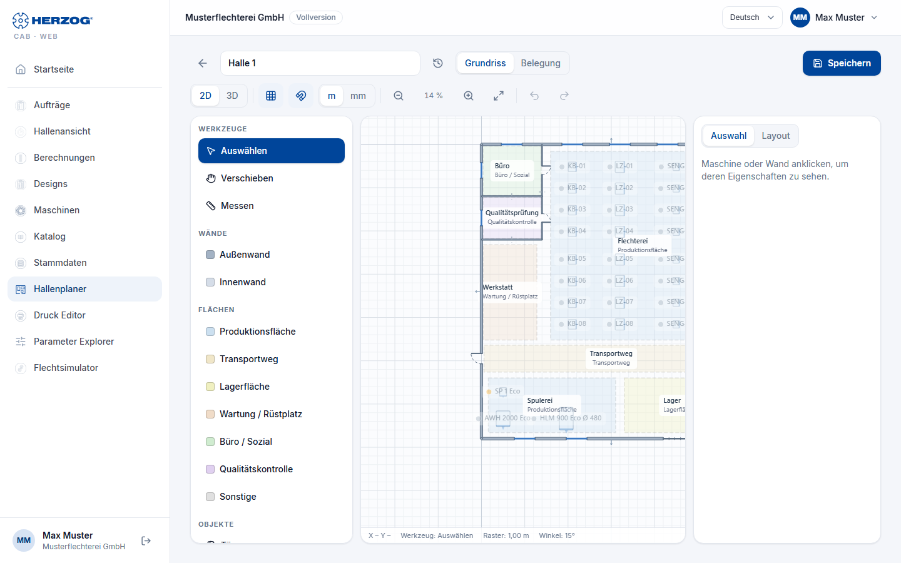

# Factory Planner (web app)

!!! abstract "Reference — The Factory Planner module of the web app: managing floor plans and assignments, the 2D editor and the 3D view"

## What you use this area for { #wofur-sie-diesen-bereich-nutzen }

The Factory Planner represents your production hall: a **Floor plan** (walls,
areas, doors, gates, windows, stairs) and on it any number of
**Assignments** — scenarios of which machine stands where. An assignment can be
marked as **Current**. The model corresponds to the desktop app
([Factory Planner](../hall-planner/index.md)); this page is about operation
in the browser.

## Overview of the floor plans { #ubersicht-der-grundrisse }

| Element | Meaning |
|---|---|
| **New floor plan** | Asks for the name (hall / area) and opens the editor. |
| **Search floor plan…** | Filters the list. |
| Floor plan card | Name, date of change, number of walls, areas and elements, and the associated **Assignments**. |
| **Edit** | Opens the floor plan in the editor (*Floor plan* mode). |
| **Rename…** / **Duplicate…** / **Delete…** | Deleting also removes all assignments of the floor plan; the machines remain in the master data. The floor plan and assignments go to the [recycle bin](versions.md#papierkorb). |
| **New assignment / scenario** | Creates an assignment for the floor plan (name, e.g. *Variant*). |
| Assignment: **Set up** | Opens the assignment in the editor (*Assignment* mode). |
| Assignment: **Set as actual assignment** | Marks the assignment as the current layout (*Current*). |

!!! info "Layouts in the old format"
    Layouts from older desktop versions contain the floor plan and machines
    in one file. **Split** turns this into one floor plan and one
    assignment *Standard* — like the migration in the desktop app.

## The editor { #der-editor }

At the top is the **header** with the name of the floor plan and the switch
**Floor plan** / **Assignment**, below it the **toolbar**. On the left,
in *Floor plan* mode, is the **Tools** palette (tools, walls, areas,
objects), in *Assignment* mode the **Catalogue** of your machines; in the middle
the **drawing area**, on the right the tabs **Selection** (properties of the
selected object) and **Layout**. At the bottom, a status line shows the
mouse position, the tool, the grid and, when measuring, the length.

### Toolbar { #werkzeugleiste }

| Element | Effect |
|---|---|
| **Floor plan** / **Assignment** | Mode: edit the floor plan or place machines. In Assignment mode you select the assignment next to it (*Current* marked). |
| **2D** / **3D** | Drawing view or the interactive 3D view (see below). |
| Grid / snap | Show or hide the grid, switch snapping to the grid on or off. |
| **Unit** | Meters or millimeters. |
| **Zoom out** / **Zoom** / **Zoom in** / **Fit** | Zoom of the drawing area (also mouse wheel or two fingers). |
| **Undo** / **Redo** | Editing steps. |
| **Edit** | With a selection: rotate 90° left/right, duplicate or delete the selection; with several machines, distribute evenly horizontally/vertically and line them up. |
| **Save** | Saves the floor plan or assignment (*Save current layout*). |
| **Versions** (icon in the header) | Earlier versions of the floor plan (*Floor plan* mode) or of the selected assignment (*Assignment* mode), see [Versions and recycle bin](versions.md). |

### "Tools" palette (Floor plan mode) { #palette-werkzeuge-modus-grundriss }

| Group | Tools |
|---|---|
| **Tools** | **Select** (select, move, mark objects), **Move** (hand: drag the view), **Measure** (click two points — the length appears at the bottom). |
| **Walls** | Draw **Exterior wall** and **Interior wall** as a chain of clicks; right-click or ++esc++ ends it. |
| **Areas** | Production area, transport route, storage area, maintenance, office, quality control …: click the corner points, click the first point again to close. |
| **Objects** | Place **Door**, **Gate**, **Window** on a wall; **Stairs** on a free spot; **Banner / logo**. |
| **Set scale** | Click a reference distance on the floor plan image and enter the actual length in meters. |

### "Catalogue" palette (Assignment mode) { #palette-katalog-modus-belegung }

Your **Braiding machines** and **Bobbin winding machines** from the
[Machine Fleet](machines.md) with search field and type filter. Drag a
machine into the floor plan or place it in the center of the view by double-clicking.
Machines without dimensions are marked *Dimensions missing* —
add length and width on the machine page.

### "Selection" tab { #reiter-auswahl }

Properties of the selected object (name, dimensions, rotation, wall type, door
or gate width, etc.). Without a selection, the note *Click a machine or
wall to see its properties.* appears here.

### "Layout" tab { #reiter-layout }

| Setting | Effect |
|---|---|
| **Name**, **Description** | of the floor plan or assignment. |
| **Grid size**, **Snap**, **Object snap**, **Angle snap** | Drawing aids. |
| **Load hall floor plan** | A photo or plan as a drawing background from the [media library](media.md) or as a file; **Transparency**, **Orientation** (rotate by 90°) and **Set scale** align the image. |
| **Load image/logo…** | Banner or logo for the plan. |
| **Wall texture (3D)** | Prepared; has no effect in the web app yet. |

## 3D view { #3d-ansicht }

**3D** in the toolbar shows the hall spatially: walls with openings,
doors, gates, windows, stairs, the floor plan image and the machines as
boxes with a front band and image (for internal accounts the 3D model). Controls:
*Rotate: left mouse button · Pan: right mouse button · Zoom: wheel*; on a
touchscreen, one finger rotates, two fingers pan, pinching zooms.

!!! info "Difference from the desktop app"
    Context menus, **Connect walls**, the automatic area detection and
    wall textures of the desktop app do not exist in the web app.

## Related pages { #verwandte-seiten }

* [Factory Planner (desktop app)](../hall-planner/index.md) · [Editor](../hall-planner/editor.md) · [3D factory view](../hall-planner/view-3d.md)
* [Setting up a production hall](../tasks/build-hall.md)
* [Machines (web app)](machines.md)
