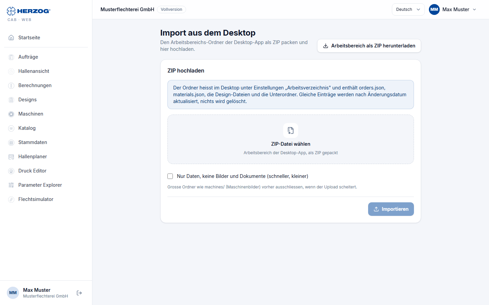

# Import from the desktop app and export (web app)

!!! abstract "Reference — The "Import from the desktop app" page in the user menu of the web app: uploading the desktop app's workspace as a ZIP or downloading the web workspace as a ZIP"

## What you use this area for { #wofur-sie-diesen-bereich-nutzen }

The web app works with the same data model as the desktop app. Via
this page you transfer a complete **Workspace** of the
desktop app — orders, customers, materials, bobbins, colors, machines,
designs, hall plans, print templates and the associated files — into the account with a
single ZIP upload. Conversely, you download the web app's workspace
as a ZIP, for example as a backup or to open it in the desktop app.

For ongoing synchronization there is also the **cloud sync** in the
desktop app ([Licence and cloud](../admin/settings/license.md)), which
uploads changes automatically and fetches changes from the web app. Which way suits which case is explained in
[Bringing data from the desktop into the web app](../tasks/desktop-to-web.md).

You open the page via *User menu > Import from the desktop app* or the
tile on the home page; it requires the permission
**Workspace settings**.

## The screen at a glance { #der-bildschirm-im-uberblick }

| Element | Meaning |
|---|---|
| **Download workspace as ZIP** | Exports the account's workspace as a ZIP in the file format of the desktop app. |
| **Select ZIP file** | The workspace folder of the desktop app, packed as a ZIP. |
| **Data only, no images and documents (faster, smaller)** | Skips images and documents in the ZIP. |
| **Import** | Starts the import (*Import running …*). |
| **Result** | Table per data type with **Created**, **Updated**, **Unchanged**, **Files** and, if applicable, **Error**. |

## How to pack the workspace { #so-packen-sie-den-arbeitsbereich }

1. In the desktop app, open *System administration > Storage location* — it
   shows the path of the **workspace folder** (see
   [Storage location](../admin/storage-location.md)).
2. Pack this folder with Windows Explorer (*Send to > Compressed
   (zipped) folder*) or an archiving program. Among other things, the folder contains
   `orders.json`, `materials.json`, the design files and subfolders.
3. Upload the ZIP here.

!!! tip "Large folder?"
    The `machines/` subfolder with machine images can become large.
    If the upload fails, exclude it beforehand or check
    **Data only** — images can be added later via the
    [media library](media.md).

## What happens during the import { #was-beim-import-passiert }

* Identical entries (same identifier) are **updated by modification
  date** — the newer one wins. **Nothing is deleted**.
* New entries are created, unchanged ones are skipped.
* Files (images, documents) are adopted into the media library;
  identical files only once.
* Users, roles and profiles of the desktop app do not belong to the
  workspace and are not imported — users come from the
  [customer account](../setup/account.md).
* In the [trial](trial.md), the quantity limit also applies to the import.

The import can be repeated as often as you like, e.g. to bring in orders
changed later.

## Related pages { #verwandte-seiten }

* [Bringing data from the desktop into the web app](../tasks/desktop-to-web.md) — the workflow
* [Licence and cloud (desktop app)](../admin/settings/license.md) — the automatic cloud upload
* [Storage location (desktop app)](../admin/storage-location.md) — where the workspace folder is located
* [Media library (web app)](media.md)
