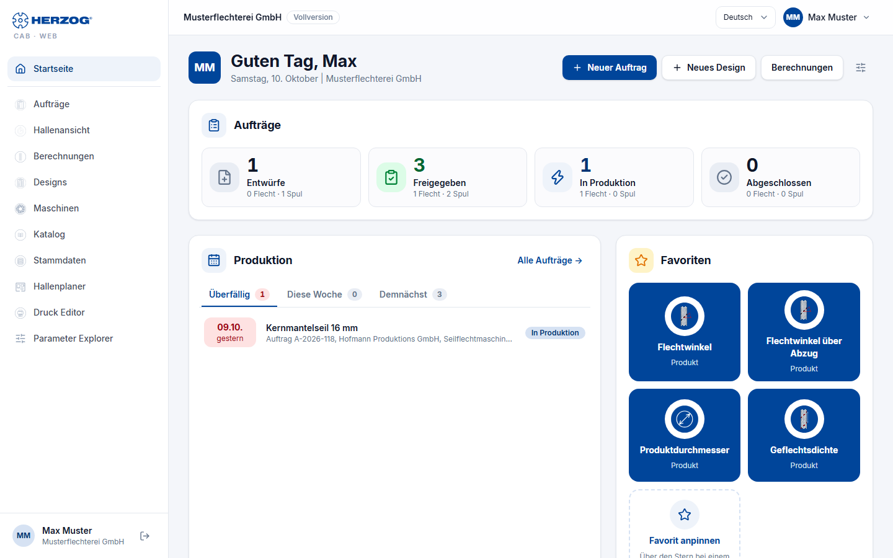

# Web app

!!! abstract "Reference — Herzog CAB in the browser at app.herzog-cab.com: what the web app is, what it can do and where to find the modules"

## What the web app is { #was-die-web-app-ist }

**Herzog CAB Web** is Herzog CAB as an application in the browser. There is
nothing to install: you open [app.herzog-cab.com](https://app.herzog-cab.com),
sign in with your user from the [customer account](../setup/account.md)
and work in your **company's workspace** — all users of the account
see the same orders, designs, machines and master data. The calculators
deliver the same results as the desktop app, the Designer draws
the same braid patterns, and printing uses the same print templates.

The web app is part of the annual subscription (**Herzog CAB Full Version** or
**Herzog CAB Designer**) and shares its seats with the program. A
seat is one person who is currently working. Anyone working in the program and in the browser
at the same time occupies two seats. To try it out, Herzog will set up a free
[trial version](trial.md) for you on request: 30 days, in the
program and in the browser.

## The modules { #die-module }

- :material-login-variant: **Sign in and select account**

    ---

    Sign-in with email address, password and code; account selection; signing out.

    [:octicons-arrow-right-24: Sign in](login.md)

- :material-view-quilt-outline: **Interface**

    ---

    Sidebar, header, tabs, user menu and operation on
    tablet and smartphone.

    [:octicons-arrow-right-24: Interface](interface.md)

- :material-home-outline: **Home page**

    ---

    Orders by status, upcoming production, favorites, recently
    opened items and quick access to all modules; customizable.

    [:octicons-arrow-right-24: Home page](start.md)

- :material-clipboard-list-outline: **Orders**

    ---

    Create, filter, edit and print braiding and winding orders.

    [:octicons-arrow-right-24: Orders](orders.md)

- :material-calculator-variant-outline: **Calculations**

    ---

    All calculators of the desktop app in five groups — the same inputs and
    results, with favorites and history.

    [:octicons-arrow-right-24: Calculations](calculations.md)

- :material-palette-outline: **Designs and Designer**

    ---

    Design library and Designer with all six braid types,
    setup overview and true 3D view.

    [:octicons-arrow-right-24: Designs and Designer](designer.md)

- :material-factory: **Machines**

    ---

    Machine Fleet with braiding and bobbin winding machines, plus the Herzog catalogue.

    [:octicons-arrow-right-24: Machines](machines.md)

- :material-database-outline: **Master data**

    ---

    Materials, bobbins, colors and customers.

    [:octicons-arrow-right-24: Master data](master-data.md)

- :material-floor-plan: **Factory Planner**

    ---

    Draw floor plans, plan machine assignments, 2D and 3D.

    [:octicons-arrow-right-24: Factory Planner](hall-planner.md)

- :material-printer-outline: **Print**

    ---

    Orders, winding orders and designs with print templates as a page or PDF.

    [:octicons-arrow-right-24: Print](print.md)

- :material-file-document-edit-outline: **Print editor**

    ---

    Design print templates for orders, designs and calculations in the
    browser.

    [:octicons-arrow-right-24: Print editor](print-editor.md)

- :material-history: **Versions and recycle bin**

    ---

    View and restore earlier versions of an entry,
    bring back deleted entries.

    [:octicons-arrow-right-24: Versions and recycle bin](versions.md)

- :material-account-cog-outline: **User menu**

    ---

    Settings, account and users, subscription and orders, company,
    media library, recycle bin, roles and the import from the desktop app.

    [:octicons-arrow-right-24: Settings](settings.md) ·
    [Account and users](account.md) ·
    [Subscription and orders](subscription.md) ·
    [Company](company.md) ·
    [Media library](media.md) ·
    [Recycle bin](versions.md#papierkorb) ·
    [Roles](roles.md) ·
    [Import from the desktop app](import.md)

- :material-clock-start: **Trial and registration**

    ---

    Try it free for 30 days: request a trial version, limits of the
    trial, the way to a subscription.

    [:octicons-arrow-right-24: Trial](trial.md)

## Desktop app and web app compared { #desktop-app-und-web-app-im-vergleich }

Both programs work with the same data model; a workspace of the
desktop app can be [transferred into the web app](import.md). Not everything
exists in both — the most important differences:

| | Desktop app | Web app |
|---|---|---|
| Installation | Windows / macOS, installer | none — browser |
| Data | workspace folder on the computer or a network drive, per profile | central in the customer account, one workspace per account |
| Users | account users (or local / Entra / LDAP with dongle) | account users only |
| Calculations | all calculators, history, favorites | the same calculators, history and favorites per user on all devices, search |
| Designer | all six braid types, coloring by click, textures, track animation, true 3D, two-window comparison, mixed designs | all six braid types, coloring by click, textures, plying colors (color per yarn), occupation overview with animation, true 3D; one design per page, mixed designs view only |
| Versions | — | earlier versions and recycle bin for orders, designs, machines, master data, hall plans and print templates, also for changes from the cloud sync |
| Orders | braiding and winding order, period filter, duplicating | braiding and winding order, filter by type, status and machine |
| Printing | print editor for templates, printing via Windows | Print editor for templates (with undo and preview with sample data), printing via the browser, PDF |
| Factory Planner | 2D editor with wall textures, context menus, automatic areas, 3D | 2D editor (walls, areas, doors, gates, windows, stairs, calibrating), 3D view |
| Machines | Machine Fleet, Herzog catalogue (from 2.1.0), master data dialogs, 3D models | Machine Fleet with cards/list, catalogue, full machine maintenance |
| Mobile use | web server with QR code (order view) | the whole app, adapted to tablet and smartphone |
| Licence | annual subscription, one seat per running program | the same annual subscription, one seat per person in the browser |

A comparison to support the decision in your plant is available under
[Desktop app or web app?](../basics/platforms.md).

!!! info "Languages"
    Like the desktop app, the web app is available in German, English, Polish,
    Spanish, Italian and Chinese. You choose the language in the
    header or under [Settings](settings.md); it applies to your
    user on all devices.

## Related pages { #verwandte-seiten }

* [Customer account and invitation](../setup/account.md)
* [System requirements](../setup/system-requirements.md#web-app) — browser and screen
* [Bringing data from the desktop into the web app](../tasks/desktop-to-web.md)
* [Licence portal](../portal/index.md) — modules and seats
