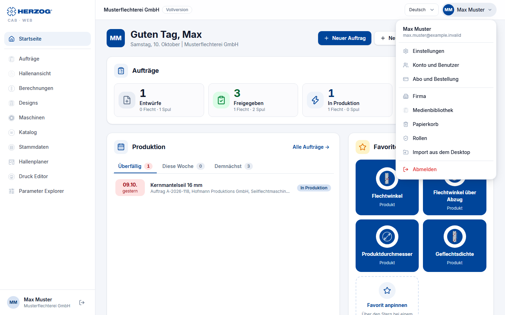

# Web app interface

!!! info "Concept — How the web app is structured: sidebar, header, tabs, user menu, lists and dialogs, operation on tablet and smartphone"

## The frame { #der-rahmen }

| Area | Content |
|---|---|
| **Sidebar** (left) | One entry per module (see [below](#eintrage-der-seitenleiste)), each only with the matching permission. At the bottom your name, the account and the **Sign out** icon. The sidebar only answers the question "which module am I in" — subpages and actions are located in the page itself. |
| **Header** (top) | On the left the name of the account with a label (e.g. *internal*, the edition or *Trial: n days left*), on the right the **language selection** and the **user menu**. |
| **Content** | The current page with the **page title**, actions to the right of it (e.g. **New braiding order**) and below it **tabs** for subpages (e.g. *Materials*, *Bobbins*, *Drums*, *Colors*, *Customers* under Master data or the machine kinds in the Herzog catalogue). |

### Sidebar entries { #eintrage-der-seitenleiste }

From top to bottom, each only with the stated permission
([Roles](roles.md)):

| Entry | Visible with | Page |
|---|---|---|
| **Home page** | always | [Home page](start.md) |
| **Orders** | *View orders* | [Orders](orders.md) |
| **Shop floor view** | *View orders* and *View master data* | Orders per machine with their status |
| **Calculations** | *Run calculations* | [Calculations](calculations.md) |
| **Designs** | *View designer* | [Designs and Designer](designer.md) |
| **Machines** | *View master data* | [Machines](machines.md) |
| **Catalogue** | *View master data* | [Herzog catalogue](catalog.md) |
| **Master data** | permission for at least one master data tab | [Master data](master-data.md) |
| **Factory Planner** | *View Factory Planner* | [Factory Planner](hall-planner.md) |
| **Print editor** | *View print templates* | [Print editor](print-editor.md) |
| **Parameter Explorer** | *Open Parameter Explorer* and *View orders* | Parameters of the orders |

Which entries you see also depends on the module: with
*Herzog CAB Designer*, Orders, Shop floor view, Calculations,
Machines, Catalogue, Factory Planner and Parameter Explorer are missing; under Master data
Colors and Customers remain.

## User menu { #benutzermenu }

Clicking your initials or your name at the top right opens the
user menu:

| Entry | Target |
|---|---|
| **Account** (selection) | Only for Herzog employees with several internal accounts: switches the account. |
| **Language** | On a smartphone here instead of in the header. |
| **Settings** | [Language, user, password note](settings.md). |
| **Account and users** | [Edition, modules, seats, users and roles](account.md). |
| **Subscription and orders** | [Activations, trial, ordering an annual subscription or sending an inquiry](subscription.md). |
| **Company** | [Company data and logo for print templates](company.md). |
| **Media library** | [Uploaded images and documents](media.md). |
| **Recycle bin** | [View and restore deleted entries](versions.md#papierkorb). |
| **Roles** | [Roles and permissions](roles.md) — only with the permissions *Manage roles* or *Manage users*. |
| **Import from the desktop app** | [ZIP import and export of the workspace](import.md) — only with the permission *Workspace settings*. |
| **Sign out** | Ends the session. |

## Lists, cards and forms { #listen-karten-und-formulare }

* **Lists** have a **search field** and **Filter** at the top; the number of hits
  is shown next to them (*n of m …*). On narrow screens, tables become
  **Cards**.
* **New…** buttons are to the right of the page title; **Open**
  or a click on the row leads into the editor.
* **Save** is at the top right of the editor. After saving, a
  confirmation (*Saved.*) briefly appears at the bottom edge; errors appear
  as a red message box.
* **Confirmation prompts** (e.g. when deleting) open as a dialog — on a
  smartphone as a sheet from the bottom. Deleted orders, designs, machines,
  master data, hall plans and print templates end up in the
  [recycle bin](versions.md#papierkorb).
* **Versions:** Editors have a **Versions** button with the earlier
  versions of the entry, see [Versions and recycle bin](versions.md).
* **Version conflict:** If someone else has saved an entry while you had it
  open (e.g. the desktop app via cloud sync), the web app reports when
  saving *"This entry has since been changed by someone else. Please
  reload."* — reload the page and enter your change again. You can then
  see what the other person saved under **Versions**. Usually the
  [edit lock](#bearbeitungssperre) prevents this in the first place.

## Edit lock { #bearbeitungssperre }

When you open an entry for editing, the web app locks it for everyone else:
for colleagues in the web app and, if the desktop app works with
[cloud sync](../admin/settings/license.md), also for the computers in the
workspace folder. Anyone who opens the same entry sees it read-only until
you are done. The basic idea and the desktop app side are described in
[Multiple users in the same workspace folder](../basics/multi-user.md#die-bearbeitungssperre).

Locked on opening: braiding and winding orders, designs in the
[Designer](designer.md) (if you come from an order, the order too),
[machines](machines.md), in the [Factory Planner](hall-planner.md) the
floor plan and the selected assignment, the template in the
[Print editor](print-editor.md), the entry in the edit dialog of the
[master data](master-data.md) and the program in the
[Braiding Simulator](braiding-simulator.md).
New entries that have not yet been saved, and entries you may only view,
are not locked by the web app.

### The lock { #das-schloss }

Whatever **someone else** is currently editing carries a small gray lock in
lists and cards: in the orders, the designs, the machines, the hall plans,
the master data, the shop floor view, the template selection of the Print
editor and in the Braiding Simulator. If you point at it, the tooltip shows
*Being edited* and below it name, location and start, e.g.
*Max Muster · PC-12 · since 14:32*. The location is the computer name if
someone is editing in the desktop app, otherwise *Web app*. The lists check
every 30 seconds; a lock therefore appears or disappears with a short
delay.

### The notice in the editor { #der-hinweis-im-editor }

!!! warning "📷 Screenshot missing"
    **Subject:** Order in the web app with the notice “Being edited – read only” next to **Versions**, the buttons **Try again** and **Release lock** and the tooltip on the lock.
    **How to create:** Open the same order in two browsers (two users of the same account, one with the *Release locks* permission); in the second browser point the mouse at the lock. Sample account, 1440 × 900 px.
    **Target file:** `assets/screenshots/web/sperre-hinweis.png`
    <!-- web-bild ../assets/screenshots/web/sperre-hinweis.png -->

If someone else is editing the entry, a notice appears at the top of the
editor next to **Versions**, and all fields are read-only:

| Notice | Meaning | Buttons |
|---|---|---|
| *Being edited – read only* | Someone else is editing the entry; who it is appears in the tooltip on the lock. | **Try again** checks immediately; if it is not free yet, the web app reports *The entry is still being edited.* **Release lock** only with the *Release locks* permission. |
| *Available now – reload* | The other user is done. If a third person takes the entry in the meantime, *Being edited – read only* appears again. | **Reload** reloads the page with the current version, then you edit. |
| *Now being edited by someone else – read only* | You had the entry, now someone else is editing it. | **Reload** |
| *Your editing session was ended – read only. Unsaved changes can no longer be saved.* | Someone with the *Release locks* permission has released your lock. | **Reload** |
| *Released due to inactivity – reload to continue working* | 30 minutes without input and without unsaved changes: the web app has released the entry. | **Reload** |
| *No connection to the server – read only* | The web app cannot reach the server and cannot take the lock. | **Try again** |

The server rejects saving, deleting or restoring an entry that someone else
is currently editing with *This entry is currently being edited.*

### When the entry is free again { #wann-der-eintrag-wieder-frei-ist }

* You close the tab, reload the page or go to another page in the web app.
  If you go straight on to an editor of the same entry (e.g. from the
  Designer back to the order), the lock stays without a gap.
* 30 minutes without input, if there are no unsaved changes.
* The tab reports to the server every minute. If nothing arrives for three
  minutes, for example because the computer is asleep or the network is
  gone, the entry is free.

Each browser tab edits on its own: if you open the same entry in a second
tab or additionally in the desktop app, you see it read-only there.

### Release lock { #sperre-aufheben }

With the **Release locks** permission (group *Administration*, by default
only in the *Administrator* role, see [Roles](roles.md)) you end someone
else's lock: click **Release lock** in the notice and confirm the prompt
*Release lock?*. It names the editor, e.g. *Being edited by Max Muster on
PC-12 since 14:32. Releasing the lock ends this editing session: unsaved
changes there can no longer be saved.* The page reloads and you edit the
entry. The release is logged. If someone else has taken over the entry in
the meantime, the web app reports *Someone else is editing the entry by
now.*

### Status from the shop floor { #status-aus-der-halle }

You can set the order status in the **shop floor view** even while
someone is editing the order. Whoever has the order open takes over the new
status when saving: *The status was set to "In production" on the shop
floor in the meantime and has been applied.* If they had changed the status
themselves, theirs applies: *Saved. The status from the shop floor ("In
production") was replaced by yours.*

## Tablet and smartphone { #tablet-und-smartphone }

The web app adapts to the screen width:

* **From 768 px (tablet):** sidebar and header as on the desktop, lists
  as cards depending on the space.
* **Smartphone:** The sidebar becomes a **drawer**, which you open via the
  menu icon at the top left. At the bottom edge there is a **tab bar**
  with **Home**, **Orders**, **Calculators**, **Designs** and **More** (opens
  the drawer). In the drawing areas (Designer, Factory Planner) you zoom
  with two fingers.

!!! tip "As an app on the home screen"
    Most browsers offer to *add the page to the home screen*.
    The web app then starts like an app — without an address bar.

## Related pages { #verwandte-seiten }

* [Sign in and select account](login.md)
* [Home page](start.md)
* [Versions and recycle bin](versions.md)
* [Interface at a glance (desktop app)](../basics/interface.md) — for comparison
* [Multiple users in the same workspace folder](../basics/multi-user.md) — edit lock in the desktop app
* [Roles](roles.md) — *Release locks* permission
