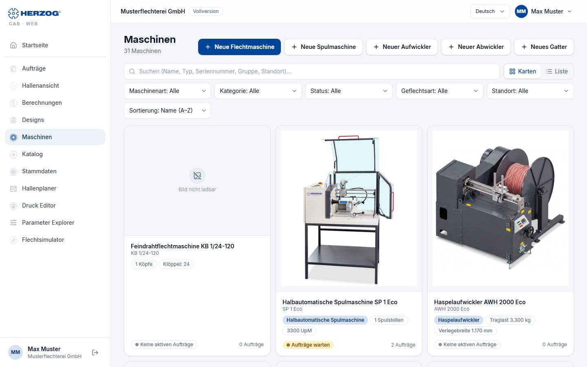
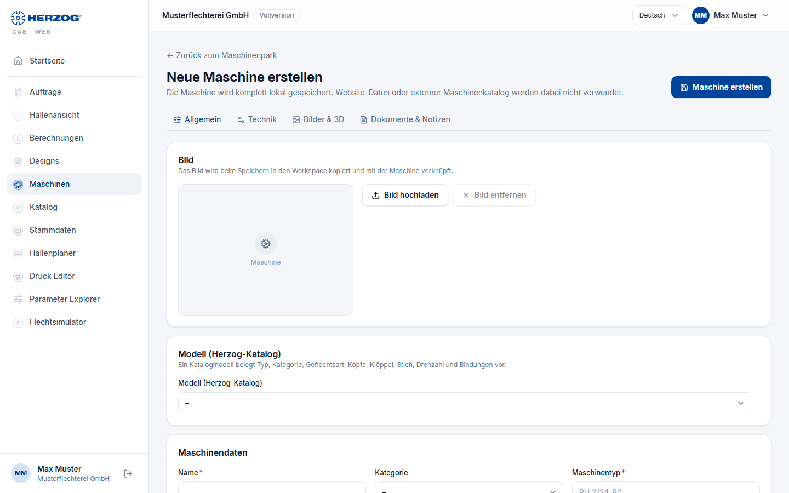

# Machines (web app)

!!! abstract "Reference — The Machines module of the web app: Machine Fleet with card and list view and the machine page"

## What you use this area for { #wofur-sie-diesen-bereich-nutzen }

Under **Machines** you maintain the machines of your plant — the master data
that orders, Designer and Factory Planner work with. The Herzog models
as templates are in their own area, the [Herzog catalogue](catalog.md); from there
you create a machine directly. The meaning of the machine data is described in
the reference of the desktop app ([Braiding machines](../master-data/braiding-machines.md),
[Bobbin winding machines](../master-data/winding-machines.md),
[Machine Fleet](../machine-park/index.md)); this page is about operation
in the browser.

## Machine Fleet { #maschinenpark }

| Element | Meaning |
|---|---|
| **New braiding machine** / **New bobbin winding machine** | Open the machine page for a new machine. |
| **Search** | Filters by name, type, serial number, group or location. |
| **View**: **Cards** / **List** | Cards with image and key figures, or a table. |
| Filter | **Machine type** (braiding/bobbin winding machines), **Category**, **Status**, **Group**, **Braid type**, **Location**; the number of hits is shown next to them (*n of m machines*). |
| **Sort** | Order of the list. |
| Card / row | Name, type, category, location, status, key figures (heads, carriers, speed or winding heads and rpm) and the number of running **Orders**. A click opens the machine page. |

## Machine page { #maschinenseite }

The machine page is divided into four tabs; **Save** is at the top
right, next to it **Delete** and **[Versions](versions.md)** with the
earlier versions of the machine. **← Back to Machine Fleet** leads to the
list. To make changes you need the permission *Edit master data* — otherwise
the page is read-only and names the missing permission.

| Tab | Content |
|---|---|
| **General** | Image (**Upload image** / **Remove image**), **Model (Herzog catalogue)** — a catalogue model prefills type, category, braid type, heads, carriers, pitch, speed and bindings —, machine data (**Name**, **Series**, **Category**, **Machine type**, **Serial number**, **Group**, **Location**, **Year of manufacture**, **Status**) and the running orders of this machine. |
| **Technical** | Braiding machine: **Braid type**, **End horngear slots**, **Max. carriers per head**, **Heads**, **Pitch**, **Carrier type**, **Speed**, **Oil quantity**, **Total carriers**, **Bindings**, **Matching bobbins**, **Dimensions** (length, width, height — with **Calculate dimensions** roughly estimated from heads, carriers and pitch), **Take-up winding**, **Take-up option** (free or from the suggestions of the catalogue model; switching the take-up winding leaves a selected take-up option in place), **Meter counter** and **Accessories**. Bobbin winding machine: **Winding technology** (winding heads, bobbin diameter, winding length, speed, traversing, winding type, speed control, yarn tension, control, drive, traverse step, traverse width, bobbin weight, **Setup time per order**, **Loading time per bobbin**), counters, monitoring, materials, automatic bobbin change (SPA), yarn handling, strand laying (HLM) and **Accessories**. Take-up units, pay-off units and creels: their design and dimension data and **Accessories**. |
| **Images & 3D** | **Box views**: up to five images (front side, back view, left, right, top view) for the substitute box in the 3D factory view; **3D model** (OBJ) only for internal accounts, **Scale**, **Rotation X/Y/Z**, **Front direction**. |
| **Documents & notes** | **Description**, **Documents** (operating instructions, data sheets, take-up tables … via **Add document**, with **Open** and **Remove document**) and **Notes**. |

For all machine types, **Accessories** is shown in the **Technical** tab as a list to
check off: the suggestions of the catalogue model, grouped as in the
[Herzog catalogue](catalog.md) (provided it is enabled for your account),
plus your own accessories — next to catalogue suggestions under *Own accessories*.
You enter new ones in the **Add accessory** field and confirm with
**Add** or the Enter key; it appears already checked.
What is checked is saved.

Images and documents are stored in the [media library](media.md) of the account.
**Delete** removes the machine together with image, documents and 3D model — with
a confirmation prompt. The machine itself goes to the
[recycle bin](versions.md#papierkorb); image, documents and 3D model, on the other hand,
are gone permanently.

!!! tip "Winding time defaults"
    **Setup time per order** and **Loading time per bobbin** of a
    bobbin winding machine are the defaults for the winding time estimate in the
    [winding order](orders.md); there they can be overridden per order.

## Machine from the Herzog catalogue { #maschine-aus-dem-herzog-katalog }

Instead of creating a machine by hand, you adopt a Herzog model: in the
[Herzog catalogue](catalog.md) you select accessories, take-up and setup, enter
group, serial number and name and create the machine directly with
**Add to braiding machines** (or **Add to bobbin winding machines** …)
— with the technical data and the image from the catalogue. It is then listed in the
Machine Fleet; you add everything else on the machine page.

## Related pages { #verwandte-seiten }

* [Herzog catalogue (web app)](catalog.md)
* [Machine Fleet (desktop app)](../machine-park/index.md)
* [Braiding machines (master data)](../master-data/braiding-machines.md) · [Bobbin winding machines (master data)](../master-data/winding-machines.md)
* [Factory Planner (web app)](hall-planner.md) — placing machines in the hall
* [Media library (web app)](media.md)
