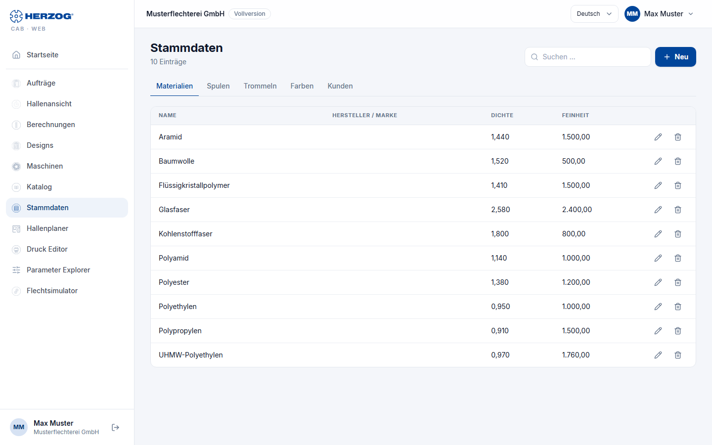

# Master data (web app)

!!! abstract "Reference — The Master data module of the web app: materials, bobbins, drums, colors and customers as tabs with list and form"

## What you use this area for { #wofur-sie-diesen-bereich-nutzen }

Under **Master data** you maintain the basic data that orders, calculators
and the Designer access. Five tabs: **Materials**, **Bobbins**,
**Drums**, **Colors**, **Customers**. Machines have their own module ([Machines](machines.md)),
floor plans are in the [Factory Planner](hall-planner.md), images and documents in
the [media library](media.md), designs under [Designs](designer.md).

The meaning of the fields corresponds to the desktop app — see
[Materials](../master-data/materials.md), [Bobbins](../master-data/bobbins.md),
[Drums](../master-data/drums.md), [Colors](../master-data/colors.md) and
[Customers](../master-data/customers.md).

!!! info "Which tabs you see"
    Materials, Bobbins, Drums and Colors require the permission
    **View master data**, the Customers tab the permission **View
    orders**. With *Herzog CAB Designer* there are only **Colors** and
    **Customers**.

## The screen at a glance { #der-bildschirm-im-uberblick }

Every tab has the same structure:

| Element | Meaning |
|---|---|
| **New** | Opens the empty form for a new entry. |
| **From Herzog catalogue …** | Only in the **Bobbins** and **Drums** tabs and with the permission to edit: opens the [Herzog catalogue](catalog.md) in the matching tab; there you adopt Herzog bobbins and drums. |
| **Search …** | Filters the list live; the number of hits is shown next to it (*n entries*). |
| List | Table with the most important columns; on a smartphone, cards with title, subline and two key figures. |
| **Edit** / **Delete** | Opens the form or removes the entry after a confirmation prompt (*The entry goes to the recycle bin and can be restored from there.*). See [Recycle bin](versions.md#papierkorb). |
| Form | Opens as a dialog (**Save** / **Cancel**); required fields are marked. An entry that someone else has just changed can only be saved after reloading. For a saved entry, **Versions** with its earlier versions is shown at the bottom left, see [Versions and recycle bin](versions.md). |

## The tabs in detail { #die-reiter-im-detail }

### Materials { #materialien }

| Field | Meaning |
|---|---|
| **Name** (required) | Designation of the material. |
| **Manufacturer / brand** | Free text. |
| **Density** (required) | in g/cm³, three decimal places. |
| **Fineness** and **Fineness unit** | Titer in tex, dtex, den, Nm or Ne. |
| **Note** | Free text. |

### Bobbins { #spulen }

| Field | Meaning |
|---|---|
| **Name** | Leave empty: the display name is generated from the dimensions. |
| **Outer diameter**, **Core diameter**, **Winding Length** (required) | in mm. |
| **Horngear diameter** | in mm. |
| **Volume** | in cm³; calculated from the dimensions if empty. |
| **Machine types** (required) | Multiple selection as in the desktop app: *Round braider*, *Square braider*, *Horizontal braider*, *Carbon fiber braider*, *Wire braider*, *Packing braider*. |

If the list is empty, it shows *No bobbins yet. Add them with
"From Herzog catalogue …".*

### Drums { #trommeln }

| Field | Meaning |
|---|---|
| **Name** | Leave empty: the display name is generated from the dimensions. |
| **Article number** | Your own number. |
| **Material** | *Wood*, *Steel*, *Plastic* or *Other*. |
| **Outer diameter**, **Core diameter**, **Traverse width** (required) | in mm. |
| **Winding diameter** | in mm; leave empty if winding goes up to the flange edge. |
| **Drum width** | in mm; leave empty if it corresponds to the traverse width. |
| **Bobbin volume** | in cm³; calculated from the dimensions when saving if empty. |
| **Empty weight** | in kg; without this figure there is no total weight of the full drum. |
| **Quill bore**, **Driver pin**, **Center to pin distance** | in mm, optional. |
| **Note** | Free text. |

The list shows name, article number, outer and core diameter,
traverse width, bobbin volume and empty weight. If it is empty, it shows
*No drums yet. Add them with "From Herzog catalogue …".*
The drums are available for selection in the calculators
[Product length per drum](../calculations/product/rope-length-on-drum.md)
and [Drum and take-up winder selection](../calculations/product/drum-take-up-selection.md).

### Colors { #farben }

| Field | Meaning |
|---|---|
| **Name** (required), **Code** | Designation and identifier. |
| **Color value** (required) | Color picker. |
| **Palette**, **Pantone**, **Reference system** | Assignment to palette and reference system. |
| **Notes** | Free text. |

The colors are available as a palette in the [Designer](designer.md).

### Customers { #kunden }

| Field | Meaning |
|---|---|
| **Customer number**, **Company** (required), **Name**, **Contact person** | Basic data. |
| **Street**, **ZIP code**, **City**, **Country** | Address. |
| **Phone**, **Mobile**, **Email**, **Website** | Contact. |
| **Private customer** | Flag. |
| **Notes** | Free text. |

## Related pages { #verwandte-seiten }

* [Master data (desktop app)](../master-data/index.md)
* [Machines (web app)](machines.md) · [Herzog catalogue (web app)](catalog.md) · [Media library (web app)](media.md)
* [Import from the desktop app](import.md) — adopting master data from the desktop app
