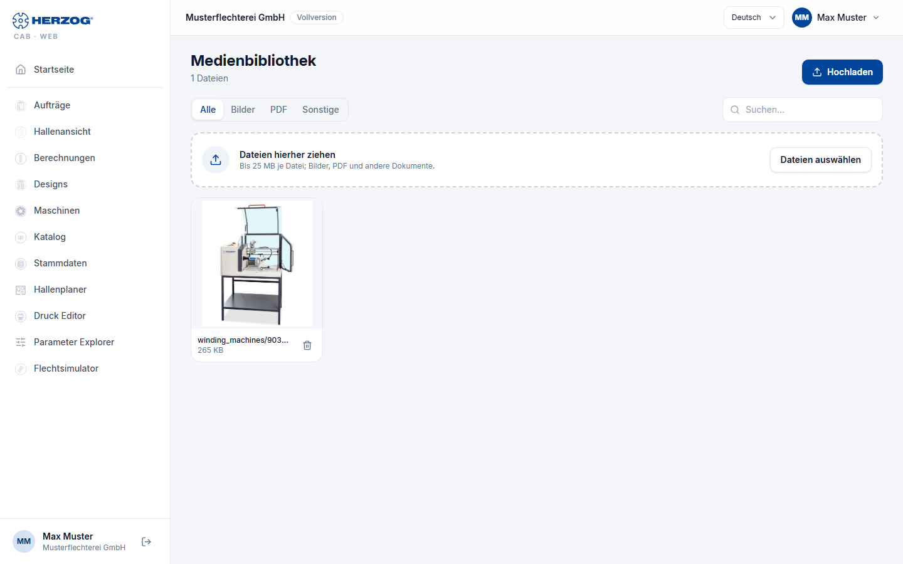

# Media library (web app)

!!! abstract "Reference — The "Media library" page in the user menu of the web app: uploaded images and documents of the account"

## What you use this area for { #wofur-sie-diesen-bereich-nutzen }

The media library collects all files of the workspace that are not
data themselves: machine images and box views, documents attached to
machines, floor plan images of the Factory Planner, the company logo and images
for print templates. What you upload on a machine page or in the Factory Planner
ends up here automatically; conversely, you can upload files in advance
and then select them in the appropriate places. The library
corresponds to [Media](../master-data/media.md) in the desktop app.

You open the page via *User menu > Media library*.

## The screen at a glance { #der-bildschirm-im-uberblick }

| Element | Meaning |
|---|---|
| **Upload** | Selects one or more files; alternatively, drag files onto the list. |
| Search field | Filters by file name. |
| Filter **All** / **Images** / **PDF** / **Other** | Filters by file type; the number of hits is shown next to it (*n of m files*). |
| List | Name with preview, **Type**, **Size**, **Uploaded** (date) and group (e.g. machines, floor plans). |
| **Open** | Shows the file in a new tab. |
| **Delete** | Removes the file after a confirmation prompt — also wherever it is used. |

To upload and delete you need the permission of the respective group
(e.g. **Edit master data** for machine images). Identical files
are stored only once when uploaded.

## Related pages { #verwandte-seiten }

* [Media (desktop app)](../master-data/media.md)
* [Machines (web app)](machines.md) — images and documents attached to machines
* [Factory Planner (web app)](hall-planner.md) — floor plan images
* [Company (web app)](company.md) — company logo
