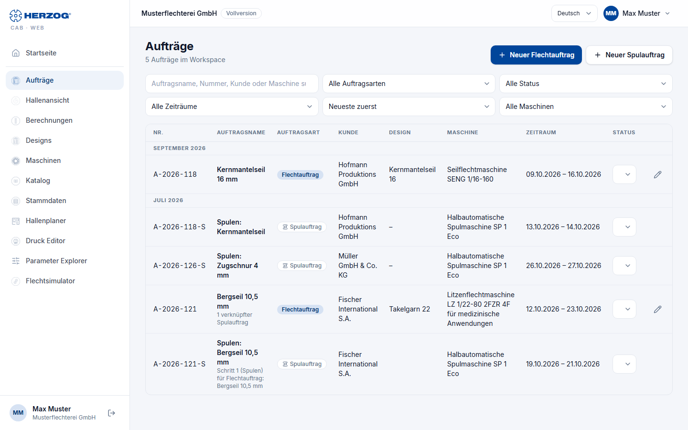
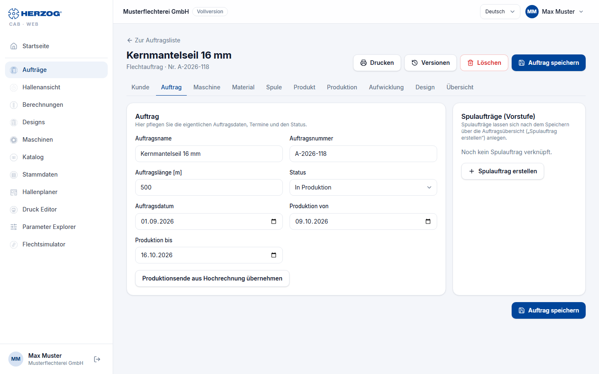
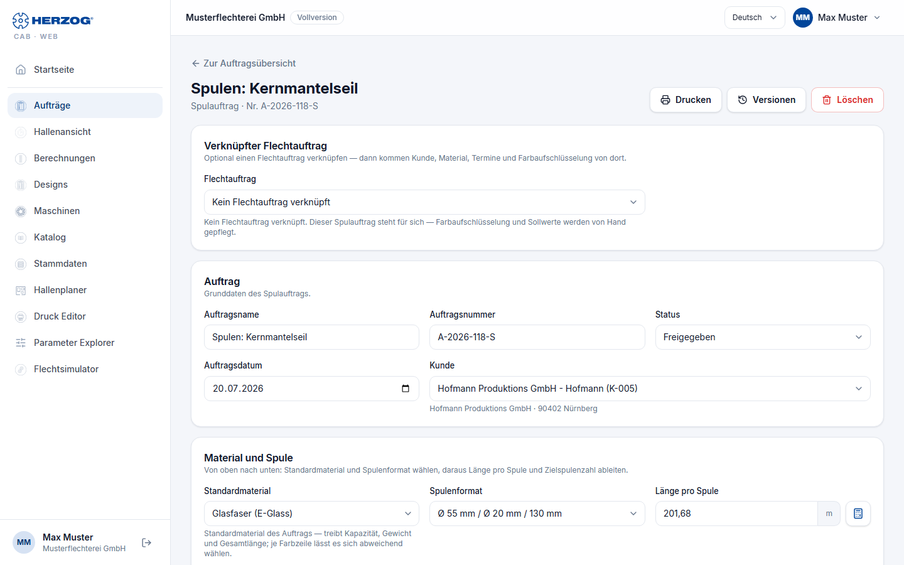

# Orders (web app)

!!! abstract "Reference — The Orders module of the web app: order list, braiding order editor, winding order editor and printing"

## What you use this area for { #wofur-sie-diesen-bereich-nutzen }

Under **Orders** you manage the braiding and winding orders of your account —
the same orders that the desktop app also knows when you [import](import.md) the
workspace or synchronize it via cloud upload.
The editors correspond field by field to those of the desktop app; this page
describes operation in the web app and refers to the reference pages of the desktop app
for the meaning of the fields.

## Order list { #auftragsliste }

| Element | Meaning |
|---|---|
| **New braiding order** / **New winding order** | Open an empty editor (to the right of the page title). |
| **Search** | Filters live by order name, number, customer or machine. |
| **Order type** | *All order types*, *Braiding orders*, *Winding orders*. |
| **Status** | *All statuses* or one status: Draft, Released, In production, Completed. |
| **Period** | *All periods*, *Today*, *This week*, *Last week*, *This month* or *Last 30 days*, as in the [desktop app](../orders/index.md#filter-zeitraum). |
| **Sort** | *Newest first*, *Oldest first*, *Production date* or *Order date*, as in the [desktop app](../orders/index.md#auswahlliste-sortierung). |
| **Machine** | *All machines* or one machine from your Machine Fleet. |
| Number of hits | *n orders in the workspace* or *n of m orders visible*. |

The filters are stored in the address of the page. A bookmark or the
browser's back button therefore keeps them, and the counters on the
[home page](start.md) jump here already filtered. As in the desktop app,
the list divides the orders into time groups (*Today*, *This
week*, *Last week*, then month and year).

The table shows **No.**, **Order name**, **Order type** (chip
*Braiding order* or *Winding order*), **Customer**, **Design** (name or *–*),
**Machine**, **Period** (production from–to) and **Status**. You change the status
directly in the row via the drop-down list — the change is
saved immediately. Winding orders carry the addition *Step 1 (winding) for
braiding order: …*, braiding orders state the number of their linked
winding orders.

| Icon in the row | Effect |
|---|---|
| **Open** (pencil) | Opens the editor. |
| **Duplicate** (two sheets) | With write permission: saves a copy of the order and opens it in the editor. |
| **Create winding order** (bobbin) | Only for braiding orders with write permission: creates a linked winding order, prefilled with customer, material, bobbin format, date and target values. |
| **Delete** (trash can) | With write permission; confirmation prompt. If a braiding order has linked winding orders, these remain and only lose the link. The deleted order goes to the [recycle bin](versions.md#papierkorb). |

On narrow screens the list appears as cards.

## Braiding order editor { #flechtauftrag-editor }

The editor has the same nine tabs as the
[braiding order editor of the desktop app](../orders/braiding-order.md):
**Customer**, **Order**, **Machine**, **Material**, **Bobbin**, **Product**,
**Production**, **Design**, **Overview**. The meaning of each field is described
there — here only the special features of the web app:

* The header shows the order name and number, the note *unsaved*
  when there are open changes, as well as **Back to orders**, **Print**,
  **[Versions](versions.md)** (view and restore earlier
  versions), **Delete** and **Save order**.
* You select **Customer**, **Machine**, **Material** and **Bobbin** from the
  master data of the account; the buttons **Open customers**,
  **Open braiding machines**, **Open material management** and
  **Open Bobbin Management** jump to the respective maintenance. Entries that no longer
  exist appear as *… (no longer available)* in the field.
* The **calculator icons** next to the fields of the Product and
  Production tabs open the respective calculator as a dialog, prefilled with the
  order values; **Apply** writes the result back. At the
  braiding angle field the icon opens *Braiding angle from take-up*, as on the desktop.
* **Production from / to** and **Apply production end from
  estimate** work as on the desktop. You set the production hours per
  working day (default 8 h) for the whole account under
  [Settings](settings.md).
* The **Design** tab shows the linked design with preview and the
  carrier table; **Open design** switches to the [Designer](designer.md),
  **New design** creates a new one.
* The **Winding orders (preparation)** card next to the *Order* tab lists
  the linked winding orders with status and number of bobbins; **Create winding
  order** creates a new one after saving.

## Winding order editor { #spulauftrag-editor }

The winding order is a scrolling page with the cards **Linked
braiding order**, **Order** (basic data, customer), **Material and bobbin**
(standard material, bobbin format, length per bobbin, target number of bobbins,
total length), **Color breakdown**, **Winding parameters** (collapsible)
and **Machines and schedule** (bobbin winding machines, distribution, winding time,
production period) — the same order as in the desktop app. The
fields are explained in the [winding order editor of the desktop app](../orders/winding-order.md).

Special features of the web app:

* As with the braiding order, the header offers **Print**,
  **[Versions](versions.md)** and **Delete**.
* When linking a braiding order, a dialog asks whether customer,
  material, bobbin format, production date and target values should be
  applied (**Apply** or **Link only**).
* Warnings appear as message boxes: deviating number of bobbins, missing
  winding time, or if the winding end is after the braiding start of the linked
  order.
* The **Bobbin winding time details** calculator is not included in the web app; the
  winding time estimate itself is available.

## Printing { #drucken }

**Print** in the header opens the [print page](print.md) with the
default template for braiding or winding orders.

## Related pages { #verwandte-seiten }

* [Braiding order editor (desktop app)](../orders/braiding-order.md) — meaning of all fields
* [Winding order editor (desktop app)](../orders/winding-order.md)
* [From customer order to machine sheet](../tasks/order-to-machine-sheet.md) — the workflow
* [Printing (web app)](print.md)
* [Versions and recycle bin](versions.md) — bring back earlier versions and deleted orders
