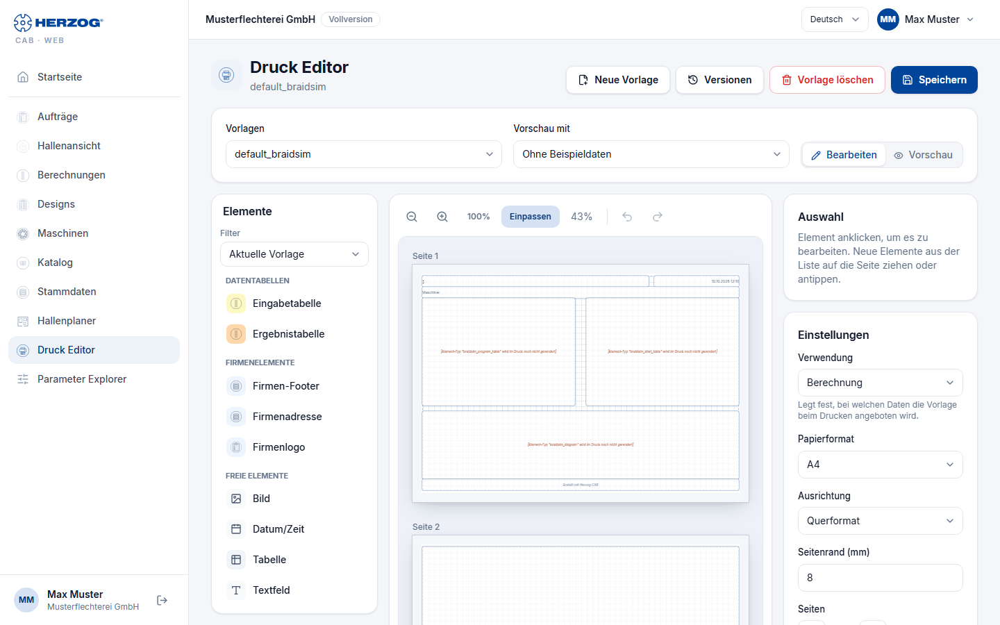

# Print editor (web app)

!!! abstract "Reference — The Print editor of the web app: creating, editing, saving and deleting print templates in the browser"

## What you use this area for { #wofur-sie-diesen-bereich-nutzen }

In the **Print editor** you design the print templates with which the
[print page](print.md) outputs orders, winding orders, designs and calculations
— the same templates as in the
[print editor of the desktop app](../print-templates/index.md). Structure and
elements correspond to the program; the meaning of the individual elements and
placeholders is described under
[Elements and placeholders](../print-templates/elements.md). This page
describes operation in the browser and the differences.

You open the editor via **Print editor** in the sidebar, via the
**Print editor** tile on the [home page](start.md) or on the
print page via **Edit template** — the template selected there is then
already loaded.

!!! info "Permissions"
    You see the editor with the permission **View print templates**. You can only change,
    save and delete with **Edit print templates**;
    without this permission, the top of the page shows *With your role you can view print templates
    but not change them.* See [Roles](roles.md).

## The screen at a glance { #der-bildschirm-im-uberblick }

| Area | Content |
|---|---|
| **Header** | Title **Print editor**, below it the name of the template (or *New template*), with the addition *unsaved* if there are changes. On the right **New template**, **Versions**, **Delete template** and **Save**. |
| **Templates** | All print templates of your account and the supplied default templates, sorted by name. Supplied templates without your own version carry the addition *(supplied)*. |
| **Preview with** | Sample data for the preview (see [below](#vorschau-mit-beispieldaten)). |
| **Edit** / **Preview** | Switch between the work area and the print view. |
| **Elements** (left) | The building blocks of the template, grouped as in the program, with **Filter**. On tablet and smartphone, the list is shown as a horizontally scrolling bar above the page. |
| Page (middle) | The pages of the template with grid; the elements show their real print content. Above it the zoom bar. |
| **Selection** (right) | The selected element and its buttons. |
| **Settings** (right) | Usage, paper size, orientation, page margin and number of pages of the template. |

## Managing templates { #vorlagen-verwalten }

| Button | Effect |
|---|---|
| **New template** | Starts an empty template. |
| **Save** | Opens the dialog *Save printout template* with the field **Template name**. The same name as the loaded template overwrites it; *a different name creates a new template.* The message *Template saved.* confirms this. |
| **Versions** | Only for templates of your account: view and restore earlier versions of the template, see [Versions and recycle bin](versions.md). |
| **Delete template** | Only for templates of your account: deletes the template after a confirmation prompt. It goes to the [recycle bin](versions.md#papierkorb). |

If someone else has changed the template since you loaded it,
the editor does not save and reports *The template has been changed by someone
else in the meantime. Both versions can be seen under "Versions".*

!!! info "Changing supplied default templates"
    The supplied default templates can also be changed.
    If you save under the same name, your account gets its own
    version, which takes precedence when printing. If you delete this version again,
    the supplied one applies (*The supplied version will then apply
    again.*).

If you switch templates or start a new one with unsaved changes,
the editor asks (**Discard** or **Cancel**); when
leaving the page, the browser warns you.

## Placing elements { #elemente-platzieren }

* **Drag** – drag an element from the list onto the page; a green
  or red preview shows whether there is space for it there.
* **Click or tap** – the element is placed on the currently
  visible page.

The **Filter** above the list works as in the program (*Current template*,
*Show all*, *Calculation*, *Design*, *Order*) — see
[Editor layout](../print-templates/editor.md#element-palette-links). If there is no free space left
on the existing pages, the editor asks whether a
**new page should be created** and the element placed there.

## Working on the page { #auf-der-seite-arbeiten }

| Action | Effect |
|---|---|
| Drag element | Moves it; when released it snaps into place, also on another page. A shadow shows beforehand where it will land. |
| Handle at the bottom right | Changes the size. |
| Buttons at the top right of the element | **Minimize**, **Maximize**, **Delete**. |
| Double-click | Opens the edit dialog of the element. |
| Right-click | Context menu with **Edit**, **Copy**, **Delete**. |
| ++ctrl++ + mouse wheel | Zooms the page. |

The zoom bar above the page offers **Zoom out**, **Zoom in**,
**100%**, **Fit** (default: the page fits the width) and the
percentage display, and in **Edit** mode also **Undo** and
**Redo**.

### "Selection" area { #bereich-auswahl }

Shows the selected element with page and size (e.g. *Page 1 · 120 × 54
mm*) and the buttons **Edit element** (for elements with a
dialog), **Minimize**, **Maximize**, **Copy** and **Delete**. After
**Copy**, **Insert** appears; the copy is placed on the visible
page. Without a selection, it shows *Click an element to edit it.
Drag new elements from the list onto the page or tap them.*

### "Settings" area { #bereich-einstellungen }

| Setting | Meaning |
|---|---|
| **Usage** | *Calculation*, *Design* or *Order* — determines for which data the template is offered when printing. |
| **Paper size** | *A4* or *A3*. |
| **Orientation** | *Portrait* or *Landscape*. |
| **Page margin (mm)** | 0 to 50 mm. |
| **Pages** | **−** / **+** removes or adds a page. If there are elements on the removed pages, the editor asks whether they should be **moved** to the last remaining page or **deleted**. |

### Keyboard shortcuts { #tastenkurzel }

| Key | Effect |
|---|---|
| ++del++ or ++backspace++ | Delete the selected element |
| ++ctrl+c++ / ++ctrl+v++ | Copy / paste element |
| ++ctrl+z++ | Undo |
| ++ctrl+y++ or ++ctrl+shift+z++ | Redo |
| ++esc++ | Clear the selection |

## Editing elements { #elemente-bearbeiten }

The edit dialogs (*Edit text field*, *Edit setup*,
*Edit image*, *Edit company logo*, *Edit date and
time*, tables and data tables) contain the same settings
as in the program — see
[Elements and placeholders](../print-templates/elements.md). Special features
in the browser:

* **Text field** – you edit the text as plain text; font, size,
  bold, italic, alignment and text color apply to the whole field.
  You insert placeholders such as `{order.number}` via the search in the dialog.
  Text formatted in the program (e.g. individual words in bold) is
  kept as long as you do not change it in the browser.
* **Image** – images come from your account's print images in the
  [media library](media.md) (**Select image**); in addition the **Rotation
  (°)**.

## Preview with sample data { #vorschau-mit-beispieldaten }

In **Preview** mode the editor shows the pages as they will be
printed. Via **Preview with** you fill the placeholders with real data
from your account — matching the **Usage** of the template: for *Calculation*
a calculator, for *Order* an order, otherwise a design. *Without
sample data*, the placeholders remain empty.

## Differences from the desktop app { #unterschiede-zur-desktop-app }

* **Additionally in the browser:** undo and redo, the preview with
  selectable sample data and the print view in the editor.
* **Text fields** only as plain text with one font for the whole field
  (see above).

!!! info "Templates from the browser in the program (from program version 2.1.0)"
    Templates that you create or change in the Print editor of the web app
    also come back into the program from program version 2.1.0; until then,
    print templates only went from the program to the web app. If you delete the customized version of a
    default print template in the web app, the supplied one applies again in the
    program. The prerequisite is that the program
    synchronizes its workspace folder with the cloud and adopts changes from the
    web app — the switches for this are under
    [Settings > Licence](../admin/settings/license.md), card
    *Cloud (app.herzog-cab.com)*.

## Related pages { #verwandte-seiten }

* [Printing (web app)](print.md) — applying templates, printing, PDF
* [Print editor (desktop app)](../print-templates/index.md) · [Elements and placeholders](../print-templates/elements.md)
* [Media library (web app)](media.md) — images for print templates
* [Company (web app)](company.md) — company data and logo for letterhead and footer
* [Roles (web app)](roles.md) — viewing and editing print templates
