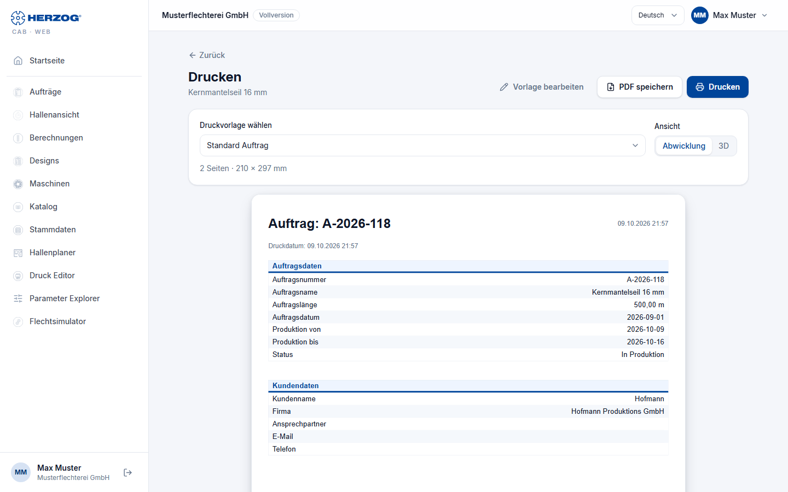

# Printing (web app)

!!! abstract "Reference — The print page of the web app: orders, winding orders, designs and calculations with print templates as a page or PDF"

## What you use this area for { #wofur-sie-diesen-bereich-nutzen }

The web app prints with the same **Print templates** as the desktop app —
supplied, adopted from your workspace or designed in the
browser. The print page builds the template in the browser, shows the
preview and outputs it via the browser's print dialog or saves
it as a PDF. You design templates in the [Print editor of the web app](print-editor.md)
or in the [print editor of the desktop app](../print-templates/index.md); from
the program they come via [import](import.md) or cloud sync.

You reach the print page via **Print** in the
[braiding order and winding order](orders.md), in the [Designer](designer.md) and
on every [calculator page](calculations.md).

## The screen at a glance { #der-bildschirm-im-uberblick }

| Element | Meaning |
|---|---|
| **Back** | Back to the order, design or calculator. |
| **Edit template** | Only with the permission **Edit print templates**: opens the selected template in the [Print editor](print-editor.md). |
| **Choose print template** | The supplied default templates — in your account's version if you have customized them — and your own templates, as far as they match the print target; the default template for braiding order, winding order, design or calculation is preselected. |
| **View** | **Unrolled view** or **3D** — which image of the design appears on the template (for designs and for orders with a linked design). |
| Preview | The pages of the template with the data of the order or design; above it the number of pages and format (*2 pages · 210 × 297 mm*). |
| **Print** | Opens the browser's print dialog — printer or *Save as PDF*. |
| **Save PDF** | Creates a PDF file directly and downloads it. |

The web app fills placeholders for company data and logo from
[Company](company.md); carrier tables, color breakdown and parameters
come from the order or design.

!!! tip "Printout not right?"
    In the browser's print dialog, check the paper size (A4) and margins and
    switch off the browser's *headers and footers*. **Save PDF**
    bypasses these settings.

## Related pages { #verwandte-seiten }

* [Print editor (web app)](print-editor.md) — designing templates in the browser
* [Printing an order and QR code (desktop app)](../orders/print.md)
* [Print editor (desktop app)](../print-templates/index.md) — designing templates in the program
* [Company (web app)](company.md) — company data for letterhead and footer
* [Print problems](../help/print-problems.md)
