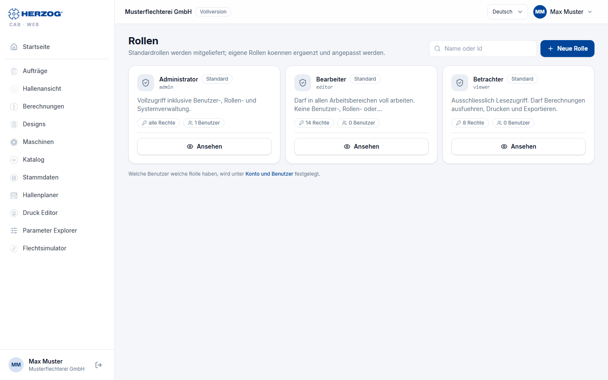

# Roles (web app)

!!! abstract "Reference — The "Roles" page in the user menu of the web app: viewing default roles, creating custom roles with individual permissions"

## What you use this area for { #wofur-sie-diesen-bereich-nutzen }

A **Role** bundles permissions. The web app ships with the default roles
**Administrator**, **Editor** and **Viewer**; administrators
can add custom roles — for example *Sales* (only view orders and designs)
or *Winding* (edit orders, no master data). Which
users have which role is defined under
[Account and users](account.md).

You open the page via *User menu > Roles*; it only appears with
the permission **Manage roles** or **Manage users**.

## The screen at a glance { #der-bildschirm-im-uberblick }

| Element | Meaning |
|---|---|
| **New role** | Opens the dialog *Add new role*. |
| **Name or Id** / **Search** | Filters the list. |
| Role card | Name, indicator **Default** or **custom**, description, *all permissions* or *n permissions* and *n users*. |
| **View** | Default roles are read-only. |
| **Edit** / **Delete** | Change or remove custom roles; a role that is still assigned to users cannot be deleted. |

!!! info "Only pass on permissions that you have yourself"
    You can only create, change or delete a custom role if you yourself have
    all permissions of this role. The same applies when assigning under
    [Account and users](account.md#benutzer-und-rollen): you can neither assign nor withdraw roles with permissions
    that you do not have, and your
    own roles are changed by another administrator.

## Creating or editing a role { #rolle-anlegen-oder-bearbeiten }

| Field | Meaning |
|---|---|
| **ID** | Identifier: starts with a lowercase letter, only a–z, 0–9 and _, at most 32 characters (e.g. `supervisor`). Cannot be changed after creation. |
| **Name** | Display name. Default roles are translated automatically. |
| **Description** | Free text. |
| **All permissions (Administrator)** | The role has all permissions; the individual checkboxes are then ignored. |
| **Individual permissions** | One checkbox per permission, ordered by groups (see below). At least one permission is required. |
| **Create** / **Save** / **Cancel** | |

### The permissions { #die-rechte }

| Group | Permission | Effect in the web app |
|---|---|---|
| Administration | **Manage users** | Assign roles under Account and users; Roles page visible. |
| | **Manage roles** | Create, change, delete roles. |
| | **Manage company data** | Edit [Company](company.md). |
| | **Workspace settings** | [Import and export](import.md) of the workspace. |
| | **Release locks** | End someone else's [edit lock](interface.md#bearbeitungssperre) (button **Release lock**), in the web app as in the desktop app. Of the built-in roles only the *Administrator* has it. |
| Master data | **View master data** / **Edit master data** | See or change [master data](master-data.md) and [machines](machines.md). |
| Factory Planner | **View Factory Planner** / **Edit Factory Planner** | [Factory Planner](hall-planner.md). |
| Orders | **View orders** / **Edit orders** | [Orders](orders.md). |
| Designer | **View designer** / **Edit designer** | [Designs and Designer](designer.md). |
| Braiding Simulator | **View Braiding Simulator** / **Edit Braiding Simulator** | See the [Braiding Simulator](braiding-simulator.md) or change programs. Only for accounts with the Braiding Simulator, see [Licence and rights](../braiding-simulator/licence.md#rechte). |
| Print templates | **View print templates** / **Edit print templates** | Open the [Print editor](print-editor.md) or change, save and delete templates there; **Edit template** on the [print page](print.md). |
| Calculations / Export | **Run calculations** | [Calculations](calculations.md). |
| | **Print / Export** | [Print](print.md) and export. |
| Special tools | **Open Parameter Explorer** | Prepared for later functions. |

The permissions correspond to those of the desktop app
([Roles and permissions](../admin/roles.md)); custom roles, however,
are maintained separately in each program.

## Related pages { #verwandte-seiten }

* [Account and users (web app)](account.md) — assigning roles
* [Inviting and managing users (licence portal)](../portal/users.md)
* [Roles and permissions (desktop app)](../admin/roles.md)
