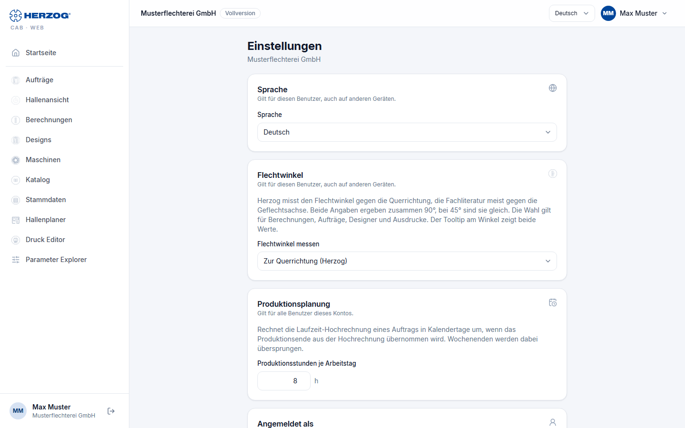

# Settings (web app)

!!! abstract "Reference — The "Settings" page in the user menu of the web app: language, braiding angle, production planning, signed-in user, privacy, Designer defaults and the way to password and security"

## What you use this area for { #wofur-sie-diesen-bereich-nutzen }

The web app deliberately has few settings: most things — users, roles,
modules, company data — are in the [customer account](account.md) or in the
[licence portal](../portal/index.md). Here you set your **Language**,
choose how the **Braiding angle** is measured, define the
**Production hours per working day** and customize the **Designer**.

You open the page via *User menu > Settings*.

## The screen at a glance { #der-bildschirm-im-uberblick }

The cards are arranged one below the other. Below each card title it says to whom the
setting applies: to **this user** (on all devices), to **all
users of this account** or only to **this browser**.

## Controls in detail { #bedienelemente-im-detail }

| Card | Applies to | Content |
|---|---|---|
| **Language** | this user | German, English, Polish, Spanish, Italian or Chinese. The same selection is available in the header. |
| **Braiding angle** | this user | **Measure braiding angle**: against which direction Herzog CAB shows the braiding angle (see [below](#flechtwinkel)). |
| **Production planning** | all users of this account | **Production hours per working day**, 1 to 24 h in steps of 0.5 h (default 8 h). An order uses this to convert the runtime estimate into calendar days when you apply the production end from the estimate; weekends are skipped. Everyone with the permission *View orders* may see the card, everyone with *Edit orders* may change it. With the *Herzog CAB Designer* module it is missing. The desktop app stores the same value per computer, see [Production planning (desktop app)](../admin/settings/appearance.md#produktionsplanung). |
| **Signed in as** | — | Name, email address and company, plus the edition as a chip (for internal accounts the note *internal account*). You change your name in the [licence portal](../portal/security.md#name). |
| **Privacy** | this browser | **Send anonymous usage statistics**: which functions and calculations are used, without content, names or account. If the browser is not allowed to store data, the checkbox is locked. More on this under [Privacy (desktop app)](../admin/settings/appearance.md#datenschutz). |
| **Designer** | this browser | Defaults for new designs, preview and view, animation and the behavior with unsaved changes — the same settings as in the desktop app under [Design](../admin/settings/legacy-import.md#vorgaben-fur-neue-designs). Only with the permission *View designer*. |
| **Password and security** | — | Note: *Password and two-factor sign-in are managed in the licence portal.* The button below opens the page [Password, second factor and name](../portal/security.md) there. |

### Braiding angle { #flechtwinkel }

Herzog measures the braiding angle against the **transverse direction** of the braid,
the technical literature mostly against the **braid axis**. The two values
add up to 90°; at 45° they are equal.

| Selection | Effect |
|---|---|
| **To the cross direction (Herzog)** | Default. Angles as in the desktop app. |
| **To the braid axis (technical literature)** | All angles appear as the complement to 90°, for example 30° instead of 60°. |

The choice applies to display, input and printout in calculations,
orders, in the Designer and in printing. Your saved data does not change
in the process. When you point at an angle, a tooltip shows both
values.

!!! info "Difference from the desktop app"
    Font size, theme (light/dark), diagnostics, storage locations,
    legacy design import and web server only exist in the
    [desktop app](../admin/settings/index.md). The web app follows the
    font size and zoom of the browser.

## Related pages { #verwandte-seiten }

* [Web app interface](interface.md) — language selection in the header
* [Account and users](account.md)
* [Orders (web app)](orders.md) — production end from the estimate
* [Password, second factor and name (licence portal)](../portal/security.md)
