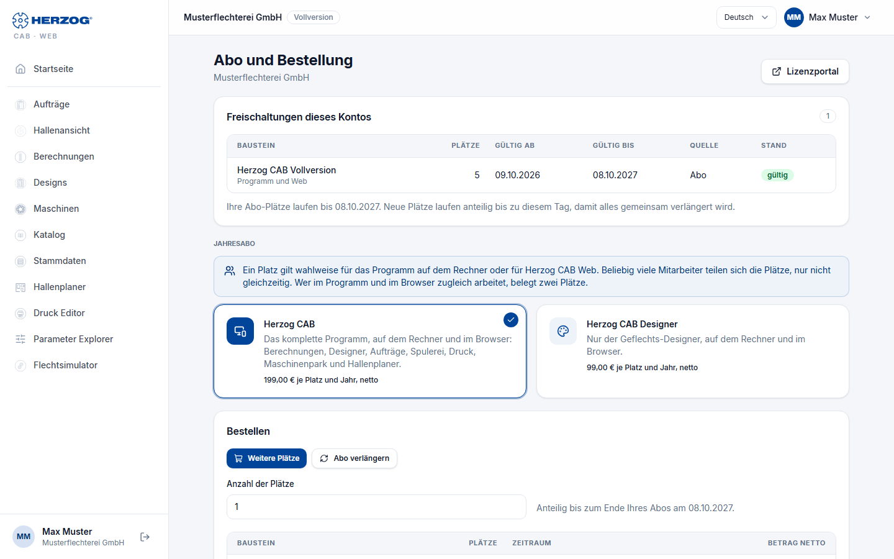

# Subscription and orders (web app)

!!! abstract "Reference — The "Subscription and orders" page in the user menu of the web app: activations of the account, trial, ordering or renewing an annual subscription, enquiry to sales"

## What you use this area for { #wofur-sie-diesen-bereich-nutzen }

Here you see what is enabled for your account and until when. You
order the annual subscription here, buy additional seats or renew the subscription.
During the [trial](trial.md) the page also shows the
remaining term. The page can still be reached when the trial has
expired and the rest of the web app is blocked.

You open the page via *User menu > Subscription and orders*, via the
chip *Trial: n days left* in the header or from the page *No
access to the web app*.

## The annual subscription in brief { #das-jahresabo-in-kurze }

* **Annual subscription only.** Herzog CAB is available as a subscription for one year, charged
  per seat. There is no monthly term.
* **Two subscriptions.** *Herzog CAB* comprises the complete program. *Herzog CAB
  Designer* comprises only the braid designer.
* **One quota for program and browser.** A seat applies either
  to the program on the computer or to the web app. Any number of
  employees share the seats, just not at the same time. Anyone working in the
  program and in the browser at the same time occupies two seats.
* **One common renewal date.** All subscription seats of an account end on
  the same day. Seats that you buy later run pro rata until
  this day. After that you renew everything together.
* **Order with invoice.** Herzog GmbH sends you the invoice.
  Activation takes place after receipt of payment.

## The screen at a glance { #der-bildschirm-im-uberblick }

From top to bottom: notices, the activations of the account, an open
order (if any), the two subscriptions, the **Order** area,
the **Enquiry to sales** and your previous orders. At the top
right, **Licence portal** opens the [licence portal](../portal/index.md).

## Controls in detail { #bedienelemente-im-detail }

### Notices at the top { #hinweise-oben }

| Notice | Meaning |
|---|---|
| *Trial: n days left (until &lt;date&gt;). A subscription removes the quantity limit.* | You are in the trial. |
| *The trial expired on &lt;date&gt;. With a subscription you can continue right away; all data is kept.* | The trial is over. The web app is blocked until you subscribe. The data is kept. |
| *The e-mail address has not been confirmed yet.* and **Send e-mail again** | After self-registration. Open the link from the welcome email. The button sends the email again. |
| *Thank you! As soon as Stripe confirms the payment …* / *The payment was cancelled …* | Feedback after a card payment. Only if card payment is offered. |

### Activations of this account { #freischaltungen-dieses-kontos }

The table shows everything that is enabled for the account.

| Column | Content |
|---|---|
| **Module** | Name, below it the scope: *Program and web* (subscription), *Program only* (perpetual licence) or *Web only* (earlier web module). |
| **Seats** | Number of people who may work at the same time. |
| **Valid from** / **Valid until** | Term. For perpetual licences it shows *Lifetime*. |
| **Source** | Where the activation comes from, for example *Order*, *Trial version*, *Purchase* or *Goodwill*. *Subscription (Stripe)* is shown for an earlier subscription that was concluded in the browser via Stripe. |
| **Status** | *valid*, *expired* or *ended*. |

If the account has a running subscription, the renewal date is shown below the table:
*Your subscription seats run until &lt;date&gt;.*

### Open order { #offene-bestellung }

At most one order per account can be open. As long as it is open,
it is shown here instead of the **Order** area. The card shows number,
type, status, the items and the amounts.

| Status | What happens next |
|---|---|
| *under review* | If your account is not yet registered as a Herzog customer, Herzog briefly reviews the first order. You will hear from us by email, usually on the same working day. |
| *awaiting payment* | By invoice: Herzog GmbH sends the invoice. We activate after receipt of payment. By card: you pay with **Pay now**. |

For a renewal by invoice, your seats remain active until
receipt of payment. The maximum period is shown on the card.

| Button | Effect |
|---|---|
| **Pay now** | Only for payment by card. Opens the card payment. The seats are then activated immediately. |
| **Cancel order** | Cancels the order after a confirmation prompt. Possible as long as no invoice is on its way: during the review or as long as the card payment is outstanding. Otherwise reply to the order email. |

### Annual subscription { #jahresabo }

A note explains the common quota (see
[above](#das-jahresabo-in-kurze)). Below it are two cards:

| Card | Scope |
|---|---|
| **Herzog CAB** | The complete program, on the computer and in the browser: calculations, Designer, orders, winding, printing, Machine Fleet and Factory Planner. |
| **Herzog CAB Designer** | Only the braid designer, on the computer and in the browser. |

Each card shows the price per seat and year (net) or *Price on
request*. A click selects the subscription for the order. You order a subscription with
*Price on request* via the enquiry to sales.

### Order { #bestellen }

Only the **administrators** of your account can place orders. Everyone else
sees a note here.

At the top you select what you are ordering:

| Selection | When visible | Effect |
|---|---|---|
| **Order a subscription** | No running subscription yet. | The subscription runs for one year from receipt of payment. |
| **Additional seats** | Subscription running. | The new seats run pro rata until the renewal date. This way everything is renewed together. |
| **Renew subscription** | Subscription running. | All subscription seats run for another year, counted from the renewal date. |

For **Order a subscription** and **Additional seats** you enter the **Number of
seats** (1 to 100). Below it is what the order costs: per
item module, seats, period and net amount, then net total,
VAT and total amount.

**Billing details**

| Field | Meaning |
|---|---|
| **Company** | Required field. Appears on the invoice. |
| **Your purchase order number (optional)** | Your own reference for the order. |
| **Billing address** | Required for the first order. If you are already a Herzog customer, leave the field empty if the address from our records applies. |
| **Country (code)** | Required field, for example *DE*. Determines the VAT. |
| **VAT ID (EU outside Germany)** | For companies in the EU outside Germany. |
| **Message to Herzog (optional)** | Free text about the order. |

VAT: 19 % in Germany. For companies in the EU with a VAT ID and
outside the EU, none is charged.

**Payment**

| Payment method | Effect |
|---|---|
| **Invoice** | Herzog GmbH sends the invoice. Activation takes place after receipt of payment. |
| **Card** | Only visible if card payment is set up. The seats are activated immediately after payment. Here too, the invoice comes from Herzog GmbH. |

Finally, you check the box *I place a binding order with obligation to pay on behalf of
this company.* and click **Order with obligation
to pay**. The order then appears as an open order at the top of
the page.

### Enquiry to sales { #anfrage-an-den-vertrieb }

For everything that cannot be ordered directly. Examples: a different
subscription instead of the current one, or renewing fewer seats.

| Element | Effect |
|---|---|
| **Enquiry to sales** | Opens the **Message** field. Administrators only. |
| **Message** | Your request, desired term, questions. |
| **Send enquiry** / **Cancel** | Sends the enquiry or closes the field. The answer comes by email. The enquiry also appears in the [licence portal](../portal/licenses.md#anfragen). |
| *Or by email* | Address of the sales department for a normal email. |

### Your orders { #ihre-bestellungen }

As soon as there are orders, a table lists them: **No.**,
**Date**, **Scope** (type and items), **Amount** (gross, below it
the payment method) and **Status**. If an invoice exists, the
invoice number is shown below the status.

!!! info "Program download, computers and users"
    The program download, the computers and the users are in the
    [licence portal](../portal/index.md). There you can also order the same subscription under *Order*.

## Related pages { #verwandte-seiten }

* [Trial and registration](trial.md)
* [Account and users](account.md)
* [Licence portal](../portal/index.md)
* [Customer account and invitation](../setup/account.md)
