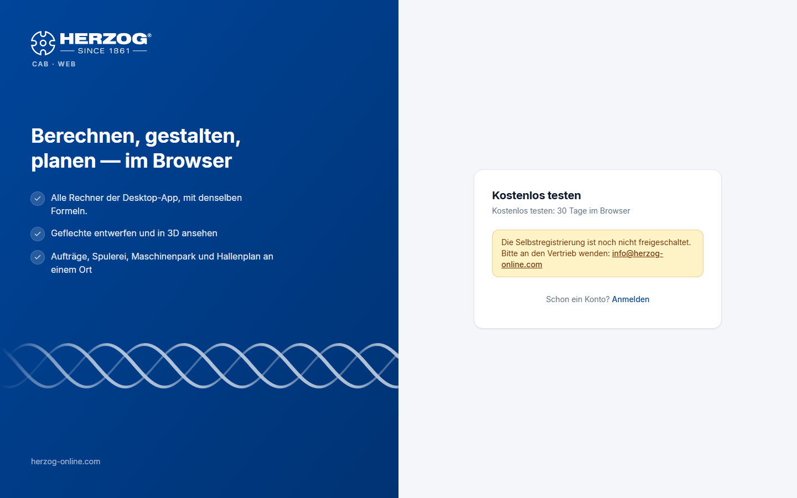

# Trial and registration (web app)

!!! info "Concept — Trying Herzog CAB free for 30 days: requesting a trial version, limits of the trial, the way to a subscription and self-registration"

## Two ways into the trial { #zwei-wege-in-die-testphase }

| Way | For whom |
|---|---|
| **Request a trial version from Herzog:** Herzog enables the module *Herzog CAB trial version* | The usual case, for prospective customers and for existing customers. Herzog creates a customer account or uses your existing one and invites you by email, see [Customer account and invitation](../setup/account.md#so-kommen-sie-ins-konto). The trial version applies for 30 days to the whole account, on the computer and in the browser. |
| **Self-registration** via **Try for free** on the [sign-in page](login.md) | Only if Herzog has enabled self-registration; otherwise the button is missing. Creates a new account with you as administrator. The account gets the module *Herzog CAB Web Trial* (30 days, browser only). |

!!! tip "Requesting a trial version"
    If there is no **Try for free** button on the sign-in page,
    request the trial version from Herzog: from your
    Herzog contact person or via the addresses under
    [Contacting support](../help/support.md).

## Self-registration { #selbstregistrierung }

!!! info "Only if enabled"
    This section only applies if Herzog has enabled
    self-registration. Otherwise, request the trial version from Herzog.

| Field | Meaning |
|---|---|
| **Company** | Name of your company — becomes the name of the account. |
| **Name** | Your name. |
| **Email address** | Your sign-in name; the confirmation email is sent to this address. |
| **Country** | Location of the company. |
| **Password** / **Repeat password** | At least 10 characters. |
| Terms of use and privacy policy | Consent via checkbox. |
| **Create account and start trial** | Creates the account and signs you in. |

After that:

1. You receive a **welcome email** with a confirmation link. Until you
   open it, the header shows *Confirm e-mail*; the web app can
   nevertheless be used immediately.
2. The link leads to the page **Confirm e-mail** (*The e-mail address has been
   confirmed.*) and from there to the application. If no email arrived, send
   it again under [Subscription and orders](subscription.md).
3. Your account has the module **Herzog CAB Web Trial** with **one
   seat** for **30 days**. During the trial only **one user** is
   possible. You invite further users after subscribing in the
   [licence portal](../portal/users.md).

!!! info "Limit on registrations"
    At most three registrations per day are possible from one internet address.

## What applies during the trial { #was-in-der-testphase-gilt }

* **Full range of functions** of the web app: all calculators, Designer with all
  braid types, orders, machines, Factory Planner, printing, import.
* **Quantity limit:** Some data types are limited, see the table
  below.
* **Remaining term:** The chip *Trial: n days left* in the header leads
  to [Subscription and orders](subscription.md).
* **After expiry**, the web app blocks access (*No access to the web app*).
  Your data is kept and is available again immediately after you subscribe.

### Quantity limit { #mengenbegrenzung }

| Area | At most |
|---|---|
| Designs | 2 |
| Machines (braiding, bobbin winding and take-up machines together) | 2 |
| Orders (including winding orders) | 4 |
| Customers | 3 |
| Users | as many as the trial version has seats; after self-registration, one |
| Calculations | 100 per calculation type |

Materials, bobbins, drums, colors, hall plans and print templates are
not limited. The home page shows the status, for example *1 / 2*. When
a limit is reached, the web app reports it. The ZIP import and the
sync from the desktop app also observe the limits.

## The way to a subscription { #der-weg-zum-abo }

Under [Subscription and orders](subscription.md) you order the annual subscription.
A seat then applies either to the web app or to the program on the
computer. Activation takes place after receipt of payment. With
activation the quantity limit no longer applies. All data created during the trial
is kept.

!!! info "Trial version of the desktop app"
    The trial version of the desktop app has the same limits. See
    [Trial version and quotas](../basics/trial-quotas.md).

## Related pages { #verwandte-seiten }

* [Sign in and select account](login.md)
* [Subscription and orders](subscription.md)
* [Customer account and invitation](../setup/account.md)
