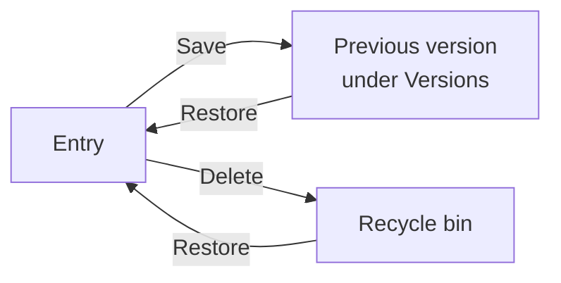

# Versions and recycle bin

!!! abstract "Reference — Viewing and restoring earlier versions of an entry, bringing back deleted entries from the recycle bin"

## What you use this area for { #wofur-sie-diesen-bereich-nutzen }

Every time an entry in your account's workspace is saved or
deleted, Herzog CAB keeps the previous version. This lets you see who
changed what and when, and bring back a version that was changed or
deleted by mistake. This applies to all ways in which data reaches the
workspace:

* saving and deleting in the web app,
* the [cloud sync](../admin/settings/license.md) of the desktop app,
* the [import from the desktop app](import.md).

If the cloud sync has overwritten a change from the web app with the desktop's
version, you will therefore find the web app's version again
under **Versions**.

Versions exist for **Designs**, **Braiding and winding orders**,
**Machines**, the master data **Materials**, **Bobbins**, **Drums**,
**Colors** and **Customers**, **Hall plans** (floor plans and assignments) and
**Print templates**. Files in the [media library](media.md) (images,
documents, 3D models), settings, users and roles have no
versions.

Where a version goes when you save or delete, and how you get it back:

## Where the "Versions" button is located { #wo-der-knopf-versionen-steht }

The button appears as soon as an entry has been saved once. In
toolbars only the icon is shown (a clock with an arrow); the name
appears when you point at it.

| Area | Location |
|---|---|
| [Designer](designer.md) | Icon in the toolbar, next to **Print**. |
| [Braiding order and winding order](orders.md) | Button in the header, next to **Print**. |
| [Machine](machines.md) | Button at the top right, next to **Delete** and **Save**. |
| [Master data](master-data.md) (materials, bobbins, drums, colors, customers) | Button at the bottom left of the *Edit …* dialog. |
| [Factory Planner](hall-planner.md) | Icon in the header of the editor, next to **Save**: in *Floor plan* mode for the floor plan, in *Assignment* mode for the selected assignment. |
| [Print editor](print-editor.md) | Button in the header, only for templates of your account and with the permission *Edit print templates*. Supplied default templates only have versions once your account has saved its own version. |

Anyone who is allowed to see the entry may view its versions.

## The "Versions" dialog { #der-dialog-versionen }

!!! warning "📷 Screenshot fehlt"
    **Motiv:** Dialog „Versionen" eines Designs: oben der Kasten „Aktuell: Version n" mit Datum, Person und Quelle, darunter die Liste der früheren Fassungen mit „Unterschiede" und „Wiederherstellen", bei einer Fassung die aufgeklappte Tabelle der Unterschiede.
    **So erzeugen:** Web-App lokal (127.0.0.1:5173), Seite `/designs/<id>`, Symbol „Versionen"; automatisch per `python _tools/web_screenshots.py shots nur:versionen`
    **Ziel-Datei:** `assets/screenshots/web/versionen.png`
    <!-- web-bild ../assets/screenshots/web/versionen.png -->

The dialog is called *Versions: &lt;name of the entry&gt;*.

| Element | Meaning |
|---|---|
| Box at the top | The current version: *Current: version n*, when and by whom it was saved and where it came from (*Web app* or *Program*). For a deleted entry it shows *Deleted on &lt;date&gt;* with the person and the button **Restore entry**. |
| List of versions | All stored versions, the newest at the top. For each version: *Version n*, when and by whom it was saved, the source as a chip (*Web app* or *Program*) and below it, when and by whom it was replaced: *changed*, *deleted* or *replaced by a restore*. |
| **Differences** / **Hide** | Expands a table below the version: **Field**, **This version**, **Current**. It only lists the fields that differ from the current version, with their internal name. Simple values are shown in plain text; for lists and nested data it shows *changed*, for missing fields *missing*. If both are the same, it shows *Same content as the current version.* |
| **Restore** | Makes this version the current one again (see below). Only with the permission to edit. |

If there are no earlier versions yet, it shows *No earlier versions yet.
From now on, every save keeps the previous version here.* This
is the case for entries that have not been saved since versions were introduced
on 05.10.2026. If someone saves an entry without changing anything,
no new version is created.

## Restoring a version { #eine-version-wiederherstellen }

1. Open the entry and click **Versions**.
2. If necessary, use **Differences** to check what is different in the version.
3. For the desired version, click **Restore**.
4. Confirm the prompt *Version n from &lt;date&gt; becomes the current
   version. The present version stays in the history.* with
   **Restore**.

The web app reports *Restored.*, reloads the page and shows the
entry in the old version. In the master data dialog, the dialog closes
instead. The version is saved as a new version with the source
*Web app*. The version it replaces then appears in the list itself.
A restore can therefore also be undone.

On the machine page, the web app does not keep unsaved inputs.
There, the prompt points out that anything not saved is lost when the page is
reloaded.

If the desktop app works with the cloud sync and the return path is
switched on, the restored version reaches the workspace folder like any other
change from the web app.

### Who may restore { #wer-wiederherstellen-darf }

Anyone who may also edit the entry may restore it
([Roles](roles.md)):

| Entries | Permission |
|---|---|
| Designs | *Edit designer* |
| Orders and customers | *Edit orders* |
| Materials, bobbins, drums, colors, machines | *Edit master data* |
| Floor plans and assignments | *Edit factory planner* |
| Print templates | *Edit print templates* |

Without this permission you can only view the versions.

### Messages { #meldungen }

| Message | Meaning |
|---|---|
| *This editor has unsaved changes. Please save or discard them before you restore a version.* | The editor has open changes. As long as they exist, the **Restore** button is missing. |
| *Someone else has saved in the meantime. The history is being reloaded.* | A colleague or the cloud sync has just saved the entry. Check the reloaded list and then restore again. |

## Recycle bin { #papierkorb }

!!! warning "📷 Screenshot fehlt"
    **Motiv:** Papierkorb der Web-App mit Bereichsfilter (Alle, Design, Auftrag, Material …) und der Tabelle Name, Bereich, Gelöscht am, Von, Quelle mit den Knöpfen „Versionen" und „Wiederherstellen".
    **So erzeugen:** Web-App lokal (127.0.0.1:5173), Seite `/papierkorb`; automatisch per `python _tools/web_screenshots.py shots nur:papierkorb`
    **Ziel-Datei:** `assets/screenshots/web/papierkorb.png`
    <!-- web-bild ../assets/screenshots/web/papierkorb.png -->

Deleted entries do not disappear immediately but go to the
**Recycle bin**. You open it via *User menu > Recycle bin*. It shows
the deleted entries of all areas that you are allowed to see, with the most recent
deletion at the top. Whatever the desktop app deletes via the cloud sync
also ends up here.

| Element | Meaning |
|---|---|
| **All** / areas | Filter by area, for example *Design*, *Order*, *Material*, *Machine*, *Hall plan*, *Assignment* or *Print template*. Appears as soon as there are entries from more than one area in the recycle bin. |
| **Name** | Name of the deleted entry. |
| **Area** | Where the entry comes from. |
| **Deleted on** / **By** | Time of deletion and who deleted it. |
| **Source** | *Web app* or *Program* (via the cloud sync). |
| **Versions** | Opens the ["Versions" dialog](#der-dialog-versionen) of the deleted entry. There you can also bring back an older version. |
| **Restore** | Brings the entry back in its last version, after the prompt *The entry comes back in its last version.* It is then listed again in its list, and the web app reports *&lt;name&gt; has been restored.* Only with the permission to edit (see [above](#wer-wiederherstellen-darf)). |

On a smartphone the entries appear as cards with the same buttons. If
nothing has been deleted, it shows *The recycle bin is empty.* For each area the
recycle bin shows the 200 most recently deleted entries.

!!! warning "What does not end up in the recycle bin"
    The web app deletes files in the [media library](media.md) permanently.
    This also applies to the image, documents and 3D model of a machine: they
    are removed together with the machine when it is deleted. If you bring the machine
    back from the recycle bin, only its data returns.

!!! info "Trial"
    A restored entry counts like a newly created one. If the
    [trial limit](trial.md) for this area has been reached, it can
    only be brought back after deleting another entry or with a subscription.

## How long versions are kept { #wie-lange-versionen-aufbewahrt-werden }

* **Versions:** 90 days. For each entry the **last 20 versions**
  are kept longer as well. The server removes older versions once a day.
* **Recycle bin:** Deleted entries remain in the recycle bin until someone
  restores them. Nothing can be permanently deleted there.

!!! info "Difference from the desktop app"
    The desktop app has no *Versions* dialog and no recycle bin.
    If it works with the cloud sync, its saves and
    deletions still end up here, with the source *Program*. Without cloud sync,
    no versions are created for the data in the workspace folder.

## Related pages { #verwandte-seiten }

* [Web app interface](interface.md) — user menu and version conflicts
* [Roles](roles.md) — permissions for editing
* [Licence and cloud](../admin/settings/license.md) — cloud sync of the desktop app
* [Known limitations](../help/limitations.md#cloud-abgleich-der-desktop-hat-vorrang)
